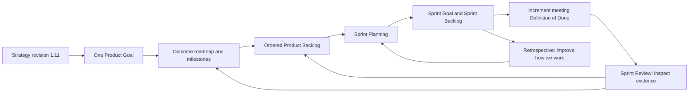

<!-- SPDX-License-Identifier: MIT -->
<!-- Part of PyBLE (https://pyble.dev) — see /LICENSE. -->

# Cycle 1 — delivery guide and Scrum working agreement

## Document control

| Field | Value |
|---|---|
| Package | PyBLE 2026 Q4 reliable workflow, Cycle 1 (`C1`) |
| Prepared | 25 September 2026; Asia/Bangkok |
| Strategy | [Implementation Plan, revision 1.11](../../planning/PyBLE_Implementation_Plan_and_Strategy_v1.0.md) |
| Repository baseline | `23ed764b0ef88dce9720c66fbd1c0655268860cf` |
| Proposed cycle | 28 September–20 December 2026; six two-week Sprints |
| Status | C1-S1: six Done, two Prepared and four Awaiting evidence. The 31 October continuation accepts M-02 and app-only M-04; S2 has ten Done tasks and T11 awaiting participants. External TestFlight/Google Play delivery and human capacity remain unresolved; no staffed-team ceremony is inferred |
| Primary audience | Tablet-owning makers, provisionally; confirm one reachable cohort before observation |
| Authoritative contracts | [Contributor rules](../../../AGENTS.md), [App specification](../../specifications/App/specs.md), [App TDD](../../specifications/App/TDD.md), [PBLE/1](../../specifications/protocol.md), and applicable firmware/release specifications |

This package derives execution views from the strategy. It does not replace normative specifications, expand hardware claims, create GitHub issues, or authorize store/website publication. The strategy and original package were recorded together in planning baseline `d039db0`. The [C1-S1 execution record](c1-s1/00_Execution_Record.md) owns actual results and blockers.

**31 October acceptance update:** scoped current-text recovery (PYB-006.2 / M-02) and the app-only M-04 candidate pass engineering review at `bef67bd`: 984 ordinary tests, 36 frozen-runtime CI checks, both-platform recovery/keyboard evidence and all ten declared app/profile rows. The [C1-S2 record](c1-s2/00_Execution_Record.md) preserves exact artifacts, firmware baselines, earlier-row impact assessments and the temporary Android qualifier battery-policy condition. Signed packages and the release packet are prepared; original device policy and normal board advertising are restored, and owned fixtures are cleaned. [PR #41](https://github.com/PyBLE-dev/PyBLE/pull/41) merged after all 36 checks on its final head passed. Internal-account TestFlight `0.3.0 (9)` offer/Open, production About and bounded device smoke are verified ([delivery record](c1-s2/06_Release_Readiness.md#31-october-testflight-delivery-and-published-metadata)); the update transaction was not observed. PYB-002.1 public-description correction is complete. M-05 remains partial: external build 9 is submitted and Waiting for Review; Google Play open-testing build 9 is submitted with Changes in review; approval and delivery remain pending. S1 remains six Done / two Prepared / four Awaiting evidence; S2 has ten engineering tasks Done and participant follow-up unfinished. Original dates/hours remain the baseline; the [continuation plan](04_Sprint_Plan.md#31-october-continuation-order-and-reforecast) records the next work and unresolved human capacity.

## 1 November selected continuation

Under the user's firmware-roadmap implementation request, work follows the
preceding recommendation to implement PYB-017.1 → PYB-018 run/session status
first. This records an implementation scope assumption, not a separate
explicit first-increment-versus-full-roadmap choice or completion of the full
roadmap. The [selected backlog leaves](05_Product_Backlog_and_Stories.md#4-conditional-expansion-backlog-and-complete-parent-traceability)
own the breakdown; the [firmware execution record](firmware-v070/00_Execution_Record.md)
owns source and physical evidence. Remaining Reliable Projects features stay
proposed, and October's app-only acceptance does not qualify new firmware.
The selected implementation is ready for review in [PR #47](https://github.com/PyBLE-dev/PyBLE/pull/47):
R5 normal UI passes on both tablets across all five profiles, and Android actual
ATT23/247 passes for each. Historical iPad 0.3/Waveshare remains Partial after an
initial empty-GET stall and successful normal retry. Final review also corrected
Pico autorun admission; its new exact image and six affected tablet cases pass.
Four ESP images retain their unchanged source/artifact evidence. Full resource
and release admission remain pending, including [#48](https://github.com/PyBLE-dev/PyBLE/issues/48).

The original calendar and hour allowances remain the planning baseline.
This continuation adds no claimed staffed Sprint, measured human effort or
available capacity; subsequent planning must reconcile actual capacity and
any displaced work without reducing required qualification.

## Navigation and ownership of information

| File | Canonical responsibility in this package | Update trigger |
|---|---|---|
| [01 — Overview and Scrum framework](01_Overview_and_Scrum_Framework.md) | Product Goal, working agreement, quality and evidence rules | Agreement or governing contract changes |
| [02 — Product roadmap](02_Product_Roadmap.md) | Outcomes, horizons, and conditional investments | Product Goal or strategic priority changes |
| [03 — Milestones](03_Milestones.md) | Evidence-based decisions and admission criteria | New evidence or a milestone decision |
| [04 — Sprint plan](04_Sprint_Plan.md) | Sprint Goal forecasts, calendar, and capacity | Sprint Planning or Sprint Review |
| [05 — Product backlog and stories](05_Product_Backlog_and_Stories.md) | Ordered work, parent/child identities, acceptance criteria, and source traceability | Refinement or changed user evidence |
| [06 — Sprint backlogs](06_Sprint_Backlogs.md) | Task allowances, dependencies, C1-S1 execution status and later forecasts requiring replanning | Developers select/adapt work during a Sprint |
| [C1-S1 — Execution and evidence](c1-s1/00_Execution_Record.md) | Actual channel checks, pilot kit, recovery design/sizing and validation inventory | New evidence, source review or a resolved blocker |
| [C1-S2 — Implementation and evidence](c1-s2/00_Execution_Record.md) | Accepted bounded recovery and app-only qualification, retained evidence/limits, release continuation and scoped operator recipe | Source integration, actual platform runs or admission decision |

## Product Goal and current baseline

**Proposed Product Goal:** tablet-owning makers can complete useful BLE board work, recover their local work after interruption, and choose PyBLE again for a relevant task using accurately identified app and firmware builds.

| Active outcome | Main planning parents | Evidence of value |
|---|---|---|
| Know what users install | PYB-001; residual PYB-002 only | Reproducible installation guidance and dated channel/build evidence |
| Preserve users' work | PYB-006, supported by PYB-008/009 | Accepted draft survives the specified restart/failure cases without implicit board writes |
| Complete useful repeat tasks | PYB-003/004/011/012; PYB-005 if observed | Task C attempts, later-day useful work, reasons to choose PyBLE, and support effort |

| Baseline fact | Consequence |
|---|---|
| Android open-testing copy correction is complete in PR #33 | Do not replan that correction; identify any new discrepancy separately |
| App source is `0.2.0+8`; physical retry verifies Play `0.2.0 (8)` and TestFlight `0.2.0 (6)` | Android payloads map to the historical build-8 bundle; iPad source mapping remains unknown. Neither channel check proves BLE or older-OS compatibility |
| Firmware v0.6.1 is published on owner confirmation across five exact profiles | Pending automated results stay pending; no automatic PyBLE Ready badge |
| Issue #24 is closed/superseded | Do not resurrect its old release umbrella as a dependency |
| S1 baseline draft was volatile; [ADR-0048](../../decisions/0048-bounded-current-text-draft-recovery.md) now has an accepted bounded recovery increment | M-02 acceptance is recorded on 31 October; full project persistence and Blocks graph recovery remain carried |
| Lifecycle protections, tutorials, imports, and test tools already exist | Reuse them; refine only observed gaps and the documented persistence gap |

## Applying Scrum to PyBLE

The [2020 Scrum Guide](https://scrumguides.org/scrum-guide.html) is the framework reference. The Product Backlog is ordered by the Product Owner; Developers select and adapt Sprint work. Product Goal, Sprint Goal, and Definition of Done guide the respective artifacts. A Sprint Review inspects progress and informs adaptation; it is not a mandatory release approval meeting. Roadmaps, milestones, user-story notation, and hour allowances below are PyBLE planning practices, not additional Scrum requirements.

| Accountability | Proposed PyBLE arrangement | Assignment state |
|---|---|---|
| Product Owner | One maintainer accountable for the Product Goal, backlog order, and stakeholder tradeoffs | Named person TBD |
| Scrum Master | Facilitates effective Scrum, impediment removal, and sustainable delivery | Named person TBD; any combined responsibility must be explicit |
| Developers | Contributors collectively plan and deliver work, including applicable tests and evidence | Actual availability and skills TBD |
| Stakeholders/contributors | Release owner, board operator, pilot coordinator, instructor, and language reviewer supply expertise/access | These contribution responsibilities do not create extra Scrum accountabilities |

Do not represent a solo-maintainer workflow with missing accountabilities as a fully staffed Scrum Team. Record the practical arrangement and its limits. Role labels in tables are suggestions, not assignments to absent people. A coding agent does not supply independent physical evidence or become the accountable Product Owner.

| Event/practice | Proposed local cadence | Concrete output | Capacity treatment |
|---|---|---|---|
| Sprint Planning | First working day; initially allow 60 minutes | One Sprint Goal, selected items, task plan, named capacity and dependencies | Inside the Sprint's gross hours |
| Daily Scrum | 15 minutes each working day | Developers inspect the Goal and adapt the immediate plan | Inside the Sprint's gross hours |
| Sprint Review | Last working day; initially allow 60 minutes | Inspect usable Increment and evidence with stakeholders; adapt backlog | Inside the Sprint's gross hours |
| Sprint Retrospective | After Review; initially allow 45 minutes | One improvement to apply in the next Sprint | Inside the Sprint's gross hours |
| Refinement | Up to one hour weekly initially, adjusted to need | Split/clarify upcoming items; Developers size their work | Included within available capacity; no separate approval ceremony |

These local durations can change with the team; the Daily Scrum remains 15 minutes. The 14-hour reserve per Sprint includes events, refinement, support, additional qualification, and uncertainty. Do not count those hours again as extra delivery capacity.

## Local readiness and Definition of Done

| Before selection: local readiness aid | Required clarification |
|---|---|
| User outcome or learning question | Named beneficiary, observed problem, bounded in/out scope |
| Governing contract | Specification/ADR and prior approval required for behavior changes; any carried exception visible |
| Acceptance and evidence | Observable scenarios, relevant tests, physical devices when required, evidence location |
| Feasibility | Developers' estimate, actual owner/access, dependencies, safe rollback/recovery |

Readiness is a local refinement aid. It does not replace Sprint Planning or add a formal Scrum commitment. Unknowns can be selected as time-boxed discovery items with their own explicit output.

| Definition of Done: applicable requirement | Evidence required |
|---|---|
| Behavioral scope agrees with the accepted contract | Specification/ADR changed before implementation where required; all selected acceptance scenarios satisfied |
| Behavior is verified | Required `[red]` then `[green]` work, relevant regression checks, and mandatory physical evidence for the selected scope; refactor only while green |
| Repository boundaries hold | DCO-signed commits when committing; no-leak, license, dependency, localization/import, and actual required CI checks as applicable |
| Increment is coherent and usable | Review completed; integration and relevant documentation agree; no unresolved blocking data-loss or unintended-write defect |
| Claims have evidence | Exact artifacts, pass/fail/not-run states, limitations and pending release work recorded truthfully |
| Documentation/discovery scope is complete | Usable reviewed record/guide or agreed findings, source/link checks, and explicit unmet targets; no invented physical results |

This is the proposed package-wide minimum; accepted normative requirements remain binding. Apply it to the selected item rather than treating a source merge as a finished feature. A documentation or discovery item can be Done with a negative finding, while a required channel-installation verification task needs observed installation identity, origin and launch; verifying an existing installation does not imply a fresh install. A usable Sprint 1 documentation increment should help an operator or user perform the current workflow; an internal plan alone is not evidence of improved app behavior.

| State distinction | Meaning |
|---|---|
| Source complete | Implementation/review work reached its source milestone; required physical or integration work may still prevent Done |
| Done Increment | Selected acceptance and applicable Definition of Done are met; it can be inspected and used in its declared scope |
| Release admitted | All applicable release-level gates, support matrix, provenance and distribution prerequisites pass |
| Submitted / available / installed | Three different distribution observations, each requiring its own evidence |

Unfinished items return to the Product Backlog for reordering and replanning. Do not count them as Done or convert a blocked result into a pass. A release can happen during any Sprint when its applicable gates pass; recruitment and retention do not block an otherwise qualified maintenance release.

## IDs, evidence, and change control

| Convention | Rule |
|---|---|
| `PYB-001` … `PYB-032` | Existing strategy planning parents; not GitHub issue numbers |
| `PYB-006.1`, `PYB-006.2`, etc. | Derived child items in this package; acceptance is maintained in file 05; new residual `PYB-002.1` records the TestFlight metadata discrepancy |
| `A-24` | Existing broader persistence story; a bounded child does not complete all of it |
| `C1-S1` … `C1-S6` | This cycle's Sprints; distinct from historical App TDD Sprint labels |
| `C1-S1-T01`, etc. | Task identities with recorded early C1-S1 outcomes; later task rows remain forecasts, not new public contracts |
| `M-01`, etc.; `SG0` … `SG6` | Delivery milestones versus strategy gates; neither replaces CI G0/G1 or C3 firmware gates |
| Item/task status | Proposed → Selected at Planning → In progress → Review → Done. Prepared means a reviewed partial deliverable; Awaiting evidence identifies an unperformed observation/session. Both remain unfinished. Blocked names a concrete impediment/owner; later forecasts remain Proposed |
| Private versus public records | Contact/consent, device identifiers and raw logs remain private/ignored; publish only reviewed aggregate findings and redacted evidence |

When facts or priority change, update the canonical file above and its dependent tables together. Preserve old evidence and dated decisions. New opcode/capability values, hardware support, Ready awards, and publication need their normal specification and authorization paths; none is inferred from this package.

## Source map

| Source | Use and precedence |
|---|---|
| [Strategy revision 1.11](../../planning/PyBLE_Implementation_Plan_and_Strategy_v1.0.md) | Scope, targets, six-Sprint capacity, three outcomes, Ready program and conditional horizons |
| [Public roadmap](../../ROADMAP.md), [README](../../../README.md) | Current capability and distribution baseline |
| [App specification](../../specifications/App/specs.md), [App TDD](../../specifications/App/TDD.md), [ADR-0010](../../decisions/0010-working-loop-in-memory-document.md) | Persistence contract and recorded implementation deviation; consult frozen working-loop scope |
| [Firmware roadmap](../../planning/firmware-v0.6.1-v0.7.0-roadmap.md), [PBLE/1](../../specifications/protocol.md) | v0.7 proposals versus frozen wire behavior; old v0.6.1 publication/#24 wording is historical |
| [Android publication review](../../testing/website/android-open-testing-2026-09-25.md), [v0.6.1 publication record](../../testing/firmware-v0.6.1-publication-2026-09-11.md) | Dated publication evidence, separate from the new [Android](c1-s1/06_Android_Channel_Verification.md) and [iPad](c1-s1/07_iPad_Channel_Verification.md) existing-installation checks; missing automated qualification remains unfinished |
| [HIL guide](../../../tests/firmware_tests/hil/README.md), [CI workflow](../../../.github/workflows/ci.yml), [CONTRIBUTING](../../../CONTRIBUTING.md) | Reuse existing tools and gates; actual CI requirements govern merges |
