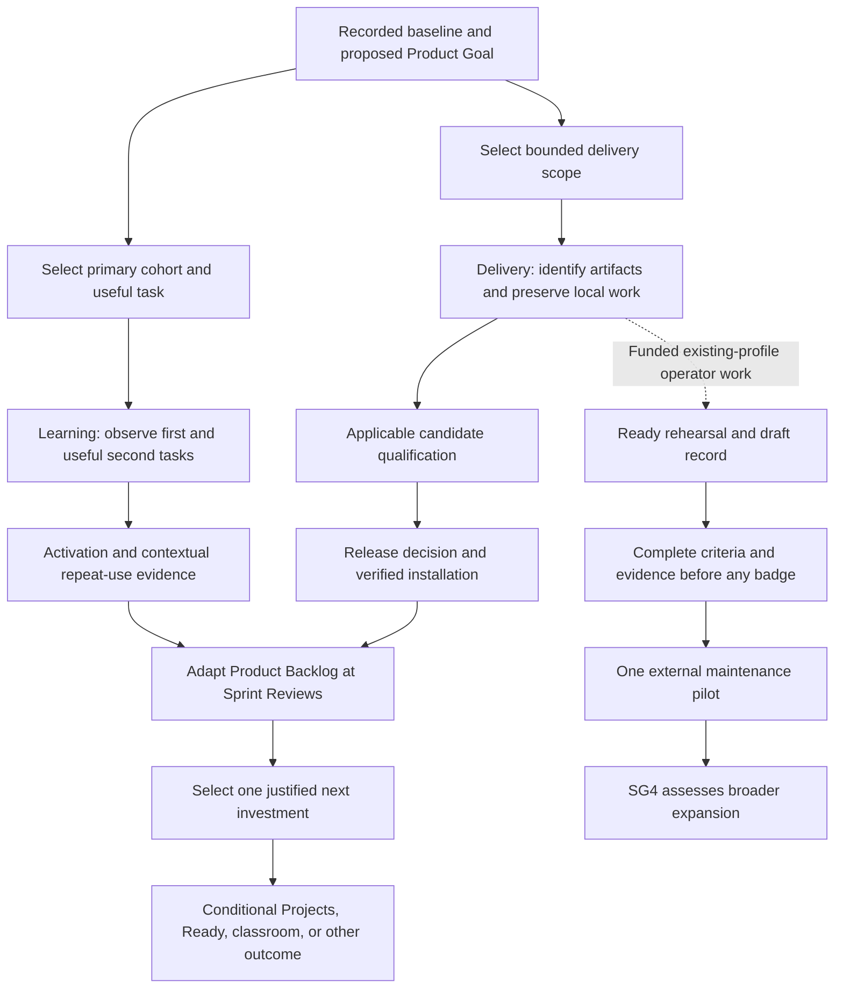

<!-- SPDX-License-Identifier: MIT -->
<!-- Part of PyBLE (https://pyble.dev) — see /LICENSE. -->

# 02 — Product roadmap

| Control | Value |
|---|---|
| Status | C1-S1 remains partial; bounded recovery and app-only qualification pass 31 October engineering review. [PR #41](https://github.com/PyBLE-dev/PyBLE/pull/41) merged after all 36 checks on its final head passed. M-05 delivery and pilot/capacity inputs remain outstanding |
| Planning date | 25 September 2026; dates use Asia/Bangkok |
| Source | [Implementation strategy revision 1.8](../../planning/PyBLE_Implementation_Plan_and_Strategy_v1.0.md), particularly §§1, 6–9, 12, 14, and 19 |
| Inspected baseline | `main` at `23ed764b0ef88dce9720c66fbd1c0655268860cf` |
| First cycle | C1: 28 September–20 December 2026; later horizons conditional through September 2028 |
| Planning authority | Product Owner orders the Product Backlog; Developers forecast feasible work during Sprint Planning; names and capacity remain unassigned |
| Related documents | [Framework](01_Overview_and_Scrum_Framework.md), [milestones](03_Milestones.md), [Sprint Plan](04_Sprint_Plan.md), [stories](05_Product_Backlog_and_Stories.md), [Sprint Backlogs](06_Sprint_Backlogs.md) |

**31 October acceptance update:** scoped current-text recovery (PYB-006.2 / M-02) and the app-only M-04 candidate pass engineering review at `bef67bd`: 984 ordinary tests, 36 frozen-runtime CI checks, both-platform recovery/keyboard evidence and all ten declared app/profile rows. The [C1-S2 record](c1-s2/00_Execution_Record.md) preserves exact artifacts, firmware baselines, earlier-row impact assessments and the temporary Android qualifier battery-policy condition. Signed packages and the release packet are prepared; original device policy and normal board advertising are restored, and owned fixtures are cleaned. [PR #41](https://github.com/PyBLE-dev/PyBLE/pull/41) merged after all 36 checks on its final head passed. Apple accepted the upload and started processing ([receipt](c1-s2/06_Release_Readiness.md#31-october-app-store-connect-upload-receipt)); actual M-05 store delivery remains pending. S1 remains six Done / two Prepared / four Awaiting evidence; S2 has ten engineering tasks Done and participant follow-up unfinished. Original dates/hours remain the baseline; the [continuation plan](04_Sprint_Plan.md#31-october-continuation-order-and-reforecast) records the next work and unresolved human capacity.

## Product Goal and decision principle

**Proposed Product Goal:** tablet-owning makers can complete useful BLE board work,
recover local work after interruption, and choose PyBLE again for another relevant
task using accurately identified app and firmware.

The first cohort remains provisional until recruitment and task selection are
confirmed. The Product Goal guides Product Backlog ordering; individual stories
and forecast dates can change as evidence improves. The [public roadmap](../../ROADMAP.md)
continues to communicate direction without promising release dates.

| Decision | Product value | Evidence that informs the next choice |
|---|---|---|
| Verify what users install | Users find an accurate installation path and support can identify their environment | Dated channel, installed version/build, provenance limits, and unresolved fields with owners |
| Preserve users' work | An interrupted tablet session does not silently discard the accepted local draft scope | Approved A-24/ADR-0010 persistence boundary, recovery scenarios, and applicable physical evidence |
| Demonstrate useful repeat use | Users accomplish work beyond a demonstration and have a reason to return | First-task and Task C outcomes, previous workflow, opportunity to use, assistance, prompting, and follow-up accounting |

## Completed baseline and remaining uncertainty

These records distinguish the historical baseline from the dated device retry.
The [C1-S1 record](c1-s1/00_Execution_Record.md) records completed design/evidence
preparation and existing channel installations separately from prepared pilot
work and missing observations. The user selected bounded recovery implementation on 31 October. Later work
remains **Proposed** until selected; that instruction does not establish actual
team capacity or a completed formal Sprint.

| Baseline item | Recorded state at the planning date | Consequence for this roadmap |
|---|---|---|
| Android distribution and public copy | Google Play 0.2.0 open testing; direct live-site checks on 25 September confirm the PR #33 correction | Preserve accurate copy; newly found TestFlight description discrepancy is PYB-002.1 |
| App source and installed identity | [Lenovo Android](c1-s1/06_Android_Channel_Verification.md): Play `0.2.0 (8)` with beta enrollment, Open and launch verified; 38/38 code/asset entries match the retained AAB | Evidence supports historical source `768fafe`; it is not complete binary equivalence, a Play Console record or validation of later source changes |
| iPad distribution | [iPad](c1-s1/07_iPad_Channel_Verification.md): existing TestFlight `0.2.0 (6)` with offered build, Open, launch and beta signing verified | Source mapping remains unknown; minimum-OS metadata conflict needs owner review. Fresh enrollment/reinstallation and production App Store availability are not claimed |
| Existing workflow | PBLE/1 editing, files, run/stop, console, Blocks, tutorials, and reviewed import already exist | Reuse implementation and tests; improve measured failures rather than rebuild the workflow |
| Firmware v0.6.1 | Owner-confirmed publication for five exact profiles; incomplete automated evidence remains visible | New qualification and compatibility claims require their own applicable evidence |
| Historical issue #24 | Closed as superseded; incomplete checklist was not declared passed | Do not recreate closure as a new dependency or treat historical closure as qualification |
| Durable drafts | Bounded current-text recovery under ADR-0048 passes scoped engineering acceptance on 31 October | Deliver the qualified candidate through the selected channels; retain broader A-24/Blocks scope |
| Adoption and Ready | No measured cohort results or awarded PyBLE Ready badge established by the strategy | Treat outcome targets and badge eligibility as proposals requiring evidence |

The [Android publication review](../../testing/website/android-open-testing-2026-09-25.md)
and current public roadmap supersede stale publication-status wording in the
older [firmware proposal](../../planning/firmware-v0.6.1-v0.7.0-roadmap.md).
That proposal still informs conditional Reliable Projects scope and compatibility.

## Roadmap horizons

The windows are sequencing forecasts measured from the proposed cycle start.
Overlapping windows permit options; they do not create simultaneous commitments
for one maintainer. The horizons remain proposals; the dated acceptance above records completed
bounded work inside H1 without declaring that whole horizon complete.

| Horizon / indicative window | Outcome and user value | Planning items / milestone | Admission and dependency | Evidence for continuation |
|---|---|---|---|---|
| H1 — Months 0–3; 28 Sep–20 Dec 2026 | Reliable mobile workflow: identify installations, protect work, and learn from useful tasks | PYB-001/003/004/006/008/009/011/013/014; conditional 005/012 and residual 002; M-01…M-06 | Named capacity and cohort; sized persistence scope and mandatory matrix; use existing release tooling | Qualified bounded maintenance increment, verified channel state, and honest activation/repeat-use assessment |
| H1 supporting rehearsal — Within C1 only if funded | Make an existing profile's setup and recovery reproducible by a second operator | Bounded PYB-009 work; input to M-07 | One existing exact profile, operator availability, and an explicit allocation within PYB-009 or spare planned capacity | Procedure, assistance log, draft Ready record, and visible gaps; no badge or new-port promise |
| H2 — Months 3–6; approximately Dec 2026–Mar 2027 | Reliable Projects addresses a demonstrated multi-file or recovery obstacle | PYB-017 then selected PYB-018…022; M-08 | Relevant pilot evidence; accepted scope, protocol/ADR changes, capability registry, and cross-version plan | One coherent selected capability, legacy fallback, and applicable exact-artifact qualification; complete v0.7.0 is not promised |
| H3 — Months 3–9; approximately Dec 2026–Jun 2027 | PyBLE Ready makes correct selection/setup easier and establishes maintainable outside ownership | PYB-024/025; M-07 | Existing-profile reproduction, reviewed criteria, complete public record, owner/reviewer, then one external maintainer | First eligible exact-configuration record; measured setup/support effort; SG4 before broader expansion |
| H4 — Months 6–12; approximately Mar–Sep 2027 | A reusable supervised lesson helps learners complete safe board work | PYB-026/028; optional 027 only after bundle-contract approval; M-09 | Reliable core, classroom-specific safety/security review, consent arrangements, and multi-board selection evidence | Reviewed lesson and at least two measured sessions; sustainable instructor support and SG5 assessment |
| H5 — Months 6–12; approximately Mar–Sep 2027 | Reproducible research explains measured technical or educational results | PYB-016/030; conditional research stream | Named investigator, suitable contribution, approved study/ethics decision where applicable, and qualified artifacts | Reproducible benchmark or submission-ready package if results justify it; no acceptance/publication promise |
| H6 — Months 12–24; approximately Sep 2027–Sep 2028 | Sustainable compatibility growth and justified richer or secure workflows | Selected PYB-023/029/031/032; M-10 for untrusted/field deployment | Demonstrated demand, external ownership, support capacity, and explicit scope decisions | Reviewed compatibility maintenance; security evidence for untrusted use; bounded data/service experiments only when justified |

## First-cycle sequencing

| Sprint | Forecast focus | Principal milestone evidence | Adaptation rule |
|---|---|---|---|
| C1-S1; 28 Sep–11 Oct | Installation baseline, safe primary-cohort task, initial observations, and scope sizing | M-01 / SG0 | Replan estimates and remaining scope when actual capacity, persistence design, or hardware inventory is known |
| C1-S2; 12–25 Oct | First accepted durable-draft increment; observed onboarding fix only if warranted | M-02 progress | Split oversize work into independently reviewable increments without weakening recovery criteria |
| C1-S3; 26 Oct–8 Nov | Complete selected recovery scope, stage qualification, and observe useful second tasks | M-02; inputs to M-03/M-04 | A representative device/profile result is a checkpoint, not full matrix qualification |
| C1-S4; 9–22 Nov | Understand the highest-impact task obstacle and establish follow-up eligibility | M-03 / SG2 | Aim for 20 activated, follow-up-consenting participants by 22 November; preserve failures and recruitment blockers |
| C1-S5; 23 Nov–6 Dec | Freeze candidate, complete applicable evidence, and assess mature follow-ups | M-04 / SG1; M-06 inputs | Release only when relevant evidence passes; qualified maintenance may also ship earlier |
| C1-S6; 7–20 Dec | Verify actual channel/install state and choose one subsequent investment | M-05; M-06 / SG3 | Record pass, iterate, blocked, or inconclusive outcomes; make a dated next-stage decision |

**Sizing update:** recovery now has a 45–72 hour working estimate including supporting tasks. Its 60-hour S2–S4 allocation option would displace original matrix/activation work. The table above is the original sequencing baseline, not a validated selection; replan before using its delivery dates. The full matrix has its own [costed inventory](c1-s1/04_Validation_Inventory_and_Operator_Recipe.md).

The [Sprint Plan](04_Sprint_Plan.md) owns detailed dates and capacity. The first
Sprint Backlog now records early C1-S1 execution and pending pilot evidence;
later allocations are forecasts requiring replanning. A milestone review neither replaces a Sprint Review nor supplies
missing Definition of Done evidence.

## Capacity and ordering rules

| Constraint | Roadmap consequence |
|---|---|
| Assumed 20 hours/week for 12 weeks; availability uncommitted | 240 gross hours; 156 planned envelope and 84 reserved; confirm during C1-S1 |
| 136 planned hours currently allocated; 20 planned hours unassigned | Optional work requires explicit allocation; spare capacity is not already assigned to every optional item |
| Maximum 26 planned hours per Sprint | Include known specification, implementation, review, and mandatory validation when selecting work |
| One substantial implementation change plus one documentation/release task | Forecast parallel streams do not authorize seven concurrent implementations |
| Existing known data-safety gap | Recruitment delay does not block correcting durable-draft loss |
| Required qualification | Reserve is not a substitute for estimating mandatory tests; reduce optional scope or extend time when necessary |
| Optional export/localization/outreach/research | PYB-007/010/015/016 and early 017 require explicit spare or independent contributor capacity |
| Qualified maintenance delivery | SG2/SG3 cohort targets, Ready awards, new protocols, and complete classroom scope are not release prerequisites |

## Choices after the cycle

| Observed evidence | Preferred next investigation or investment | Guardrail |
|---|---|---|
| Users return but repeatedly hit multi-file limitations | Select and approve a Reliable Projects capability | No invented opcodes or implicit approval of the full v0.7.0 proposal |
| Provisioned users succeed while setup prevents others starting | Improve selection/provisioning; evaluate whether a Ready record reduces errors | Distinguish compatibility from firmware installation status |
| One outside maintainer reproduces and sustains a profile | Review SG4 and consider one additional demand-backed profile | A new chip family is not required; retain exact-board qualification |
| Introductory tasks succeed without meaningful subsequent use | Revisit the audience, task, and benefit relative to existing workflows | Missing opportunity to use is context, not proof of rejection or hidden success |
| Supervised use is valuable and support is manageable | Select a bounded lesson/classroom pilot | SG5 and multi-board safety precede broader teaching claims |
| Field/untrusted demand becomes credible | Review ownership/authentication scope and independent evaluation | SG6 precedes untrusted-deployment claims; a compatibility badge is not security certification |
| Support effort exceeds available capacity | Narrow supported work and recruit ownership before expanding | Do not trade away normative evidence or introduce paid/closed app features |

## Review and traceability

| Review point | Record and update |
|---|---|
| Each Sprint Review | Inspect usable outcomes and evidence with stakeholders; adapt Product Backlog ordering and forecasts |
| Each Sprint Retrospective | Improve the team's working process and follow up on the selected improvement |
| A strategic decision | Link its milestone, evidence, limitations, and next action; preserve the previous target and observed result |
| Changed release/profile scope | Review affected normative requirements and qualification, rather than treating this roadmap as an exception |
| New expansion commitment | Name capacity, owner/reviewer, user problem, and a bounded outcome before selecting delivery work |

Follow [repository governance](../../../AGENTS.md), current normative specifications,
and accepted ADRs. This roadmap proposes priorities; it does not authorize a
protocol change, claim physical results, award a badge, or approve a release.
