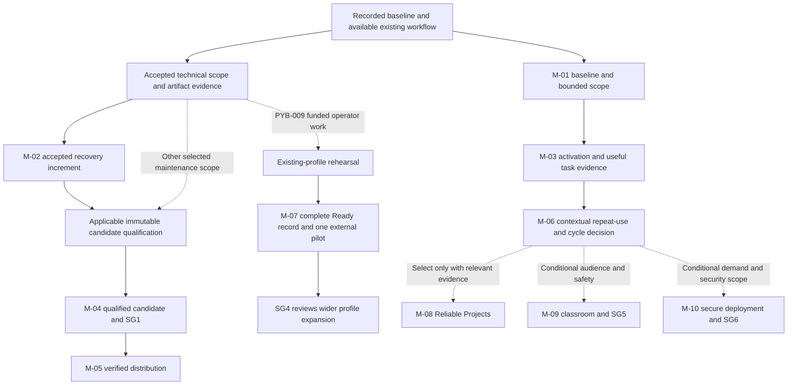

<!-- SPDX-License-Identifier: MIT -->
<!-- Part of PyBLE (https://pyble.dev) — see /LICENSE. -->

# 03 — Outcome and evidence milestones

| Control | Value |
|---|---|
| Status | M-01/SG0 remains Blocked on 25 September by pilot ownership/cohort/setup and capacity decisions; existing channel installations verified on retry. M-02 and scoped app-only M-04 pass 31 October engineering review; device closeout is complete. [PR #41](https://github.com/PyBLE-dev/PyBLE/pull/41) tracks final integration; required CI and merge precede publishing. M-05 channel delivery remains pending; forecast windows need replanning |
| Planning date | 25 September 2026; dates use Asia/Bangkok |
| Source | [Implementation strategy revision 1.8](../../planning/PyBLE_Implementation_Plan_and_Strategy_v1.0.md), especially §§4, 8–10, 14, and 19 |
| Inspected baseline | `main` at `23ed764b0ef88dce9720c66fbd1c0655268860cf` |
| Related documents | [Framework](01_Overview_and_Scrum_Framework.md), [roadmap](02_Product_Roadmap.md), [Sprint Plan](04_Sprint_Plan.md), [stories](05_Product_Backlog_and_Stories.md), [Sprint Backlogs](06_Sprint_Backlogs.md) |
| Meaning | Milestones describe inspectable outcomes and decision evidence; they are not additional Scrum events or promised releases |

**31 October acceptance update:** scoped current-text recovery (PYB-006.2 / M-02) and the app-only M-04 candidate pass engineering review at `bef67bd`: 984 ordinary tests, 36 frozen-runtime CI checks, both-platform recovery/keyboard evidence and all ten declared app/profile rows. The [C1-S2 record](c1-s2/00_Execution_Record.md) preserves exact artifacts, firmware baselines, earlier-row impact assessments and the temporary Android qualifier battery-policy condition. Signed packages and the release packet are prepared; original device policy and normal board advertising are restored, and owned fixtures are cleaned. [PR #41](https://github.com/PyBLE-dev/PyBLE/pull/41) tracks final integration; required CI and merge precede publishing. Actual M-05 store delivery remains pending. S1 remains six Done / two Prepared / four Awaiting evidence; S2 has ten engineering tasks Done and participant follow-up unfinished. Original dates/hours remain the baseline; the [continuation plan](04_Sprint_Plan.md#31-october-continuation-order-and-reforecast) records the next work and unresolved human capacity.

## Assessment and evidence states

Use **Proposed** until work is selected. At a milestone assessment, record one of
the decisions below with a date, responsible person, evidence links, and next
action. A calendar boundary never creates a pass. SG identifiers refer to the
strategy's decision gates; they do not replace repository CI G0/G1 or C3-G0…C3-G6.

| Decision / state | Meaning | Required follow-up |
|---|---|---|
| Proposed | Outcome has been planned but not accepted as completed work | Refine and select through Product Backlog ordering and Sprint Planning |
| Pass | The milestone's defined evidence supports its bounded outcome | Record scope, limitations, reviewer, and any independently required downstream gate |
| Iterate | Evidence exposes a solvable gap or misses a proposed target | Order the next improvement; preserve the original observation and target |
| Blocked | A named dependency prevents the required work or assessment | Record owner, reason, next check date, and effect on other work |
| Inconclusive | Evidence is insufficient for a defensible outcome decision | Retain descriptive results and identify what further evidence would resolve uncertainty |
| Documented limited-scope decision | A strategic choice is deliberately narrower than the proposed outcome | Record accepted scope and reasons; it cannot convert failed/missing mandatory release evidence into a pass |

| Distinction | Interpretation |
|---|---|
| Source complete | A scoped implementation may be merged while broader candidate qualification remains pending |
| Done Increment | The usable increment meets its applicable Definition of Done, including required physical evidence; unfinished work is not part of it |
| Release admitted | The immutable selected candidate satisfies all applicable release requirements and sign-off |
| Submitted / available / installed | These are separate distribution observations; store submission alone proves neither availability nor successful installation |
| Sprint Review | Stakeholders inspect outcomes and adapt the Product Backlog; this is not a required release-approval meeting |

## First-cycle milestone register

Forecast windows guide coordination. They are not deadlines for removing tests,
waiving evidence, or declaring a target met. Roles require named assignments;
no role in this table implies committed staffing or independent review.

| ID / status | Outcome and value | Forecast window / stories | Dependencies and evidence | Assessment / accountable contribution |
|---|---|---|---|---|
| M-01 — Blocked (25 Sep) | Accepted baseline and bounded cycle scope make installation, pilot, and engineering decisions reproducible | C1-S1, 28 Sep–11 Oct; PYB-001/003/004, residual 002, sizing 006/009 | Dated channel/install/source mapping or explicit owned unknowns; one primary cohort/job; safe task/consent rules; initial observations or recruitment blocker; actual capacity; persistence and physical-matrix estimates | SG0: accept a bounded scope or record gaps; Product Owner with release, pilot, and Developers |
| M-02 — Pass (31 Oct; bounded scope) | A usable, bounded local-draft recovery increment protects accepted user work after interruption | C1-S2–C1-S3, 12 Oct–8 Nov; selected PYB-006 scope, supporting 009/008, observed 005 only if selected | Accepted App specification/TDD and ADR-0010 change; text/Blocks scope; persistence boundary; relaunch, interrupted-write, and corrupt-state scenarios; no implicit board overwrite/run; relevant regression and physical evidence | Review against the selected story acceptance criteria and Definition of Done; Developers with a named review path |
| M-03 — Proposed | Observed first-use and meaningful second-task evidence explains activation and its largest obstacle | C1-S4, 9–22 Nov; PYB-004/011 and justified 005/012 | Safe recorded pilot setup; at least 12 eligible primary-cohort task starts, all outcomes retained; successful unassisted timing; Task C attempts, prior workflow, assistance and reasons | SG2: assess provisional completion/timing targets and severe failures; pilot lead supplies evidence, Product Owner records next investment |
| M-04 — Engineering pass (31 Oct; app-only scope) | A frozen maintenance candidate is qualified for its declared release scope | Normally C1-S5, 23 Nov–6 Dec; PYB-008/009/013 and included fixes | Applicable exact-artifact matrix and normative gates pass; provenance/recovery/instructions; no unresolved release-blocking data-loss, unintended/cross-session write, or critical workflow regression within the accepted threat model | SG1: release or submission decision with required sign-off; release owner and QA/review path |
| M-05 — Preparation in progress; delivery pending | Users can obtain the selected qualified app build through a verified existing channel | C1-S5–C1-S6, 23 Nov–20 Dec; PYB-014 and residual 002 | M-04; distribution-owner access; separate submission, availability, installed build/provenance, and installation outcome records; current user-facing claims | Verified-channel milestone passes only for the stated evidence; store delays are recorded as blockers; release owner |
| M-06 — Proposed | Useful-repeat and support evidence drives one explicit next-stage investment | C1-S6, 7–20 Dec; PYB-011 follow-up, cycle review; Ready inputs only if selected | Mature consented cohort accounting, useful Task C/return outcomes, task opportunity, prompting, missing responses, support burden, and status of candidate/channel evidence; retain blocked outcomes | SG3 assessment plus dated continue/narrow/pause-expansion decision; Product Owner with pilot and Developers |

[C1-S1 evidence](c1-s1/00_Execution_Record.md) includes the ledger, pilot protocol, recovery contract, cost model and verified existing Play/TestFlight installations. Six tasks are Done, two are Prepared awaiting pilot setup and four await participant/observation evidence. Human ownership, cohort/setup and actual capacity remain unconfirmed, so M-01/SG0 remains blocked. Missing participants are recorded as a recruitment gap, not completed observations. Current-build verification does not pass M-05 for a future qualified update. M-02's S2–S3 window and the conditional S2–S4 sizing option remain historical forecasts. Acceptance occurred during the 31 October continuation; replan remaining distribution and recruitment with actual capacity.

M-04 may occur in any Sprint once a maintenance candidate qualifies. M-03 and
M-06 do not block it. M-06 can assess learning and choose a narrower next step
even if release or recruitment remains blocked; the decision must say so.
M-02 is not a claim that every matrix row or the whole A-24 ambition is complete.

## Measurement rules for M-03 and M-06

| Measure | Proposed target | Interpretation and evidence boundary |
|---|---|---|
| Eligible first-task completion | At least 80% unassisted among at least 12 starts; at 12 starts, at least 10 successes | Failures, abandonment, and timeouts stay in the denominator; freeze eligibility/task/assistance rules prospectively |
| First successful run timing | Empirical nearest-rank p90 at or below 10 minutes for successful unassisted Task A runs | Start at first launch; report sample size and raw distribution beside all-start completion; no qualifying runs means unavailable |
| Follow-up eligibility | Aim for 20 activated, primary-cohort participants consenting to follow-up by 22 November | Their day-14 windows close by 6 December; fewer than 20 mature eligible participants makes the retention target inconclusive |
| Useful return | Provisional 40% confirmed useful day-7–14 returns among all mature, consented participants | Include all eligible participants in the denominator; distinguish missing follow-up, respondents, prompting, and task opportunity |
| Product value | Meaningful Task C attempts and reasons to choose or leave PyBLE | A repeated introductory print demonstration or a retention percentage alone does not establish value |
| Additional signals | Aim for 30 non-maintainer activations and five substantive reports | Discovery signals, not maintenance-release gates; distinguish recruitment sources and positive/negative feedback |

Missing follow-up is not a confirmed non-return. Retain participants who lacked
a relevant new task in the primary denominator and report any opportunity-to-use
subgroup separately. Recalibrate targets/windows only prospectively in a dated
decision that preserves the original results.

## Conditional future milestone register

These milestones remain Proposed beyond the base C1 commitment. Their windows
are options from the strategy, not simultaneous assignments. Research and paid
support experiments remain conditional roadmap streams rather than implied
release or publication promises.

| ID / status | Outcome and value | Indicative window / stories | Admission and evidence | Decision boundary |
|---|---|---|---|---|
| M-07 — Proposed | A complete Ready record and one external maintenance pilot make one exact profile easier to choose, set up, and sustain | Months 3–9; PYB-009 → 024 → 025; funded existing-profile rehearsal may start in C1 | Second operator reproduces published procedure; criteria/use/retest/withdrawal rules reviewed; complete artifact/hardware/workflow/installation/maintenance record; owner/reviewer; one external maintainer and measured setup/support effort | First badge only after its declared criteria pass; SG4 assesses broader expansion after the bounded pilot, not permission to start rehearsal |
| M-08 — Proposed | One selected Reliable Projects capability resolves a demonstrated workflow limitation | Months 3–6, conditional; PYB-017 then selected 018…022; 032 only if separately justified | Approved scope and normative wire/spec/ADR decisions; unchanged legacy behavior; capability fallback; cross-version tests and applicable five-profile physical/release evidence | No approval of the whole v0.7.0 feature set, opcode allocation, or release date by this milestone |
| M-09 — Proposed | A reusable supervised lesson and at least two measured sessions demonstrate sustainable teaching use | Months 6–12; PYB-026/028; 027 only if bundle scope is approved | Reliable core; multi-board selection/interference exercise; classroom safety/security and consent review; accessible lesson, instructor setup/intervention and outcome records | SG5 governs broader classroom use; small supervised evidence cannot establish unrestricted classroom scale |
| M-10 — Proposed | A justified ownership/security design supports an explicitly bounded untrusted or field deployment claim | Months 12–24 through Sep 2028, only on demonstrated demand; PYB-023 | Approved ownership/authentication and versioning scope; independent review; downgrade/reset/recovery evidence; sustainable support | SG6 before untrusted/field claims; a Ready badge does not satisfy security admission |

| M-07 stage | Required output | What it does not establish |
|---|---|---|
| Existing-profile rehearsal | Procedure, exact setup, operator/assistance record, and explicit gaps | Badge eligibility, a new supported port, or independent reproduction if bespoke help remains necessary |
| First public record | All declared criteria and reproduction pass; maintenance/use rules; visible installation status | Qualification of untested versions, revisions, or an entire chip family |
| One external maintainer pilot | Agreed responsibilities, independently reproduced results, support/retest effort | A partnership before agreement or automatic capacity for another profile |
| SG4 expansion assessment | Demand and sustainable maintenance support the next bounded addition | Permission to waive normal specification or release requirements |

## Evidence dependencies

The delivery and learning branches operate together. Known defects can be fixed
without waiting for recruitment. M-07 requires applicable qualification evidence
for its exact claim; it neither requires every unrelated app release nor waives
an atomic five-profile firmware release gate.

## Evidence record and maintenance

| Field | Required content when a milestone is assessed |
|---|---|
| Identity | Milestone ID, dated assessment, source strategy revision, scope, named responsible person and reviewer |
| Decision | Proposed/pass/iterate/blocked/inconclusive or explicit limited-scope decision, with reasons |
| Traceability | Selected PYB stories, actual issue/PR links when they exist, affected specifications/ADRs, and exact candidate identity |
| Results | Applicable pass/fail/not-run/blocked evidence; preserve limitations and historical results |
| Measurements | Cohort and task definitions, denominators, missing data, timing method, assistance and opportunity context where relevant |
| Next action | Product Backlog adaptation, responsible owner, target review, and impact on forecast windows |
| Privacy | Public redacted summaries and evidence hashes; personal contact/consent and raw sensitive records stored separately |

Reuse existing qualification reports and release schemas. The [strategy's
verification entry points](../../planning/PyBLE_Implementation_Plan_and_Strategy_v1.0.md#106-verification-entry-points)
identify relevant tools; document creation itself does not rerun their checks
or supply hardware evidence. Follow the [framework](01_Overview_and_Scrum_Framework.md)
for Scrum accountabilities, Definition of Done, and review/adaptation practice.
