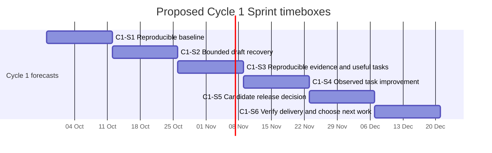

<!-- SPDX-License-Identifier: MIT -->
<!-- Part of PyBLE (https://pyble.dev) — see /LICENSE. -->

# Cycle 1 — Sprint plan and capacity forecast

| Field | Value |
|---|---|
| Status | Proposed; goals and selection are confirmed at each Sprint Planning |
| Cycle | `C1`, 28 September–20 December 2026, Asia/Bangkok |
| Basis | [Strategy revision 1.2, §8](../../planning/PyBLE_Implementation_Plan_and_Strategy_v1.0.md#8-twelve-week-implementation-schedule) |
| Product Goal and quality rules | [Working agreement](01_Overview_and_Scrum_Framework.md) |
| Acceptance criteria | [Product backlog and stories](05_Product_Backlog_and_Stories.md) |
| Task-level proposal | [Sprint backlogs](06_Sprint_Backlogs.md) |

## Forecast and commitment boundary

| Planning element | Treatment |
|---|---|
| `C1-S1` | Candidate selection for the next Sprint; not a committed Sprint Backlog before Planning |
| `C1-S2` … `C1-S6` | Forecasts revised using preceding results, capacity and learning |
| Sprint Goal | One coherent outcome confirmed by the Scrum Team at Planning |
| Scope and task details | Developers select feasible items and adapt their plan with the Product Owner as learning changes scope |
| Milestones | Inspectable evidence/decision points; not mandatory release ceremonies or waterfall phases |
| Estimates | Task hours are initial capacity allowances, not measured velocity, story points, or promises |
| Missing people/devices/access | Explicit blockers; do not invent availability or lower the Definition of Done |

## Capacity model

The source assumes one primary maintainer at 20 hours/week. Confirm real availability and any contributor capacity at Planning; extra roles do not create extra hours.

| Sprint | Gross assumed hours | Base planned allowance | Unallocated planned headroom | Reserve | Planned ceiling |
|---|---:|---:|---:|---:|---:|
| C1-S1 | 40 | 22 | 4 | 14 | 26 |
| C1-S2 | 40 | 24 | 2 | 14 | 26 |
| C1-S3 | 40 | 24 | 2 | 14 | 26 |
| C1-S4 | 40 | 22 | 4 | 14 | 26 |
| C1-S5 | 40 | 24 | 2 | 14 | 26 |
| C1-S6 | 40 | 20 | 6 | 14 | 26 |
| **Total** | **240** | **136** | **20** | **84** | **156** |

The reserve covers events/refinement, support, additional qualification and uncertainty. Known tests/reviews belong in each selected item's estimate. Rehearsal or optional work may consume explicitly assigned headroom; do not count it twice. The 26-hour ceiling is a local planning assumption, not a Scrum rule. If required work does not fit, reduce scope or revise the forecast, preserving quality and the fixed Sprint timebox.

## Sprint Goals, usable results, and evidence

| Sprint / dates | Proposed Sprint Goal | Candidate parents / child items | Intended usable result | Review evidence and milestone link |
|---|---|---|---|---|
| **C1-S1** — 28 Sep–11 Oct | Make the current installation and primary-cohort task reproducible, and determine a feasible draft-recovery scope | PYB-001.1/.2, 003.1, 004.1/.2, 006.1, 009.1; 011.2 when follow-up is due; residual 002 only if found | Reviewed installation/evidence record and reusable current-workflow task/operator guidance; accepted recovery design if review completes | [M-01](03_Milestones.md): installed-state evidence/unknowns, named cohort, five baseline starts or explicit recruitment blocker, sized persistence and applicable matrix |
| **C1-S2** — 12–25 Oct | Enable recovery of the smallest accepted current-text draft scope while preserving safe board/session behavior | PYB-006.2; continue 009.1 and start 008.1; rolling 011.2; PYB-005.1 only for a real observed blocker | Usable bounded recovery increment when all selected acceptance and DoD checks pass | [M-02](03_Milestones.md): persisted boundary, relaunch, interrupted/corrupt storage and stale-completion evidence; visible carried A-24/Blocks scope |
| **C1-S3** — 26 Oct–8 Nov | Make the recovery increment reproducibly testable on selected devices and observe useful second tasks | PYB-008.1/.2, 011.1/.2; 006.2 only if replanned unfinished; optional 009.2 | Candidate-specific operator evidence and task findings; qualified maintenance changes may release now | [M-02/M-04](03_Milestones.md): completed versus pending matrix rows, Task C outcomes, optional existing-profile rehearsal with assistance/gaps |
| **C1-S4** — 9–22 Nov | Improve the highest-impact observed task obstacle and establish interpretable activation/follow-up cohorts | PYB-011.1/.2; 012.1 or 005.1 only if evidence selects it; affected 008 reruns | An observed improvement if a defect is selected; otherwise usable findings and existing-workflow guidance | [M-03](03_Milestones.md): at least 12 primary-cohort starts including failures; reasons to choose PyBLE; aim for 20 activated consenting participants by 22 Nov |
| **C1-S5** — 23 Nov–6 Dec | Reach a justified release decision for the candidate and account for mature follow-up windows | PYB-008.2, 013.1, 014.1 when admitted, 011.2 | Release-ready candidate if every applicable gate passes; otherwise explicit blocker and recovery plan | [M-04](03_Milestones.md): immutable artifacts and required gates; follow-up accounting by 6 Dec; submission recorded separately from approval |
| **C1-S6** — 7–20 Dec | Verify actual distribution and choose one next investment from useful-repeat and support evidence | PYB-014.1/.2 as needed, 011.2; cycle decision; optional 015.1 | Verified delivery record or documented external blocker, usable support guidance, evidence-based next backlog order | [M-05/M-06](03_Milestones.md): installed identity, complete denominator and missing-data report, support effort, one next-stage decision |

These are whole-product goals, not separate analysis, coding, testing and release departments. Every delivered increment includes its applicable design, implementation, verification and documentation. S3/S5 qualification work does not postpone tests needed to make earlier increments Done.

The full safe recovery slice may exceed the initial S2 allowance. PYB-006.1 must expose that before selection. Replan a smaller independently safe increment or later delivery; never label happy-path-only persistence Done or count the whole A-24 umbrella as complete.

## Calendar

The diagram shows forecast timeboxes, not guaranteed feature delivery. Reviews and Retrospectives are proposed for the last working Friday; Sprints end on Sunday so the next timebox begins immediately on Monday.

| Sprint | Planning | Review and Retrospective | Important observation window |
|---|---|---|---|
| C1-S1 | Mon 28 Sep | Fri 9 Oct | First comparable baseline observations |
| C1-S2 | Mon 12 Oct | Fri 23 Oct | Continue recruitment alongside known persistence work |
| C1-S3 | Mon 26 Oct | Fri 6 Nov | Task C attempts and recorded-build cohorts |
| C1-S4 | Mon 9 Nov | Fri 20 Nov | Aim for 20 activated follow-up-consenting participants by Sun 22 Nov |
| C1-S5 | Mon 23 Nov | Fri 4 Dec | Latest target cohort's day-14 window closes Sun 6 Dec; include final late-weekend accounting in S6 if needed |
| C1-S6 | Mon 7 Dec | Fri 18 Dec | Cycle closes Sun 20 Dec; late observations remain clearly dated |

## Replanning and release rules

| Trigger | Action |
|---|---|
| Store/device access is unavailable | Mark the installation task Blocked and assign an owner; continue independent contract/tool work |
| Recruitment is insufficient | Record the gap; preserve the denominator and report outcomes inconclusive where required; continue qualified maintenance work |
| A severe observed defect appears | Order the smallest safe fix against the Sprint Goal; renegotiate selected scope rather than silently adding hours |
| A candidate or relevant input changes | Identify affected evidence and rerun/revalidate applicable checks; do not reuse old hashes as current results |
| All release gates pass before S5 | Release through the authorized normal process; retain dated records and revise later forecasts |
| Release gates do not pass by S5/S6 | Hold the release claim and show the blocker; the calendar does not waive a gate |
| No second operator is available | Keep PYB-009.2 pending; no independent-reproduction claim or Ready award; unrelated delivery continues |
| Cohort has no new task during days 7–14 | Keep it in the full eligible denominator; report opportunity separately and use only prospectively agreed additional windows |
| A future forecast item remains too large or vague | Return to refinement, split by usable outcome and size with Developers; do not fill a Sprint with an unresolved epic |

## Review record template

| Field | Record at each Review/Retrospective |
|---|---|
| Sprint Goal | Achieved, partially achieved or not achieved, with evidence |
| Increment | Demonstrable changes meeting DoD; unfinished items listed separately |
| Quality/release | Applicable test/physical results, exact artifacts, limitations, release state |
| Useful work | Tasks attempted/completed, assistance, opportunity, prompting and missing responses |
| Capacity | Actual delivery/support/event effort compared with allowances; no invented velocity |
| Adaptation | Updated ordered backlog, next proposed Goal, one process improvement |
