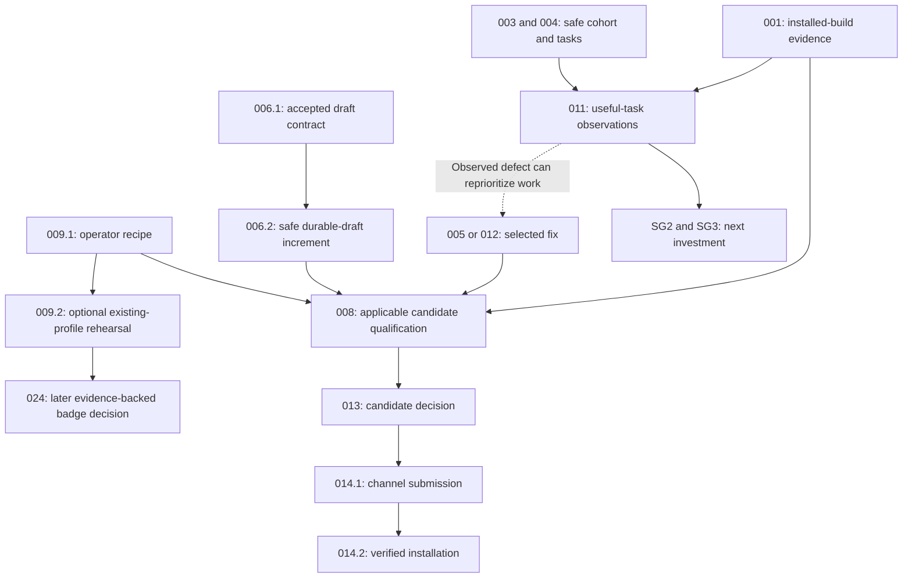

<!-- SPDX-License-Identifier: MIT -->
<!-- Part of PyBLE (https://pyble.dev) — see /LICENSE. -->

# 05 — Product Backlog and Stories

| Control | Value |
|---|---|
| Product Goal | Make the existing tablet workflow trustworthy enough for useful repeat tasks by the selected primary audience |
| Source | [Implementation strategy revision 1.4](../../planning/PyBLE_Implementation_Plan_and_Strategy_v1.0.md), reviewed 25 September 2026 |
| Cycle | Proposed 28 September–20 December 2026; Asia/Bangkok |
| Baseline | `23ed764b0ef88dce9720c66fbd1c0655268860cf`; completed publication work is evidence, not a new commitment |
| Status | C1-S1: PYB-001.1/.2 and PYB-006.1 scoped work Done; pilot preparation awaits setup, observation work awaits evidence, PYB-009.1 partial; other work remains forecast |
| Accountabilities | Product Owner orders the backlog; Developers size and select work in Sprint Planning; named people and capacity remain to be assigned |
| Navigation | [Overview and Scrum](01_Overview_and_Scrum_Framework.md) · [Roadmap](02_Product_Roadmap.md) · [Milestones](03_Milestones.md) · [Sprint plan](04_Sprint_Plan.md) · [Sprint Backlogs](06_Sprint_Backlogs.md) |

## 1. How to use this backlog

| Rule | Application |
|---|---|
| Parent identity | `PYB-001` through `PYB-032` retain the strategy's planning identities; they are not GitHub issue numbers |
| Leaf identity | Decimal suffixes identify proposed slices, such as `PYB-006.2`; link an actual issue when accepted rather than inventing its number |
| Existing identity | `A-24` remains the broader existing persistence story; the bounded PYB-006 increment does not complete all A-24 obligations |
| Sprint identity | `C1-S1` through `C1-S6` name this cycle; App TDD references to historical S1–S7 remain unchanged |
| Backlog order | The first-cycle order below is provisional; dependencies, evidence and the Product Goal guide refinement, rather than treating every P0 as simultaneous work |
| Type | User stories express an end-user outcome; engineering, research, governance and release enablers identify the actual work without an artificial persona |
| State and sizing | Use the dated execution table for current states; future leaves remain proposed and named capacity is unconfirmed. The recovery/matrix estimates now require replanning. No story points or velocity are asserted |
| Acceptance and Done | Story acceptance criteria supplement the shared Definition of Done; apply the source contract, repository gates and required physical evidence to the selected change |
| Research outcome | A completed, reviewed observation can find that a target failed. That does not pass the corresponding milestone or turn missing participants into completed observations |
| Scope change | Split an oversized item into a coherent, safe increment and replan before implementation; preserve carried requirements and record any approved deviation |

## 2. Ordered first-cycle Product Backlog

| Order | Parent / source priority | Intended outcome | Proposed slices | Forecast / dependency | Current state |
|---|---|---|---|---|---|
| 1 | PYB-001 / P0 | Know what users can install and which artifacts they receive | 001.1, 001.2 | C1-S1; existing publication review | 001.1/.2 Done for ledger and existing channel-install verification; provenance limits remain explicit |
| — | PYB-002 / P0 accuracy | Keep maintained availability claims correct | 002.1: public TestFlight description | PR #33 Android correction complete; residual found during 001 | Correction packet prepared; actual store update/public verification pending |
| 2 | PYB-003 / P0 | Conduct a safe, consented pilot with bounded data collection | 003.1 | C1-S1; 001 informs setup | Prepared — awaiting pilot setup and named collection decision |
| 3 | PYB-004 / P0 | Observe one reachable audience completing reproducible, useful tasks | 004.1, 004.2 | C1-S1; 001, 003 | 004.1 Prepared — awaiting cohort/setup; 004.2 Awaiting participant evidence |
| 4 | PYB-006 / P0 | Recover the current text draft after process restart | 006.1, 006.2 | Sized in C1-S1; S2–S4 working option requires replanning; known defect does not wait for recruitment | 006.1 Done; 006.2 implementation pending |
| 5 | PYB-009 / P0 | Make existing validation reproducible by an operator | 009.1; optional 009.2 | Inventory C1-S1, scoped recipe C1-S2; reproduction only with assigned capacity | T12 Done; 009.1 remains partial |
| 6 | PYB-005 / P0 if observed | Remove a demonstrated first-use blocker | 005.1 | C1-S2 candidate; actual 004 findings | Conditional; no defect invented |
| 7 | PYB-008 / P0 for claims | Establish the exact candidate's applicable compatibility evidence | 008.1, 008.2 | Representative checks C1-S2; staged matrix C1-S3–S5; 001, 009.1, artifacts | Proposed; hardware and mandatory workload must be costed |
| 8 | PYB-011 / P0 usability | Understand useful first and repeat tasks in the primary cohort | 011.1, 011.2 | Main activation collection C1-S3–S4; rolling follow-up from the first consented activation through C1-S6; 003, 004, recorded tested setup | Proposed; recruitment and follow-up are not assumed |
| 9 | PYB-012 / P0 if severe | Resolve the highest-impact observed failure | 012.1 | C1-S4 candidate or earlier when evidence warrants | Conditional; reorder promptly when a real severe failure appears |
| 10 | PYB-013 / P0 release | Make a candidate-specific release decision with applicable evidence | 013.1 | C1-S5 forecast; applicable 008/009 and included fixes | Proposed; maintenance candidates may qualify earlier |
| 11 | PYB-014 / P0 when ready | Make the qualified app build installable through the selected existing channel | 014.1, 014.2 | C1-S5 submission/C1-S6 verification forecast; 013 and owner access | Proposed; external review may extend calendar |
| 12 | PYB-007 / P1 | Share a previewed, privacy-preserving support record | 007.1 | Optional capacity; 003 and approved export contract | Proposed; manual template is the base fallback |
| 13 | PYB-010 / P1 | Read accurate setup and recovery guidance in Simplified Chinese | 010.1 | Optional capacity and named language reviewer | Proposed |
| 14 | PYB-015 / P1 | Discover the verified release through accurate supporting material | 015.1 | C1-S6 optional; verified claims, 002/013 | Proposed |
| 15 | PYB-016 / P1 | Prepare a defensible benchmark and research evaluation | 016.1 | Optional independent capacity; 003/004 | Proposed |

The completed portion of PYB-002 is [PR #33](https://github.com/PyBLE-dev/PyBLE/pull/33). A fresh mismatch needs its own accepted scope and evidence; do not restart the original correction or count it as this cycle's delivery.

## C1-S1 execution status — 25 September

| Item | Actual state | Evidence / next action |
|---|---|---|
| PYB-001.1 | Done for the ledger scope | [Ledger](c1-s1/01_Channel_and_Artifact_Ledger.md); unknown fields have responsible owners/actions |
| PYB-001.2 | Done for existing channel installations | [Lenovo Play `0.2.0 (8)`](c1-s1/06_Android_Channel_Verification.md) and [iPad TestFlight `0.2.0 (6)`](c1-s1/07_iPad_Channel_Verification.md): channel/Open/launch and installed identity verified. No fresh enrollment or reinstall; Android code/asset comparison supports historical source mapping, iPad mapping remains unknown |
| PYB-002.1 | Prepared; store correction pending | Public TestFlight description remains discrepant; build-6 minimum-OS metadata also needs distribution-owner review. No claim of external mutation |
| PYB-003.1 / PYB-004.1 | Prepared — awaiting pilot setup | [Pilot kit](c1-s1/02_Pilot_Protocol_and_Observation_Kit.md); technical review completed, but human owner, reachable cohort, tested board setup and collection decision remain missing |
| PYB-004.2 / PYB-011.2 | Awaiting participant/observation evidence | T06–T08 await participant sessions; T09 awaits their records. Five baseline starts and all later follow-up remain outstanding |
| PYB-006.1 | Done for design/review/sizing | [Contract and review](c1-s1/03_Recovery_Design_and_Sizing.md); PYB-006.2 implementation remains pending; revised allocation needed |
| PYB-009.1 | Partial | T12 [inventory/cost model](c1-s1/04_Validation_Inventory_and_Operator_Recipe.md) complete; S2 scoped procedure and subsequent operator results still pending |

The ordered table above retains original priorities and forecast labels. It is not evidence that all proposed dates remain feasible after the recovery estimate; use the [reforecast requirements](04_Sprint_Plan.md#c1-s1-findings-and-required-reforecast) before selecting future work.

## 3. Detailed first-cycle stories and enablers

Acceptance criteria below remain the completion authority. The [C1-S1 execution record](c1-s1/00_Execution_Record.md) reports actual outcomes; verified existing installations do not complete recruitment, board qualification or runtime recovery. Prepared and Awaiting evidence are descriptive unfinished states, not waived criteria. Role names identify needed skills; actual future assignments remain to be confirmed.

### 3.1 Distribution and pilot preparation

| ID / type / role | Outcome | Testable acceptance criteria | Dependencies and verification |
|---|---|---|---|
| PYB-001.1 / Release enabler / Release | Establish a reviewed channel and artifact ledger | Separate publication, installation, provenance and qualification fields; record evidence/date/platform/channel/build; each unknown has an owner and next action; distinguish uploaded AAB/IPA identity from installed or re-signed artifacts | Existing dated publication review; reviewer checks ledger against first-party evidence. A completed ledger does not make an unknown installation pass |
| PYB-002.1 / Publication enabler / Distribution owner | Correct the stale app-level public TestFlight description | Verify the actually offered build supports the claims; apply accurate capability-defined copy through the owner-controlled channel; retain actual metadata update and dated public verification; do not relabel historical build notes or imply untested compatibility | Discovered in 001.1; [prepared correction](c1-s1/05_TestFlight_Metadata_Correction.md). Packet prepared only; store operation needs access and explicit capacity selection |
| PYB-001.2 / User story / Release + QA | As a tablet-owning maker, I can follow the existing channel's installation path so I can start using PyBLE | Verify an eligible physical Android and iPad channel installation: perform enrollment/install where needed, or verify the existing channel-installed app without erasing user data. Record channel/enrollment state where observable, served and installed version/build, restrictions and successful launch; source mapping is evidenced or explicitly unresolved; instructions reproduce observed steps and distinguish existing-install verification from fresh enrollment/reinstallation | 001.1 and channel/device access; dated physical installation records. Existing-install evidence requires channel provenance and launch, not package inventory alone. Missing access or failed installation/launch remains blocked/failed; no fresh-install or enrollment completion is inferred |
| PYB-003.1 / Governance enabler / Lead + QA | Approve a bounded pilot that protects participants and their data | Identify trusted setting, harmless loads and wrong-board containment; explain STOP limitations and lack of authenticated ownership; approve consent, assistance/safety rules, contact separation and deletion policy; review a manual support template excluding sensitive content by default | Recorded 001 setup; named pilot decision-maker signs the scoped decision before collection. No background analytics or automatic source/console upload |
| PYB-004.1 / Research enabler / Pilot lead | Define one reachable cohort and tasks that reveal product value | Name primary audience, recruitment owner, reference setup and previous-workflow questions; separate Tasks A/B/C; fix eligibility, written guidance, assistance, timeout and exclusions prospectively; define follow-up linkage, prompting and opportunity-to-use questions | 001 and 003.1; reviewed task/observation protocol. Instructor cohort may replace the maker default by a recorded prospective choice |
| PYB-004.2 / Research enabler / Pilot lead | Observe five baseline participants before choosing a first-use change | Record five eligible started Task A outcomes, including failures, abandonment and assistance; retain build/task/OS/profile identity; record useful Task C attempts and reasons to choose PyBLE; identify actionable friction or no observed blocker | 004.1 and recorded tested setup; redacted observations and synthesis. Recruitment shortfall is reported as a blocker, not five completed observations |

| Measurement boundary | Required interpretation |
|---|---|
| Task A | Provisioned-board activation, timed from first app launch; record installation separately |
| Task B | Full self-service setup, including installation, provisioning and recovery decisions; report duration separately |
| Task C | Meaningful adaptation or own task using safe existing features; an unchanged introductory print rerun is insufficient |
| First-session Task C | Evidence of useful adaptation; it is not later-day repeat use |
| Support information | Use the reviewed manual template until optional 007.1 is delivered; participants do not depend on a new export feature |

### 3.2 Preserve work and repair demonstrated friction

| ID / type / role | Outcome | Testable acceptance criteria | Dependencies and verification |
|---|---|---|---|
| PYB-005.1 / User story / App | As a first-time maker, I can resolve the observed setup obstacle so I reach a ready board without live assistance | Cite the observed obstacle; distinguish provisioning, permission, discovery and readiness as relevant; make recovery actionable; preserve working session behavior; test the changed path and repeat a comparable task observation | Sufficient 004 evidence; selected contract, regression and relevant physical/task evidence. Not Ready until a real problem and bounded fix are selected |
| PYB-006.1 / Engineering enabler / App | Freeze and size a safe, bounded durable-draft design | Define persisted content, accepted write boundary and observable failure behavior; define recovery/discard choice, board association, interrupted-write/corrupt/full-storage handling and migration approach; explicitly include or defer Blocks; map carried A-24 obligations; follow Drift decision or approve a superseding ADR; size validation before implementation | [ADR-0010](../../decisions/0010-working-loop-in-memory-document.md), App specs/TDD and current code; reviewed specification/ADR and acceptance scenarios. Does not wait for 004 |
| PYB-006.2 / User story / App | As a maker, I can recover my current text draft after the app process restarts so an interruption does not erase my work | Restore accepted persisted content according to 006.1 after termination/relaunch; recovery requires no network/board operation; recovery/discard is explicit as specified; interrupted/corrupt/full storage follows the approved non-destructive outcome; restore never silently uploads, runs or authorizes a write to a newly selected board; stale transfer completion cannot clear newer edits; text/Blocks scope is truthful | Approved 006.1; meaningful failing-then-passing persistence/controller tests, migrations and applicable widget/lifecycle/physical regressions. Deliver safe failure behavior with the slice, not as optional later hardening |
| PYB-012.1 / User story placeholder / Maintainer | As an affected participant, I can complete the task interrupted by the highest-impact observed failure | Replace this placeholder with the actual failure, expected outcome and contract; reproduce it; verify the minimal fix and affected regressions; compare recorded task/build cohorts where applicable; close or retain the specific evidence gap truthfully | Sufficient 004 or 011 observations; selection need not wait for the whole cohort. No invented defect, implementation estimate or readiness before refinement |

| A-24 scope guard | Required treatment |
|---|---|
| Existing implementation | [EditorDocument](../../../app/lib/editor/editor_document.dart) is volatile; [data barrel](../../../app/lib/data/data.dart) remains a placeholder. Navigation survival is not restart survival |
| Persistence design | [App TDD](../../specifications/App/TDD.md) §9 describes the broader Drift model; its frozen working-loop contract records the current deviation. Do not interpret the target architecture as shipped code |
| Backend | Preserve Drift and the single settings-store direction; ADR-0010 rejects an ad-hoc scratch-file substitute. A different design requires an explicit superseding decision |
| Completion boundary | A bounded current-text recovery story does not complete full project management, all six content tables, saved boards, console history, import provenance, durable settings or Blocks recovery |
| Safe slicing | Replan an oversized 006.2; do not declare a happy-path-only build releasable while required corruption, interruption or board-write protections remain absent |
| Protocol boundary | No new PBLE operation, automatic reconnect guarantee, automatic board write or full project system is approved by these stories |

### 3.3 Qualification and reusable operator evidence

| ID / type / role | Outcome | Testable acceptance criteria | Dependencies and verification |
|---|---|---|---|
| PYB-009.1 / Engineering enabler / Protocol + QA | Make existing suites and physical procedures runnable without a new parallel harness | Inventory host/app/conformance/HIL tools; map applicable normative gates and exact profiles; document prerequisites, commands, expected evidence and safe setup/recovery; cost the required matrix; identify missing hardware/operators and boundaries between host, physical and usability evidence | 001 and source inventory; review against [HIL guide](../../../tests/firmware_tests/hil/README.md), [host fixtures](../../../tests/firmware_tests/host/conformance/README.md) and qualification tooling. Recipe starts before the full matrix |
| PYB-008.1 / Qualification enabler / QA | Expose candidate/setup failures with representative iPad and Android runs | Select and name representative exact-profile/device combinations; record immutable app/firmware/suite identity and provenance limits; run applicable core and interruption checks; record pass/fail/not_run/blocked and retain defects/evidence | 001, initial 009.1 recipe and recorded artifacts; physical results. Representative success cannot imply ten-combination qualification |
| PYB-008.2 / Qualification enabler / QA + Firmware | Complete every matrix row required for the selected compatibility claim | Cover the selected claim's required profiles/platforms and normative scenarios/counts; target five exact profiles × two app platforms for the cycle; attach candidate-bound evidence, reviewer, limitations and state per row; rerun affected evidence after relevant changes; unresolved required rows block that claim | 009.1, candidate artifacts and 008.1 findings; applicable physical/qualification gates. Explicitly replan unavailable hardware or underestimated workload without weakening requirements |
| PYB-009.2 / Engineering enabler / Second operator + QA | Reproduce one existing profile and expose gaps in a draft PyBLE Ready record | Name one existing exact profile/operator; follow published setup/core/recovery recipe; log assistance and failures; update gaps and rerun affected steps without bespoke help before claiming reproduction; draft version-bound evidence and installation status; award no badge | 009.1, suitable artifacts/hardware and explicit capacity. Optional rehearsal; missing second operator leaves reproduction pending without blocking an unrelated maintenance release |

| Qualification rule | Acceptance boundary |
|---|---|
| Exact profiles | `esp32-4mb`, `esp32-s3-n16r8`, `waveshare-esp32-s3-lcd-147b`, `esp32-c3-4mb`, `rpi-pico2-w`; preserve revision/memory constraints |
| App/firmware combinations | Name immutable supported baselines and applicable cross-version scenarios; do not use a mutable branch as artifact identity |
| Claims | A passing subset supports only its declared scope; an existing-profile rehearsal never waives an atomic five-profile firmware release gate |
| Existing publication | v0.6.1 owner confirmation does not complete pending automated evidence or confer PyBLE Ready status |
| Evidence status | `not_run` and `blocked` describe evidence rows, not a passing outcome. No simulator or host result substitutes for a required physical measurement |

### 3.4 Useful use and contextual follow-up

| ID / type / role | Outcome | Testable acceptance criteria | Dependencies and verification |
|---|---|---|---|
| PYB-011.1 / Research enabler / Pilot lead | Learn whether the primary cohort can start and adapt useful work | Record at least 12 eligible primary-cohort Task A starts, retaining all failures/timeouts/abandonment; report unassisted success and successful-only nearest-rank p90 with sample size; record Task C attempts, reasons, prior workflow and assistance; stratify changed build/task/audience cohorts | 003, 004 and recorded tested setup; public aggregates/private consented records. Initial five count only if comparable; full 008 completion and 005 are not prerequisites |
| PYB-011.2 / Research enabler / Pilot lead | Learn whether participants return for useful work when a task arises | Aim for at least 20 activated, consenting primary-cohort participants by 22 November; record consent and the day-7–14 window at activation and collect follow-up as each window arrives, including early cohorts; account for mature windows through 6 December; retain all mature eligible participants in the primary denominator; report useful returns, respondents, missing responses, prompting, task opportunity and alternatives separately | 004 prospective follow-up rules and 011 activation records; reviewed aggregate analysis. Below 20 is inconclusive; missing follow-up is not confirmed non-return; participants with no new task remain in the primary denominator |

| Target in the strategy | How the story review uses it |
|---|---|
| At least 80% unassisted completion | At 12 starts, at least 10 successes; failing/abandoned starts remain in the denominator |
| Successful-only observed p90 ≤10 minutes | Report alongside all-start outcomes and the raw small-sample distribution; no qualifying successes means unavailable |
| At least 40% useful day-7–14 returns | A provisional indicator only with at least 20 mature eligible participants and meaningful-task/context evidence |
| Participant totals | Thirty non-maintainer activations is a discovery aim, not a maintenance-release gate; recruited and independently arriving participants remain distinguishable |
| Missed targets | Report observed results and select iterate, blocked or a documented limited-scope decision; explanation alone does not pass SG2/SG3 |

### 3.5 Release and channel verification

| ID / type / role | Outcome | Testable acceptance criteria | Dependencies and verification |
|---|---|---|---|
| PYB-013.1 / Release enabler / Release + QA | Decide whether an immutable candidate can be published under its declared scope | Identify included changes/artifacts and applicable normative gates; attach passing required evidence, known limitations, provenance, recovery and accurate guidance; resolve release-blocking loss, unintended/wrong-session writes and critical workflow regressions; record review/sign-off or blocker | Applicable 008/009 and included fixes; [repository rules](../../../AGENTS.md), specifications and release evidence. Full pilot/retention cohorts and future authenticated ownership are not blanket maintenance prerequisites |
| PYB-014.1 / Release operation / Release | Submit the qualified app artifact to the selected existing channel | Match submitted artifact to 013 decision; record uploaded identity, target channel, submission receipt and current processing/review state; record owner/access and update/rollback route; preserve testing-channel wording | 013.1 and distribution-owner access; submission evidence. Submission is distinct from availability and production promotion requires its own decision |
| PYB-014.2 / User story / Release + QA | As an eligible tablet user, I can install the qualified update through the declared channel | Verify actual channel availability and eligible-device installation; record installed version/build and available provenance; exercise the applicable installation smoke path; update instructions/status with observed restrictions; retain unresolved review or installation failures explicitly | 014.1 and actual external availability; dated physical installation evidence. Waiting for store review remains a blocker, not successful installation |

### 3.6 Optional capacity: support, documentation and future design

| ID / type / role | Outcome | Testable acceptance criteria | Dependencies and verification |
|---|---|---|---|
| PYB-007.1 / User story / App + QA | As a user seeking help, I can preview a diagnostic export before sharing it | User explicitly initiates export; preview/redaction precedes sharing; observed, supplied and unknown identity fields stay distinct; omit source, file/console contents, secrets and persistent device identifiers by default; no automatic upload; current HELLO is not treated as an artifact hash | 003 and approved export contract; privacy/serialization/UI tests and relevant device checks. Manual template remains usable if this story is not selected |
| PYB-010.1 / User story / Docs + language reviewer | As a Simplified Chinese reader, I can understand verified setup and recovery steps | Named reviewer checks identity, distribution, exact compatibility and recovery guidance; preserve code/protocol tokens; link authoritative English/versioned references; translated claims match actual support status | Current guidance and reviewer/capacity; language, link and relevant publication checks; incorporate 005 if that flow changed |
| PYB-015.1 / Documentation enabler / Community | Prepare accurate evidence for release discovery | Release kit identifies actual capabilities, support limits and verified channel; screenshots/demonstration have reviewed provenance; coverage register deduplicates syndication and separates publication/discovery dates; awareness counts are not adoption claims | 002/013 and verified availability for availability claims; editorial/source review. This preparation does not assert outreach or publication occurred |
| PYB-016.1 / Research enabler / Research lead | Prepare an evaluation before collecting research data | State question, baseline/comparison, artifact identity, metrics, limitations and analysis plan; distinguish usability from efficacy; record ethics/review decision before relevant collection; define reproducible benchmark procedure | 003/004 and named independent capacity; reviewed protocol. No result, novelty, manuscript or approval is presumed |
| PYB-017.1 / Engineering enabler / Protocol | Decide whether one Reliable Projects capability is justified and ready for implementation planning | Cite measured problem; approve selected v0.7.0 scope/ADR or defer it; define capability advertisement, legacy fallback, registry changes and cross-version vectors before implementation; size one coherent slice and show what capacity it replaces | Normally cycle decision; earlier only explicit scope/capacity allocation. Approved design is not implementation, new opcode approval or v0.7.0 release qualification |

## 4. Conditional expansion backlog and complete parent traceability

Parents PYB-001–016 map to the first-cycle table. PYB-017 has a design leaf above; PYB-018–032 remain proposed epics needing refinement, named ownership, sizing and admission. Future-stage P0 does not interrupt the current cycle automatically.

| Parent / source priority | Proposed outcome | Admission and dependencies | Refinement / evidence before claim |
|---|---|---|---|
| PYB-017 / P0 future | Select Reliable Projects scope | Cycle evidence; explicit scope/capacity decision | 017.1 above; no implementation by roadmap alone |
| PYB-018 / P0 future | Query run/session state without stale reconnect assumptions | 017 approved contract | Split user/agent/app slices; reconnect/autorun and cross-version evidence |
| PYB-019 / P0 future | Inspect or abort a transfer while preserving the prior destination | 017 approved contract | Define idempotent abort and disconnect/resume semantics; fault and compatibility vectors |
| PYB-020 / P0 future | Obtain complete directory enumeration | 017 approved contract | Define mutation behavior; unchanged directory returns every entry exactly once |
| PYB-021 / P0 future | Execute files with consistent project semantics | 017 approved contract | Sibling imports, path restoration, module cleanup and fresh-run parity; preserve completed v0.6.1 hardening |
| PYB-022 / P1 future | Explain bounded console/input loss and recovery | 017/018 | Bound queues and loss reporting; floods do not silently redefine STOP |
| PYB-023 / P0 before untrusted deployment | Establish authenticated ownership and safe recovery | 003 refreshed threat model; approved security/versioning scope | Independent design review; bootstrap, replay/downgrade, reset/revocation and legacy behavior before implementation |
| PYB-024 / P0 before badge | Award a version-bound PyBLE Ready claim with a complete public record | 009 reproduction, applicable qualification, named maintainer/reviewer | Publish criteria/use/revalidation/withdrawal rules; exact hardware/software/results and visible installation status; every declared criterion passes |
| PYB-025 / P1 future | Have one external maintainer sustain a useful exact profile | 024, demand, named owner/capacity | Existing profile is sufficient; independent results and support/retest effort recorded; new ports require normal gates |
| PYB-026 / P1 future | Supply a safe, usable offline lesson pack | Core workflow gate | Reviewed wiring, expected result, recovery and accessibility; select one actual lesson |
| PYB-027 / P1 future | Import a lesson safely through a bounded bundle/QR flow | 026 and approved bundle specification | Parse limits, preview, explicit overwrite consent and separate Run; no implied atomic project deployment |
| PYB-028 / P1 future | Validate two supervised classroom sessions | 026 and classroom-specific 003 review | Setup/completion, wrong-board events, support burden and consent; no coercive reviews or participation |
| PYB-029 / P2 future | Evaluate sensor plotting/export for a demonstrated task | Stable execution/console and demand | Approved data format; rate, units, timestamps and loss/export bounds |
| PYB-030 / P1 future | Produce a reproducible research package when results justify it | 016 and qualified artifacts | Measured contribution, matched comparisons, limitations and reproducible evidence; publication not guaranteed |
| PYB-031 / P2 future | Test one bounded support/vendor service | Demand and support capacity | Record delivery cost/support effort; retain free open application features and evidence-based badge eligibility |
| PYB-032 / P2 future | Decide atomic project-deployment semantics | 019/021 and measured multi-file need | RFC and interruption model; no implementation promise before contract approval |

| PyBLE Ready guard | Required backlog treatment |
|---|---|
| Visible installation status | Distinguish **firmware installation required** from **firmware preinstalled** for the actual supplied board/kit; a profile's compatibility does not identify a seller's shipped firmware |
| Badge maintenance | Public record includes exact versions, owner, review date, support/retest duties and active/under-review/withdrawn state; unsupported claims are suspended or withdrawn with history retained |
| Open access | Compatible PBLE agents remain usable without a badge, payment, registration or app-side board allowlist |
| Early rehearsal | 009.2 may prepare a draft record within assigned capacity; 024 award and 025 external expansion remain separate decisions |

## 5. Dependency model

| Reading the model | Meaning |
|---|---|
| Maintenance path | Applicable candidate evidence gates release; a completed cohort or passing retention target does not |
| Learning path | Use a recorded tested setup; new pilot work need not wait for the whole candidate matrix or optional onboarding changes |
| Feedback | Actual severe failures can change order before the cohort completes; known durable-draft loss needs no rediscovery |
| Diagram limit | This diagram shows major dependencies, not a waiver of the applicable source contract or a commitment to run all paths simultaneously |

## 6. Refinement and handoff

| Before selecting a leaf | Required record |
|---|---|
| Ownership | Actual issue link, named Developer/owner, reviewer and needed physical operator |
| Sprint fit | Accepted goal contribution, estimate including known spec/review/tests, hardware/access, dependencies and remaining capacity |
| Contract | Normative references, selected in/out scope, accepted scenarios and any explicit carried requirement |
| Evidence | Expected automated/physical/documentary proof and location; privacy/retention handling; no fabricated result |
| Delivery | Applicable source/release gates, channel impact, recovery/rollback and public-claim boundary |
| Review | Acceptance outcome, shared Definition of Done, unresolved findings and next ordering decision; unselected work remains in the Product Backlog |

| Authoritative / related source | Use |
|---|---|
| [Implementation strategy](../../planning/PyBLE_Implementation_Plan_and_Strategy_v1.0.md) §§4, 8–10, 12, 14, 19 | Outcomes, parent backlog, capacity, pilot/Ready rules and strategic decisions |
| [App specification](../../specifications/App/specs.md) and [App TDD](../../specifications/App/TDD.md) | Current contracts and explicit implementation deviations; proposed stories do not silently amend them |
| [ADR-0010](../../decisions/0010-working-loop-in-memory-document.md) | Volatile document boundary, Drift direction and carried A-24 requirements |
| [PBLE/1 specification](../../specifications/protocol.md) | Wire behavior and compatibility; no new opcode is defined here |
| [Public roadmap](../../ROADMAP.md) | Current published availability and owner-confirmed firmware status |
| [Firmware roadmap](../../planning/firmware-v0.6.1-v0.7.0-roadmap.md) | Proposed Reliable Projects direction; its historical unpublished-v0.6.1/open-#24 notes are superseded by the strategy's dated baseline |
| [Sprint plan](04_Sprint_Plan.md) and [Sprint Backlogs](06_Sprint_Backlogs.md) | Forecast timing and task-level selection; do not convert forecast work into a commitment automatically |
