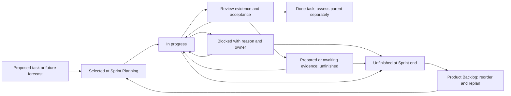

<!-- SPDX-License-Identifier: MIT -->
<!-- Part of PyBLE (https://pyble.dev) — see /LICENSE. -->

# Cycle 1 — Sprint Backlog execution and later forecasts

| Field | Rule |
|---|---|
| Status | C1-S1: six Done, two Prepared, four Awaiting evidence. C1-S2: ten engineering tasks Done, T11 Awaiting participant evidence. M-02 and app-only M-04 accepted 31 October; [PR #41](https://github.com/PyBLE-dev/PyBLE/pull/41) merged after all 36 checks on its final head passed. M-05 delivery remains pending. Original allowances/calendar remain historical |
| Product/Sprint Goals | [Framework](01_Overview_and_Scrum_Framework.md) and [Sprint plan](04_Sprint_Plan.md) |
| Acceptance authority | [Product backlog and stories](05_Product_Backlog_and_Stories.md); task completion never overrides a parent story's acceptance criteria |
| Selection | Developers confirm scope, ownership, estimates and task plan at each Sprint Planning |
| Hours | Initial task allowances totaling the source plan's 136 hours; not story points or validated effort estimates |
| Dependencies | Same-Sprint `Txx` references refer to that Sprint's task. Cross-Sprint dependencies name their full item/task ID |
| Evidence | Record artifact identity and actual results; use Prepared for reviewed partial work, Awaiting evidence for unperformed sessions/observations, and Blocked for a concrete impediment with an owner; unfinished work is never Done |
| Privacy | Keep private consent/contact/device records outside Git; link only reviewed public aggregates and redacted evidence |

Actual task evidence and blocker owners are maintained in the [C1-S1 execution record](c1-s1/00_Execution_Record.md). The original task allowances/calendar are retained as the baseline, with current S2 execution states updated below; the new 45–72h recovery estimate and matrix cost model invalidate their assumed fit. Use the [reforecast requirements](04_Sprint_Plan.md#c1-s1-findings-and-required-reforecast) before selection. Prepared TestFlight correction copy records residual PYB-002.1; its external application is not an extra committed task.

The initial tasks are small planning units, generally 1–4 hours. If a task or safe story is larger after inspection, split/reforecast before selection. A time allowance does not limit a required test's counts or justify declaring partial qualification complete. The actual Sprint Backlog includes its confirmed Goal, selected items, and the Developers' current plan; update this document as that plan changes.

Record optional follow-up consent and the prospective day-7–14 window at each activation. Collect follow-up as windows arrive, starting with the first cohort; do not postpone early cohorts until S5. S1 observation allowances include any follow-up due within S1; S2-T11, S3-T10 and later follow-up rows continue it. Developers must reallocate headroom or other selected work if actual pilot effort exceeds these allowances, preserving required recovery review and tests. Record missed windows as missing/late evidence rather than reconstructing an on-time response.

**31 October acceptance update:** scoped current-text recovery (PYB-006.2 / M-02) and the app-only M-04 candidate pass engineering review at `bef67bd`: 984 ordinary tests, 36 frozen-runtime CI checks, both-platform recovery/keyboard evidence and all ten declared app/profile rows. The [C1-S2 record](c1-s2/00_Execution_Record.md) preserves exact artifacts, firmware baselines, earlier-row impact assessments and the temporary Android qualifier battery-policy condition. Signed packages and the release packet are prepared; original device policy and normal board advertising are restored, and owned fixtures are cleaned. [PR #41](https://github.com/PyBLE-dev/PyBLE/pull/41) merged after all 36 checks on its final head passed. Apple accepted the upload and started processing ([receipt](c1-s2/06_Release_Readiness.md#31-october-app-store-connect-upload-receipt)); actual M-05 store delivery remains pending. S1 remains six Done / two Prepared / four Awaiting evidence; S2 has ten engineering tasks Done and participant follow-up unfinished. Original dates/hours remain the baseline; the [continuation plan](04_Sprint_Plan.md#31-october-continuation-order-and-reforecast) records the next work and unresolved human capacity.

## C1-S1 — reproduce the current workflow and size recovery

| Sprint control | Value |
|---|---|
| Dates / allowance | 28 September–11 October 2026 / 22 planned hours |
| Proposed Goal | Make current installation and one primary-cohort task reproducible; identify a feasible safe draft-recovery increment |
| Usable output | Reviewed installation record/guidance and task/operator procedure; the recovery contract is a separately reviewed enabler |
| Before selecting | Named channel/device access and pilot owner; cohort/task choice; known A-24 gap can proceed independently of recruitment |
| Review | M-01/SG0 evidence, including honest unknowns and any recruitment blocker; unmet physical tasks remain unfinished |

| Task ID | Parent child item | Proposed task and expected output | Dependency | Contribution role | h | Status |
|---|---|---|---|---|---:|---|
| C1-S1-T01 | PYB-001.1 | Assemble the dated channel/install/provenance/qualification ledger from existing records; assign unresolved fields | Current source/publication records | Release | 1 | Done |
| C1-S1-T02 | PYB-001.2 | Verify eligible Android enrollment/current installation and record build/version, restrictions and available source mapping | T01; Play/device access | Release + QA | 2 | Done |
| C1-S1-T03 | PYB-001.2 | Verify current TestFlight installation and record its actual build and provenance limitations | T01; TestFlight/device access | Release + QA | 2 | Done |
| C1-S1-T04 | PYB-003.1 | Review harmless hardware/pilot boundaries, consent/retention rules, and manual support template | Recorded pilot setup; named pilot owner | Pilot + QA | 2 | Prepared — awaiting pilot setup |
| C1-S1-T05 | PYB-004.1 | Confirm primary cohort and Tasks A/B/C, assistance/timeout rules, previous workflow and prospective follow-up | T04; recorded app/setup | Pilot | 2 | Prepared — awaiting pilot setup |
| C1-S1-T06 | PYB-004.2 / PYB-011.2 | Observe the first baseline batch; record every eligible start, assistance, consent/window and any due follow-up | T05; consenting participants | Pilot | 2 | Awaiting participant sessions |
| C1-S1-T07 | PYB-004.2 / PYB-011.2 | Observe the next baseline batch under the same task/build rules; record windows and collect due follow-up | T05; consenting participants | Pilot | 2 | Awaiting participant sessions |
| C1-S1-T08 | PYB-004.2 / PYB-011.2 | Complete planned observation/follow-up slots toward five baseline starts; retain failures, missing responses and recruitment gaps | T05; participant access | Pilot | 2 | Awaiting participant sessions |
| C1-S1-T09 | PYB-004.2 | Summarize baseline outcomes and actual observation cost; identify an observed obstacle without inventing one | T06–T08 actual records | Pilot + Product Owner | 1 | Awaiting observation records |
| C1-S1-T10 | PYB-006.1 | Draft the bounded Drift recovery contract: write boundary, restore/discard, board association, failure handling and carried Blocks/A-24 scope | ADR-0010 and App contracts; no recruitment dependency | App | 3 | Done |
| C1-S1-T11 | PYB-006.1 | Review acceptance scenarios and size the safe increment including required tests; record approval or unresolved design questions | T10; review path | App + reviewer | 1 | Done |
| C1-S1-T12 | PYB-009.1 | Inventory existing suites, hardware/operators, applicable gates and matrix cost; draft the next operator recipe | T01 and current tools/specs | QA + firmware | 2 | Done |
| **C1-S1 total** | | | | | **22** | |

T02/T03 verified existing Play `0.2.0 (8)` and TestFlight `0.2.0 (6)` installations, origin and launch using the ledger checklist; no fresh enrollment, reinstall or upgrade was performed. Platform reports retain provenance and minimum-OS limitations. T04/T05 have completed source QA but still need the named pilot owner, cohort and tested reference setup.

Five baseline starts is a target, not the implied result of reserving six hours. If access or session duration prevents it, report the actual sample and replan. A completed findings record does not mark an unperformed installation or observation task Done. Missing store source mapping remains an owned limitation under the applicable gate.

## C1-S2 — deliver a bounded safe recovery increment

| Sprint control | Value |
|---|---|
| Dates / allowance | 12–25 October 2026 / 24 planned hours |
| Proposed Goal | Recover the smallest accepted current-text draft scope across process restart without unintended board actions |
| Usable output | Safe recovery increment only when the selected acceptance criteria and DoD pass |
| Before selecting | PYB-006.1 contract accepted and safe slice sized; data migration/dependencies and text/Blocks boundary agreed |
| Review | M-02 evidence and carried obligations; if the safe slice exceeds capacity, replan instead of dropping failure cases |

| Task ID | Parent child item | Proposed task and expected output | Dependency | Contribution role | h | Status |
|---|---|---|---|---|---:|---|
| C1-S2-T01 | PYB-009.1 | Complete the scoped restart/setup/operator recipe and expected evidence for this increment | 006.1 scope; initial 009.1 inventory | QA + App | 2 | Done — scoped recipe executed, corrected and reviewed; independent reproduction is optional 009.2 |
| C1-S2-T02 | PYB-006.2 | Add meaningful failing tests for the accepted write boundary, relaunch recovery and absence of implicit board/network actions | Approved 006.1; specification-first sequence | App | 2 | Done — meaningful red/green tests and integrated regression pass |
| C1-S2-T03 | PYB-006.2 | Add failing tests for interrupted/corrupt/full local storage and stale completions against newer edits | Approved 006.1 | App | 2 | Done — required fault/interruption/stale-work oracles pass |
| C1-S2-T04 | PYB-006.2 | Implement the minimal accepted durable storage/migration behavior until relevant tests pass | T02/T03 red evidence | App | 4 | Done — durable storage/schema and both native restart baselines accepted |
| C1-S2-T05 | PYB-006.2 | Implement hydration and specified recovery/discard behavior through existing providers | T04 and accepted UI contract | App | 4 | Done — startup choices and normal-app recovery accepted |
| C1-S2-T06 | PYB-006.2 | Complete non-destructive error handling, truthful scope and localized recovery guidance | T04/T05 | App | 2 | Done — guidance/error/localization and required scoped evidence accepted |
| C1-S2-T07 | PYB-006.2 | Run affected controller/widget/lifecycle regressions and repository gates; resolve scoped failures | T04–T06 | App + QA | 2 | Done — 984 ordinary tests and 36 frozen-runtime CI checks pass; PR #41 subsequently merged after all 36 final-head checks passed |
| C1-S2-T08 | PYB-008.1 | Run representative Android restart/interruption scenarios on the recorded candidate; retain actual results | T01/T07; device/candidate | QA | 2 | Done — Android recovery, final affected checks and declared Q rows accepted with OEM test condition |
| C1-S2-T09 | PYB-008.1 | Run representative iPad restart/interruption scenarios on the recorded candidate; retain actual results | T01/T07; device/candidate | QA | 2 | Done — iPad recovery, final palette regression and declared Q rows accepted |
| C1-S2-T10 | PYB-006.2 | Review integration/evidence and update user guidance plus carried A-24/Blocks limitations | T07–T09 and all applicable acceptance | App + reviewer | 1 | Done — scoped engineering review and device closeout; PR #41 subsequently merged after all 36 final-head checks passed |
| C1-S2-T11 | PYB-011.2 | Collect due consented follow-up and account for early windows, missing responses and task opportunity | 004 prospective method; actual activation dates | Pilot | 1 | Awaiting participant evidence — no activation dates supplied |
| **C1-S2 total** | | | | | **24** | |

These allowances do not assert that persistence fits 24 hours. Developers must confirm the estimate or change the forecast at Planning. Required corruption/recovery protections remain part of the usable slice. Representative runs cannot complete the whole five-profile release matrix.

The bounded recovery increment and its supporting engineering tasks are
accepted and device closeout is complete. T11 remains unfinished,
so the whole S2 Sprint is not Done. [The S2 record](c1-s2/00_Execution_Record.md) supplies current proof;
[the scoped recipe](c1-s2/01_Operator_Recipe.md) keeps physical steps and expected
oracles explicit. Missing participants are not technical test failures and have
not been replaced by maintainer or automated sessions.

## C1-S3 — establish reproducible evidence and useful tasks

| Sprint control | Value |
|---|---|
| Dates / allowance | 26 October–8 November 2026 / 24 planned hours |
| Proposed Goal | Make selected recovery behavior reproducibly testable and observe useful second tasks |
| Usable output | Candidate-specific operator records, task findings and any increment meeting its full DoD |
| Before selecting | Record available artifact(s), operator/device access, applicable matrix and per-batch cost |
| Review | Actual matrix coverage and gaps; Task C outcomes; optional Ready rehearsal only if explicitly funded |

| Task ID | Parent child item | Proposed task and expected output | Dependency | Contribution role | h | Status |
|---|---|---|---|---|---:|---|
| C1-S3-T01 | PYB-008.1 | Bind candidate/build/provenance and safe setup to the selected qualification plan | 001; 009.1; candidate available | QA + release | 2 | Covered by 31 October continuation for the accepted candidate; original allowance retained |
| C1-S3-T02 | PYB-008.2 | Execute the first costed batch of required profile/platform scenarios; retain results and defects | T01; exact devices; agreed batch | QA + firmware | 4 | Covered by accepted app-only matrix; no duplicate execution or hours claimed |
| C1-S3-T03 | PYB-008.2 | Execute the next costed batch; preserve every required unrun row explicitly | T01; exact devices; agreed batch | QA + firmware | 4 | Covered by accepted app-only matrix; no duplicate execution or hours claimed |
| C1-S3-T04 | PYB-008.2 | Execute the next risk-prioritized batch or affected rerun; record immutable evidence | T01; previous findings | QA + firmware | 4 | Affected reruns completed in continuation; new source changes require new impact review |
| C1-S3-T05 | PYB-011.1 | Observe a scheduled primary-cohort activation/Task C batch on a recorded tested setup | 003/004; participant access | Pilot | 2 | Proposed |
| C1-S3-T06 | PYB-011.1 | Observe the next useful-task batch and reasons to choose another workflow or return | 003/004; participant access | Pilot | 2 | Proposed |
| C1-S3-T07 | PYB-011.1 | Analyze task outcomes, assistance and comparable cohorts; reconcile activation records | T05/T06; existing observations | Pilot | 1 | Proposed |
| C1-S3-T08 | PYB-009.1 | Correct operator instructions and evidence index from actual execution | T02–T04 findings | QA | 2 | Covered by executed/reviewed recipe and evidence reconciliation |
| C1-S3-T09 | PYB-008.2 | Review matrix states, blockers and remaining cost; determine which bounded claims are supported | T02–T04/T08 | QA + reviewer | 2 | Covered by scoped 31 October engineering review; limitations retained |
| C1-S3-T10 | PYB-011.2 | Collect rolling follow-up in each due window and account for missing responses/opportunity | Consented activation records; prospective method | Pilot | 1 | Proposed |
| **C1-S3 total** | | | | | **24** | |

The original batch allowances above are not additional work or measured hours
for the already-accepted candidate. At future Planning, map any newly required
batch to exact rows among `esp32-4mb`, `esp32-s3-n16r8`, `waveshare-esp32-s3-lcd-147b`, `esp32-c3-4mb`, and `rpi-pico2-w`, on iPadOS and Android as required. The twelve-hour execution allowance is not a prediction that all ten combinations and every normative repetition fit. Completing a batch is not completing PYB-008.2 while required rows remain unrun or failing.

## C1-S4 — improve the observed task and mature the cohort

| Sprint control | Value |
|---|---|
| Dates / allowance | 9–22 November 2026 / 22 planned hours |
| Proposed Goal | Understand and address the highest-impact observed task obstacle while establishing interpretable follow-up |
| Usable output | A qualified bounded fix if justified, or reviewed useful-task findings and improved current-workflow guidance |
| Before selecting | Comparable cohort rules; real observed problem before selecting 012.1/005.1; actual recruitment cost from earlier observations |
| Review | M-03/SG2; at least 12 started-task target and progress toward 20 activated consenting participants by 22 November |

| Task ID | Parent child item | Proposed task and expected output | Dependency | Contribution role | h | Status |
|---|---|---|---|---|---:|---|
| C1-S4-T01 | PYB-011.1 | Reconcile eligibility/build/task cohorts and remaining observation slots | 004; earlier 011 records | Pilot | 1 | Proposed |
| C1-S4-T02 | PYB-011.1 | Observe the next scheduled activation/useful-task batch, including failures | T01; consenting participants | Pilot | 3 | Proposed |
| C1-S4-T03 | PYB-011.1 | Observe a further batch within agreed capacity; record unfilled recruitment needs | T01; consenting participants | Pilot | 3 | Proposed |
| C1-S4-T04 | PYB-011.2 | Collect due follow-up, reconcile consent/windows and account for missing responses and task opportunity | Activated participants; approved method | Pilot | 2 | Proposed |
| C1-S4-T05 | PYB-011.1 | Calculate completion/timing and summarize Task C reasons, assistance and severe failures | T02/T03 and comparable prior records | Pilot + QA | 3 | Proposed |
| C1-S4-T06 | PYB-012.1 | If warranted, select and specify the highest-impact bounded failure and required evidence | Sufficient 004/011 evidence | Maintainer | 2 | Proposed |
| C1-S4-T07 | PYB-012.1 | Add a failing regression for the selected failure | T06 accepted contract | App or firmware | 2 | Proposed |
| C1-S4-T08 | PYB-012.1 | Implement the minimum safe fix and run affected tests | T07 red evidence | App or firmware | 4 | Proposed |
| C1-S4-T09 | PYB-012.1 | Review the fix, required physical/task evidence, and user guidance | T08; all applicable verification | QA + reviewer | 2 | Proposed |
| **C1-S4 total** | | | | | **22** | |

T06–T09 are a conditional ten-hour allocation, not an instruction to invent a defect. If no justified fix fits, Developers and the Product Owner reallocate it to useful observation, required qualification or unselected backlog work consistent with the Goal; retain the revised estimate. Severe defects can be selected in earlier Sprints without waiting for this slot. Reforecast recruitment effort from actual session durations; the sample targets are not guaranteed by these allowances.

An analysis task can finish with fewer than 12 starts, but PYB-011.1 remains unfinished until its minimum collection criterion is met or its scope is prospectively revised. With at least 12 starts, a reviewed negative finding can complete the research item while leaving SG2 unmet. Fewer than 20 mature eligible follow-up participants makes the retention assessment inconclusive; it does not create completed observations.

## C1-S5 — decide whether the candidate is releasable

| Sprint control | Value |
|---|---|
| Dates / allowance | 23 November–6 December 2026 / 24 planned hours |
| Proposed Goal | Reach an evidence-backed release decision and account for mature follow-up windows |
| Usable output | Admitted candidate if gates pass; otherwise a truthful blocker/evidence package with recovery guidance |
| Before selecting | Immutable candidate and included scope; actual remaining qualification cost; authorized distribution owner/access |
| Review | M-04/SG1; submission is separate from availability; late day-14 windows can be finalized in C1-S6 |

| Task ID | Parent child item | Proposed task and expected output | Dependency | Contribution role | h | Status |
|---|---|---|---|---|---:|---|
| C1-S5-T01 | PYB-013.1 | Freeze candidate identity/included changes and map applicable release requirements | Selected source/increment; 001/009 evidence | Release + QA | 2 | Covered by frozen candidate and prepared release record |
| C1-S5-T02 | PYB-008.2 | Execute a costed remaining required matrix batch or invalidated-evidence rerun | T01; exact devices | QA + firmware | 4 | Current candidate rows covered; rerun only invalidated or newly selected scope |
| C1-S5-T03 | PYB-008.2 | Execute the next required batch and retain outstanding rows honestly | T01; exact devices | QA + firmware | 4 | Current candidate rows covered; rerun only invalidated or newly selected scope |
| C1-S5-T04 | PYB-008.2 | Complete applicable cross-version/affected regressions and review unresolved defects | T01; named baselines; prior findings | QA + App/firmware | 3 | Covered by declared-baseline and affected-regression review |
| C1-S5-T05 | PYB-013.1 | Assemble immutable evidence index, limitations and accurate release notes | T02–T04 actual results; prior accepted evidence | Release | 3 | Prepared — exact artifacts, evidence index, limitations and release notes retained |
| C1-S5-T06 | PYB-013.1 | Review release admission and record sign-off or blocking conditions | T05/T09; all mandatory gates | Release + reviewer | 2 | Covered by scoped engineering admission and closeout; PR #41 subsequently merged after all 36 final-head checks passed |
| C1-S5-T07 | PYB-014.1 | If admitted and authorized, submit exact artifact to selected existing channel and retain receipt/state | T06 pass; owner access/authorization | Release | 2 | Pending — store-account/build-number verification and actual submission receipt |
| C1-S5-T08 | PYB-011.2 | Collect follow-up in due windows and account for closed windows; label immature windows and missing responses | Consented activation records; agreed method | Pilot | 2 | Proposed |
| C1-S5-T09 | PYB-013.1 | Verify update/recovery instructions against selected artifacts and accepted scope | T01; current operator/distribution guide | Release + QA | 2 | Prepared for admitted scope; actual store-upgrade observations remain 014.2 |
| **C1-S5 total** | | | | | **24** | |

The required matrix may cost more than these batches. Use the S1/Planning estimate to revise the forecast before committing; a Sprint end never shortens normative tests. If release admission is blocked, T07 is not Done and submission does not proceed. Participants activated on 22 November mature on 6 December, after the proposed Friday Review; finalize that accounting in C1-S6 without inventing early results.

## C1-S6 — verify delivery and choose one next investment

| Sprint control | Value |
|---|---|
| Dates / allowance | 7–20 December 2026 / 20 planned hours |
| Proposed Goal | Verify actual distribution and use meaningful-repeat/support evidence to choose one next investment |
| Usable output | Accurate delivery/support record and evidence-based next Product Backlog order; blocked external outcomes stay visible |
| Before selecting | Actual store state, mature consented records, candidate evidence, and current support observations |
| Review | M-05/M-06; SG3 assessment is contextual and independent of maintenance-release admission |

| Task ID | Parent child item | Proposed task and expected output | Dependency | Contribution role | h | Status |
|---|---|---|---|---|---:|---|
| C1-S6-T01 | PYB-014.1 | Verify submission/processing/availability state and remaining distribution actions | 013 admission; submission/access as applicable | Release | 2 | Pending — account/build-number checks and actual submission/processing evidence |
| C1-S6-T02 | PYB-014.2 | If Android is selected, verify eligible installation of its qualified candidate, installed build and applicable smoke behavior | Actual selected-candidate Android availability | Release + QA | 2 | Proposed |
| C1-S6-T03 | PYB-014.2 | If iPad is selected, verify eligible installation of its qualified candidate, installed build/provenance and applicable smoke behavior | Actual selected-candidate TestFlight availability | Release + QA | 2 | Proposed |
| C1-S6-T04 | PYB-014.2 | Reconcile user-facing installation/update/support guidance with actual channel outcomes | T01 and selected-channel T02/T03 results | Release + Docs | 2 | Proposed |
| C1-S6-T05 | PYB-011.2 | Complete scheduled optional follow-up and closed-window accounting | Consented activation records | Pilot | 2 | Proposed |
| C1-S6-T06 | PYB-011.2 | Analyze full mature denominator, useful returns, prompting, opportunity and missing data | T05 and earlier observations | Pilot | 3 | Proposed |
| C1-S6-T07 | PYB-011.2 | Summarize task/support effort and reasons to choose or leave PyBLE | Observations and support records | Pilot + Developers | 2 | Proposed |
| C1-S6-T08 | Cycle decision — strategy §19 | Prepare the evidence-based next-investment recommendation and proposed backlog order for Review | T06/T07; milestone states | Product Owner + Developers | 3 | Proposed |
| C1-S6-T09 | PYB-009.1 | Close the operator/evidence index with current limits and any explicitly funded Ready rehearsal status | Actual 008/009 records | QA | 2 | Current engineering index reconciled; later channel/reproduction results remain to add |
| **C1-S6 total** | | | | | **20** | |

T08 prepares a product decision; the Sprint Review/Retrospective meetings remain within the event reserve. A closed observation record may report an inconclusive target. A blocked app installation is not a completed installation, even when its blocker is documented.

Declare release channel/platform scope at Planning. Reallocate any unselected T02/T03 allowance explicitly; an unchanged or unselected channel does not block M-05. Existing availability of an older binary is not evidence that the selected candidate is available.

## Optional selection and spare capacity

These options are not extra committed tasks. Use only the stated headroom, a reallocation approved through normal Sprint planning, or separately confirmed contributor capacity. Do not assume a second operator's time is free or included in the primary maintainer's estimate.

| Option | Earliest candidate window | Selection condition | Capacity / evidence boundary |
|---|---|---|---|
| PYB-005.1 observed onboarding repair | Any Sprint after sufficient observation | Real bounded blocker and accepted contract | Size it; use up to the available headroom or replace another selected item |
| PYB-009.2 existing-profile rehearsal | C1-S3 onward, or earlier if ready | Published recipe, second operator, exact hardware and explicit estimate | C1-S3 has only 2 unallocated planned hours; larger work needs replanning/confirmed added capacity; pending reproduction awards no badge |
| PYB-007.1 previewable diagnostics | After privacy/export contract is accepted | Evidence that manual support records are insufficient | Manual template remains the base plan; no automatic upload |
| PYB-010.1 reviewed localization | After current guide and reviewer are available | Actual language need and named reviewer | Separate estimate; no dependency on an unneeded onboarding fix |
| PYB-015.1 release kit | Once corresponding claims have evidence | Qualified/verified facts; actual preparation need | Creation does not authorize outreach or claim publication |
| PYB-016.1 research design or PYB-017.1 protocol design | Only explicitly assigned spare/contributor capacity | Relevant question/problem and responsible owner | No implementation, study result or new opcode by planning alone |

| Capacity reconciliation | Hours |
|---|---:|
| Base task rows across C1-S1–C1-S6 | 136 |
| Unassigned planned headroom across Sprints | 20 |
| Event/support/additional-qualification reserve | 84 |
| Gross assumed cycle capacity | 240 |

## Execution states and unfinished work

| During execution, add | Purpose |
|---|---|
| Named assignee and current estimate | Replace role placeholders with real responsibility and feasible effort |
| Actual/remaining effort | Adapt capacity without inventing historical velocity |
| Evidence link and result | Distinguish task completion, story acceptance, usable Increment and milestone outcome |
| Blocker, owner and next check | Keep access, recruitment, hardware and external review constraints actionable |
| Dated scope adjustment | Preserve why work changed; keep acceptance in file 05 synchronized |
| End-of-Sprint outcome | Retain unfinished items and replan them; do not automatically count or carry them as Done |
