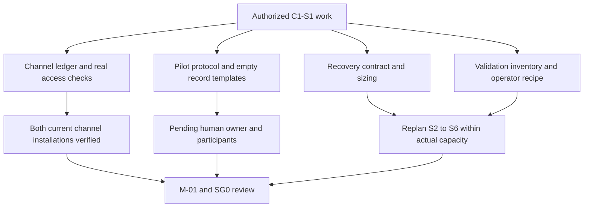

<!-- SPDX-License-Identifier: MIT -->
<!-- Part of PyBLE (https://pyble.dev) — see /LICENSE. -->

# C1-S1 — execution and evidence record

| Field | Record |
|---|---|
| Execution date | 25 September 2026, Asia/Bangkok; early work under the user's request to implement C1-S1 |
| Original proposed timebox | 28 September–11 October 2026; retained as a forecast, not a claim that a Sprint ceremony or staffed team occurred |
| Source baseline | Runtime/source `23ed764b0ef88dce9720c66fbd1c0655268860cf`; strategy/Scrum baseline `d039db09779ed45124874721f88b2e0931664743`; device retry starts from integrated documentation commit `7077276` |
| Scope | Installation evidence, pilot preparation, bounded recovery design/sizing and validation inventory; no S2 persistence implementation |
| Overall state | Six tasks Done, two Prepared, four Awaiting evidence; both existing channel installations verified. Pilot setup/observations remain unfinished; C1-S1 and M-01/SG0 are not complete |
| Execution/review | Codex implemented and reviewed repository work across isolated Git worktrees; human pilot ownership, consent and participant observations are not supplied by that review |
| Capacity | Original C1-S1 allowance remains 22 hours; these are planning allowances, not measured human effort or actual velocity |

## Deliverables and task outcomes

| Task | Parent | Outcome | Evidence / remaining action |
|---|---|---|---|
| C1-S1-T01 | PYB-001.1 | Done — reviewed ledger and owned unknowns | [Channel/artifact ledger](01_Channel_and_Artifact_Ledger.md); direct HTTPS checks; separate listing/install/provenance/qualification states |
| C1-S1-T02 | PYB-001.2 | Done — existing Play installation verified | [Android report](06_Android_Channel_Verification.md): Lenovo TB-J616X / Android 12, `0.2.0 (8)`, Play installer and beta membership, Open/launch/About; 38/38 payloads match retained build-8 AAB |
| C1-S1-T03 | PYB-001.2 | Done — existing TestFlight installation verified | [iPad report](07_iPad_Channel_Verification.md): `iPad16,10` / iPadOS 26.6.2, installed and offered `0.2.0 (6)`, TestFlight signer and successful launch; source mapping remains unknown |
| C1-S1-T04 | PYB-003.1 | Prepared — technical review complete; human collection decision absent | [Pilot protocol and templates](02_Pilot_Protocol_and_Observation_Kit.md); name the pilot owner and record bounded setup/consent approval before collecting participant data |
| C1-S1-T05 | PYB-004.1 | Prepared — task cards technically reviewed; cohort/setup unconfirmed | Same kit defines Tasks A/B/C, prospective metrics and follow-up; reachable cohort, owner and exact tested setup remain unconfirmed |
| C1-S1-T06 | PYB-004.2 / PYB-011.2 | Awaiting participant sessions | Empty private templates are ready; no consent, start, success or follow-up is invented |
| C1-S1-T07 | PYB-004.2 / PYB-011.2 | Awaiting participant sessions | Recruitment/observation owner needed |
| C1-S1-T08 | PYB-004.2 / PYB-011.2 | Awaiting participant sessions | Five baseline starts remain outstanding; no substitution by maintainer or automated tests |
| C1-S1-T09 | PYB-004.2 | Awaiting observation records | Baseline sample is absent; completion, timing, retention and observed user-friction measures are unavailable, not zero-valued performance results |
| C1-S1-T10 | PYB-006.1 | Done — bounded implementation contract specified | [Normative recovery contract](../../../specifications/App/current-draft-recovery.md), ADR-0048, App specification/TDD and ADR-0010 addendum |
| C1-S1-T11 | PYB-006.1 | Done — source review, scenario matrix and sizing | [Recovery design review](03_Recovery_Design_and_Sizing.md); S2 forecast requires replanning; no implementation or physical acceptance claimed |
| C1-S1-T12 | PYB-009.1 | Done — tool/gate inventory, explicit access gaps and costed recipe | [Validation inventory](04_Validation_Inventory_and_Operator_Recipe.md); host harness checks are separate from physical execution and full recipe reproduction |

Task completion is narrower than parent completion: PYB-009.1 still carries the S2 recipe completion and later operator updates; PYB-001.2 is complete for the verified existing-installation path, while PYB-003.1 and PYB-004 remain unfinished. No fresh enrollment, reinstall or upgrade was performed. Specifying recovery does not implement PYB-006.2 or complete A-24. Current tablet access is resolved; exact-board, operator and recruitment limitations remain visible. Prepared and Awaiting evidence are unfinished states, not additional Done tasks.

## Findings that change planning

| Finding | Decision / effect |
|---|---|
| Live website is corrected, but the search tool returns older text | Retain the Android correction; do not reopen it from cached snippets. Direct live-response evidence is in the ledger |
| Both supplied tablets are accessible and their channel installations launch | T02/T03 complete from direct current-installation evidence; keep the initial failed discovery as dated history |
| Delivered minimum-OS metadata differs from historical artifacts/notes | Android min SDK 29 versus AAB 24; iPad minimum OS 18 versus TestFlight notes 15. Distribution owner reconciles variant/archive/store eligibility before broader OS-support claims |
| Public TestFlight description still uses an older compatibility baseline | Record residual PYB-002.1 and a [ready-to-review correction packet](05_TestFlight_Metadata_Correction.md); store mutation/public verification remain pending |
| Current text is volatile and recovery is behind a connected-only shell | Specify a local startup choice and truthful durable-write boundary; current app behavior remains unchanged |
| Document value equality and stable connection facades need stronger stale-operation guards | Include revision/session guards and regressions in the recovery slice; no happy-path-only completion |
| Sized recovery work exceeds S2's allowance | Working estimate 45–72 hours including recipe, representative physical checks and follow-up; original S2–S6 selections must be replanned before commitment |
| Full firmware qualification costs are not represented by a few short batches | Use the validation inventory's normative counts and cost model; distinguish an app-only change's affected matrix from a new firmware release |
| No measured pilot data or named owner | Preserve the primary-maker cohort as provisional; SG0 is blocked, usability/retention results remain unavailable |

## Proposed next allocation — not an extra commitment

The original 136-hour task allocation, 20-hour planned headroom and 84-hour reserve remain an auditable baseline. They do not prove that newly sized work fits. The [design sizing](03_Recovery_Design_and_Sizing.md) proposes a 60-hour working allocation across S2–S4 as one option within existing ceilings; it displaces planned matrix and observation work and must be selected with actual owners, estimates and access.

| Next decision | Required input | Consequence |
|---|---|---|
| Confirm S2 scope and capacity | Recovery design's 38–63 engineering hours, applicable tests, dependency review and actual Developer availability | Select coherent implementation work and an honest completion forecast; do not promise recovery Done in S2 from the old allowance |
| Reorder S3/S4 | Revised engineering needs, device/operator availability, pilot owner and observation costs | Move or reduce optional work; explicitly reforecast displaced qualification and recruitment |
| Preserve pilot interpretation | Prospective cohort/task rules and rolling windows | If 20 consenting activations cannot occur by 22 November, retain the original target and report a later window/inconclusive result honestly |
| Admit any maintenance release | All requirements for the declared candidate and compatibility scope pass | Release need not wait for SG2/SG3 or Ready; missing mandatory evidence cannot be waived to meet a date |

## Review and continuation

| Review item | Record |
|---|---|
| M-01 / SG0 | Unfinished: human pilot owner/cohort/setup and actual capacity still need confirmation; current installed-device evidence is complete |
| M-02 | Implementation pending; contract and scenario matrix prepared, not a shipped persistence feature |
| M-03 / SG2 and M-06 / SG3 | Not assessed; no participant outcomes or mature follow-up cohort |
| M-04 / M-05 | No new release candidate or submission; current existing installations verified under PYB-001.2, not a future qualified candidate under PYB-014.2 |
| Ready | No second-operator reproduction or badge awarded |
| Worktree method | Recovery design, pilot preparation and qualification inventory used separate worktrees; the retry also isolates Android, iPad, planning updates and integration before review |
| Required next human actions | Name the pilot owner and consenting cohort, confirm exact reference board/setup and perform its smoke check; collect five actual baseline starts and analyze records; confirm actual capacity before selecting the revised next Sprint |

## 31 October handoff to bounded implementation

The user requested the next-release implementation after the C1-S1 integration
and cleanup. The [C1-S2 record](../c1-s2/00_Execution_Record.md) now records scoped
PYB-006.2 / M-02 and app-only M-04 engineering acceptance, including both-tablet
physical evidence; it tracks final integration and pending channel delivery. The
25 September findings above remain historical evidence. This handoff does not
complete the two Prepared or four Awaiting-evidence S1 tasks, M-01/SG0, full A-24,
participant observations, a Ready badge or store delivery.

## Initial integrated verification — before the device retry

| Check | Actual result / scope |
|---|---|
| Source/design peer review | Recovery contract reviewed against actual controllers; a missing Board Open session guard was corrected in the contract and DR-T11 before integration |
| Focused firmware host harness checks | 110 passed, as recorded in the validation inventory; host fixtures only |
| Publication regression suite | `python3 -m unittest discover -s tests/publication -p 'test_*.py'`: 42 passed in the integrated worktree |
| Markdown links and anchors | 135 tracked/new Markdown files checked, including this execution package; all local targets resolve |
| Mermaid | All 12 diagrams in the Scrum/execution package and recovery contract parsed and rendered to temporary SVGs; rendered artifacts not committed |
| Structure and traceability | Tables/fences/whitespace, 24 child IDs, 60 unique task IDs, original 136h allocation, and four Done/eight Blocked C1-S1 states checked |
| Repository gates | No-leak, SPDX, governance 7/7 and `git diff --check` pass |
| Not executed | Full Flutter/firmware suites, candidate builds, device installations, board/HIL runs, participant sessions, store metadata mutation and external publication |

The table above records the initial integration at `7077276`, before the user supplied accessible tablets. Its device limitations and four/eight status count are historical; the current outcomes are in the task table and retry record below.

## Device retry — 25 September 2026

| Check | Actual result / scope |
|---|---|
| Android channel | Existing Play beta installation `0.2.0 (8)` verified; Open launches PyBLE, About agrees, delivered package signatures verified and 38 code/asset payloads match the retained AAB |
| iPad channel | Existing TestFlight installation `0.2.0 (6)` verified by installed signer/beta entitlements and native offer; launch smoke passed before and after channel inspection |
| Initial access failures | Preserved with original capture hashes in the ledger; superseded by live successful device queries |
| Pilot kit source review | Task cards checked against localized UI, first-program tutorial and PBLE/1; Save/Run separation, bounded examples, STOP limitations and consent/follow-up rules retained |
| Current completion | Six Done / two Prepared / four Awaiting evidence; no task currently depends on the resolved tablet-access blockers |
| Independent document review | Separate reviewer checked central status tables, both platform reports, provenance/OS limits and historical access failures; no material findings. Integration review corrected one planning sentence to distinguish the observed TestFlight Open action from the separately executed app launch |
| Documentation validation | All local links/anchors across 137 tracked Markdown files resolve; tables/fences across 17 changed documents pass; 60 unique tasks, 24 detailed child IDs and the original 136h allocation retained |
| Mermaid | All 12 diagrams across the strategy, Scrum/execution package and recovery contract parsed and rendered; temporary SVGs removed |
| Applicable regression/gates | Publication suite 42 passed; governance 7/7, SPDX, no-leak and whitespace checks pass. Runtime/firmware code is unchanged; the earlier 110 host results above were not rerun for this documentation retry |
| Evidence limits | No fresh enrollment/reinstall/upgrade, BLE/board run, participant session, recovery implementation, store metadata update or new release qualification |

No runtime implementation changed in C1-S1. Required future recovery tests are specified, not claimed passed. No app source, firmware binary, store artifact, participant data or raw device identifiers are included in the documentation commits.

