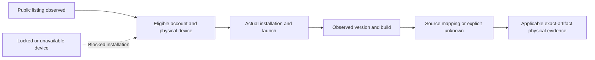

<!-- SPDX-License-Identifier: MIT -->
<!-- Part of PyBLE (https://pyble.dev) — see /LICENSE. -->

# C1-S1 — channel, installation, provenance and qualification ledger

| Field | Record |
|---|---|
| Observed | 25 September 2026; HTTP responses dated 10:03:21 UTC / 17:03:21 Asia/Bangkok |
| Source baseline | Runtime/source `23ed764b0ef88dce9720c66fbd1c0655268860cf`; planning baseline `d039db09779ed45124874721f88b2e0931664743` |
| Scope | C1-S1-T01/T02/T03; PYB-001.1/001.2; residual TestFlight metadata discrepancy PYB-002 |
| Evidence author | Codex, using direct HTTPS retrieval and local read-only device queries; no independent human installation attestation |
| Release action owner | Project maintainer Viwat Vchirawongkwin; routing responsibility, not a statement of committed availability |
| Physical outcome | Android installation not run; iPad app query blocked by lock state; neither platform's store-installed build is established |
| Related | [Execution record](00_Execution_Record.md), [pilot kit](02_Pilot_Protocol_and_Observation_Kit.md), [validation recipe](04_Validation_Inventory_and_Operator_Recipe.md) |

## Observed channel matrix

| Platform / item | Publication observation | Physical installation observation | Artifact provenance | Qualification boundary |
|---|---|---|---|---|
| Android / Google Play | Official English/US listing returned HTTP 200; names PyBLE, SciLabPro and open testing for 0.2.0 | `adb devices -l` returned no devices. No signed-in enrollment, install or launch was performed | Served version code, installed bytes and source mapping remain unverified | Listing availability and the historical build-8 test record do not qualify a currently installed binary |
| iPad / TestFlight | Public invitation returned HTTP 200 and identified the PyBLE beta; the page does not establish the currently served version/build | A paired physical `iPad16,10` was reported. Device details expose iPadOS `26.6.2` / `23G90`; app inventory failed because the device had not been unlocked recently | No installed version/build or store receipt was obtained; the historical build-5 handoff cannot fill these fields | Pairing/device metadata is not installation, launch, BLE or compatibility evidence |
| Live website `/app` | Direct HTTPS returned the corrected Android open-testing and iPad external-beta wording | Not applicable | Page response hash recorded below | Website wording is not a store rollout or physical test |
| Live website `/` | Direct HTTPS returned Android open-testing wording | Not applicable | Page response hash recorded below | Search/indexed extracts may still be stale |
| Firmware v0.6.1 | Existing 11 September publication record attests owner-confirmed publication of five exact profiles | No new board installation or run in this execution | Published source `c8f549eeabe6d2b8c2766eab022517944bb09c8c`; use the release descriptor and exact binary checksums for a physical session | Incomplete automated evidence remains incomplete; this ledger neither requalifies firmware nor awards PyBLE Ready |

Primary URLs: [Google Play](https://play.google.com/store/apps/details?id=dev.pyble.pyble&hl=en&gl=US), [TestFlight](https://testflight.apple.com/join/yU4e8s6d), [app installation page](https://pyble.dev/app), and [home page](https://pyble.dev/). The direct live website responses supersede the older invited-testing text returned by the search tool during the same inspection. No website source correction or deployment is needed for that stale extract.

The TestFlight page has a separate current discrepancy: its public description still limits the product to the older ESP-family/agent-0.4.0 baseline. The [metadata correction packet](05_TestFlight_Metadata_Correction.md) supplies replacement app-level copy and an owner verification checklist. Its preparation does not update App Store Connect or prove newer build compatibility.

## Historical artifact references — not inferred installations

| Artifact | Recorded identity | Source / original evidence | What remains unknown |
|---|---|---|---|
| Android prepared AAB | `0.2.0 (8)`; SHA-256 `ee2439589e2c2195ef4c861b524f871b0e5168e84fbea60a1cd379319c6eb5d7` | Source `768fafe45beee7731d1a38480cc0463a2f5680cd`; [10 September handoff](../../../testing/google-play/0.2.0-build-8.md) | Whether this bundle is the active open-test build; Google Play-delivered APKs may be split and re-signed, so AAB/APK digests are not interchangeable |
| Android prepared local APK | `0.2.0 (8)`; SHA-256 `3c98983a995c657f10a398d7b0f65a07c2d2af18e07c30e7d5dfc094eefcbdcf` | Same historical source and handoff | A locally signed APK does not prove the store installation path |
| iPad prepared IPA | `0.2.0 (5)`; SHA-256 `e2e44019aafd6b75f1d281a7cf4fb49d3ef7f326a4d604f2900ad249af70f2af` | Source `8f8dd32010fac9b2b636f57f9044fd040565e0dd`; [27 August handoff](../../../testing/testflight/0.2.0-build-5.md) | Processing, beta availability and the currently served build remain unverified; this historical artifact has its original iOS 13 floor |
| Firmware v0.6.1 descriptor | Historical SHA-256 `71f6aca6df07e31a1f54c7f70a48d82c7fe26b1c8ca0626a8ffc57c804fbb1bd` | [11 September publication](../../../testing/firmware-v0.6.1-publication-2026-09-11.md) | No new byte download/board validation is claimed here; bind actual session evidence to the selected release |

## Open fields and next actions

| ID | Missing evidence / blocker | Responsible action owner | Next action and review trigger |
|---|---|---|---|
| CH-01 | Physical Android device/account and eligible open-testing installation | Project maintainer / release operator | Connect an eligible device, follow the official listing, record restrictions and complete the checklist below; revisit when available |
| CH-02 | Physical iPad app inventory and current TestFlight installation | Project maintainer / iPad operator | Unlock the paired device, verify the TestFlight invitation and currently offered build, then record actual installation/update and launch; revisit after unlock |
| CH-03 | Installed build-to-source mapping on both platforms | Project maintainer / distribution owner | Match observed installed version/build to retained store build records and immutable source/artifact evidence; explicitly retain any unprovable field |
| CH-04 | TestFlight public description still states an older compatibility baseline | Project maintainer / App Store Connect owner | Review and apply the prepared metadata only with actual build support verified; record the public result and date |
| CH-05 | Current exact-board inventory, operator availability and candidate-bound physical results | Project maintainer / QA operator | Complete the [inventory](04_Validation_Inventory_and_Operator_Recipe.md); select exact artifacts and fund the required matrix before making a new compatibility claim |

Owners above identify the responsible project function and known maintainer contact. They do not assign an absent volunteer or claim a scheduled hardware session. The user has been asked for device access and a pilot owner; unanswered requests remain unresolved.

## Repeatable installation checklist

| Step | Android | iPad | Evidence to retain |
|---|---|---|---|
| 1 — Establish scope | Record device model/Android version and eligible country/account context without account identifiers | Record iPad model/iPadOS and availability of TestFlight | Date, platform, model, OS; private account details excluded |
| 2 — Follow the public channel | Open the official listing; follow its displayed testing/enrollment instructions | Open the public invitation in TestFlight; inspect the offered build and restrictions | Actual steps, enrollment/review restrictions, offered version/build where visible; HTTP 200 alone is insufficient |
| 3 — Install or update safely | Record existing-app/update state; do not uninstall or clear data merely to obtain a clean result | Record existing-app/update state; do not replace it with a locally signed build | Installation/update outcome, errors or blocker; preserve existing user work |
| 4 — Inspect the result | Launch the store-installed app; inspect About and package version/build | Launch the TestFlight-installed app; inspect About and TestFlight build identity | Observed installed identity, launch outcome, installation source and any unresolved field |
| 5 — Resolve provenance | Compare against the selected Play build record; distinguish upload and delivered signing roles | Compare against the selected App Store Connect build record | Immutable source/artifact mapping or explicit unknown; never derive it from source `pubspec.yaml` alone |
| 6 — Review | Review redacted evidence and accurate guidance | Review redacted evidence and accurate guidance | Successful installation satisfies only its scope; compatibility still needs applicable physical tests |

Read-only inspection commands, after device access is available:

```sh
adb devices -l
adb shell dumpsys package dev.pyble.pyble
xcrun devicectl device info apps --device '<paired-device>' \
  --include-default-apps --bundle-id dev.pyble.pyble
```

Keep full command outputs private because they may contain device identifiers, account-related information or paths. Publish only the selected fields above. A package inventory proves neither fresh enrollment nor a successful launch. No uninstall, clear-data, flashing, source-app installation or store submission is part of these inspection commands.

## Retained evidence and privacy

Raw responses/query files are retained in the main workspace's ignored `local/c1-s1/2026-09-25/`, outside Git. The device app query failed with CoreDevice error `10003` / RemotePairing error `1016`; its nested reason was that the device had not been unlocked recently. Device details may be cached, so the OS/model fields are reported as query output rather than proof of an active app session.

| Raw capture | SHA-256 | Meaning |
|---|---|---|
| `play.html` | `3aa2104a157b5380867ba03db97dba3e5285b2d6699006b9140474fb383f558f` | Public Google Play HTTP body |
| `testflight.html` | `78b9fb6bf3ff04ce12dfdf0e2a24ae694d0fda50cc1b8a468ae5d01c8277fdfb` | Public TestFlight invitation/description body |
| `website-app.html` | `533375076ea081da58700a1f61c1e2dc0db3795085107ec6a5e536cb2ecc6a25` | Corrected live installation page |
| `website-home.html` | `e40dd779caff6c026cd8add49946983516d9aea52f0340eec9d7efd45f2ada01` | Corrected live home page |
| `ipad-pyble-app.json` | `4677ab2fc532ec433fcd3fccde67d43e03b679f6ea23d80d3772a77232aaa474` | Failed read-only app query; no installed-build result |
| `ipad-details.json` | `737e1f0dcf2b618f891683db3a1d9c56adf01c5fc54a81abe06aa0b4d19adc00` | Device metadata query; raw personal identifiers withheld |

These hashes make the retained capture identifiable; dynamic public pages may return different bytes on a later request. They are not hashes of distributed app binaries.


