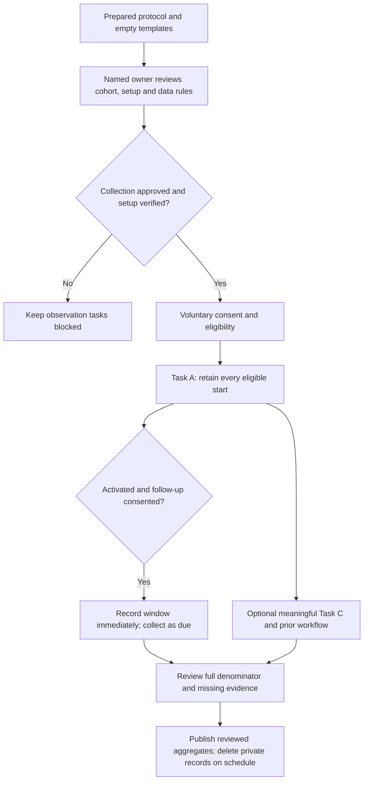

<!-- SPDX-License-Identifier: MIT -->
<!-- Part of PyBLE (https://pyble.dev) — see /LICENSE. -->

# C1-S1 — pilot protocol and observation kit

## 1. Control, evidence and collection decision

| Field | Prepared state, 25 September 2026 |
|---|---|
| Protocol | `C1-PILOT-1`; prospective procedure, not observed results |
| Scope | C1-S1-T04/T05 preparation; executable procedures and empty templates for T06–T09 and rolling PYB-011.2 follow-up |
| Acceptance | [PYB-003.1/004.1/004.2/011.2](../05_Product_Backlog_and_Stories.md), [Sprint Backlog](../06_Sprint_Backlogs.md), [strategy §§4 and 12](../../../planning/PyBLE_Implementation_Plan_and_Strategy_v1.0.md) |
| Inspected source | `d039db09779ed45124874721f88b2e0931664743`; source inspection does not identify the installed app |
| Primary cohort | Provisionally adult tablet-owning makers; human owner must confirm a reachable cohort before collection |
| Pilot decision-maker / recruitment owner / data custodian | TBD; no assignment, participant contact, consent, or approval inferred |
| Reference app and hardware | Must be bound to a dated installation record and the exact setup table below; no setup has been physically verified for this pilot |
| T04 / PYB-003.1 | Protocol/support template prepared for review; scoped human collection decision pending |
| T05 / PYB-004.1 | Tasks and measurement rules prepared for review; cohort, owner and reference setup confirmation pending |
| T06–T08 / PYB-004.2 | Blocked: collection decision, tested setup and consenting participants absent |
| T09 | Synthesis template prepared; actual baseline analysis blocked without observations |
| Results | Not collected. Success rate, timing, support cost and retention are unavailable; no trial, consent or physical result is claimed |

This kit is a manual, explicitly consented pilot procedure. It changes neither
the app's data handling nor the [public privacy policy source](../../../../tools/web/src/app/privacy/page.tsx)
and its [offline counterpart](../../../../app/lib/app/pages/privacy_policy_page.dart).
No analytics service, app export feature or automatic upload is added. The named
pilot owner must review the separate participant notice and deletion arrangements
below before collection. Recruitment and any required institutional review are
human responsibilities; this document makes no legal or ethics-approval claim.

Complete this decision record before asking anyone to participate. Preserve the
original protocol and record a new version before changing future sessions;
do not change eligibility, tasks or thresholds retrospectively to improve results.

| Required decision | Value to record before collection |
|---|---|
| Named accountable pilot owner and reviewer | — pending |
| One primary audience and recruitment source | — pending; confirm maker default or prospectively replace it, for example with instructors |
| Task purpose and previous workflow question | — pending; use §5 prompts without recording private project details |
| Exact reference setup and physical smoke evidence | — pending; complete §2 |
| Protocol version, permitted written guidance and language | — pending; freeze §4–§6 task cards and guidance revisions |
| Assistance, Task A 30-minute timeout and other task limits | — pending; approve prospective rules in §4 |
| Private storage, access, backup exclusions and deletion owner | — pending; verify §3 operationally |
| Participant notice, withdrawal contact and required review decision | — pending; attach reviewed notice privately, without asserting review that did not occur |
| Follow-up consent, contact route and window convention | — pending; freeze §7 before the first activation |
| Decision and date | — pending: approve this bounded collection / revise / defer; record actual decision-maker, not an automated signature |



## 2. Operator setup and harmless hardware boundary

Use a supervised trusted workbench, one powered pilot board and one tablet at a
time. Keep other pilot boards unpowered and other centrals disconnected. Record
unexpected advertisements, competing connections and mistaken selection as
observations; stop before a write when identity is uncertain. Isolate the station
or defer the session if another nearby device cannot be acceptably excluded.
Do not run a multi-user interference experiment inside the first-use task.

| Required reference field | Operator entry before a session |
|---|---|
| App identity | Platform/OS version, device model class, distribution channel, actual installed app version/build and dated evidence; source commit only when mapped |
| Exact board selection | Select one existing profile and its matching physical revision/memory configuration; candidate default `rpi-pico2-w` only if a verified Pico 2 W is available. A different verified profile needs a separately recorded setup, not a guessed substitute |
| Other eligible profiles | `esp32-4mb`, `esp32-s3-n16r8`, `waveshare-esp32-s3-lcd-147b`, `esp32-c3-4mb`; match the [setup tutorial source](../../../../tools/web/src/app/learn/setup/page.tsx), installer selection and physical markings |
| Firmware identity | Release, exact profile, asset/hash and source mapping if available; separately record observed agent/MicroPython versions and provenance gaps |
| Board identity check | Privately compare physical board and installer record with connected Board info before writes; retain only match/mismatch/missing in observation data, not device IDs or MAC addresses |
| Harmless configuration | No attached sensors, motors, pumps, heaters, actuators, external circuits or mains-powered loads; Tasks A/C use only finite console output and timing |
| Power and files | Accessible low-voltage board power disconnect; owner-approved disposable child folder with no valuable files; no changes to boot files or autorun |
| Tablet starting state | App installed but not yet launched for this participant's Task A; no pre-granted PyBLE permission or saved connection silently carried from a prior participant. Record any reused state as a separate cohort |
| Operator smoke check | On a separate preparation session, perform connect → board identity check → disposable file → Save to board → Run → Console; record actual date/result or remain blocked |
| Permission to reset preparation state | Owner agrees before clearing app storage/reinstalling or altering board files; never erase someone else's work to create a clean pilot state |

PBLE/1 trusts a connected client and has no authenticated ownership gate.
Bluetooth names, labels, connected status and displayed identity are selection
aids, not authorization. Pairing/encryption is not mandatory for access; no
participant secrets belong in the program. These limits follow [PBLE/1 §10](../../../specifications/protocol.md#10-security-note-v1).

**Stop is software program control, not an emergency stop.** A disconnect does
not itself stop a running program. Finite console-only tasks limit this pilot's
exposure; they do not validate safety for other hardware. If output or state is
unexpected, stop the task timer, mark the intervention and retain the failure.
Request **Stop**; if it fails, the operator may use **Soft-reboot**, which can
drop BLE, or disconnect board power for the harmless setup. Reconnect and
recheck identity before further writes. Do not promise a response deadline or
that Stop resets hardware state. Safety intervention always takes priority over
an unassisted score. A recovery demonstration is separate from the timed result.

## 3. Consent, private records and deletion

Explain this participant notice in the agreed language before collecting data:

> This optional session evaluates PyBLE's workflow, not your ability. You may
> decline a task or stop without giving a reason. We record the task outcome,
> elapsed time, help needed, broad setup details and a brief non-sensitive
> description of useful work. We do not record your screen, audio, source code,
> console contents, account information or board identifiers. Follow-up is a
> separate choice. Reports contain reviewed aggregates, not named testimonials.
> The pilot owner will explain where records are kept, when they are deleted,
> and how to withdraw identifiable records before they are aggregated.

Add the actual owner/contact, storage/access arrangement, deletion dates and
any applicable approved notice before use. Participants receive a copy. Do not
condition participation on a positive review, quote or public identity, and do
not use grades or favorable ratings as incentives. No incentive is approved by
this kit. Declining follow-up does not prevent the first session.

| Record | Minimum content and separation | Proposed retention, to approve before collection |
|---|---|---|
| Private consent register | Random session and withdrawal codes, notice/protocol version, initial consent choice/date, separate optional follow-up choice, and expiry; add a participant linkage code only with follow-up consent; no account credentials or source | Use the same deadline as private technical observations below |
| Private contact register | Only the participant's chosen follow-up contact and participant code; separate access-controlled file from technical observations; collect no contact for people declining follow-up | Delete contact and routing copies within 7 days after that person's day-14 window closes, or earlier on withdrawal |
| Private technical observations | Random session code; linked participant code only with follow-up consent; fields in §8; no direct identity or private project detail | Delete identifiable/pseudonymous observations and consent records within 30 days after the day-14 window closes, or within 30 days of the session without follow-up; earlier withdrawal handled below |
| Public findings | Reviewed aggregates, broad categories, methods and limitations; combine/suppress identifying small cells and remove identifying free text | May remain in Git indefinitely; disclose this before consent because a published unlinked aggregate cannot later be reliably attributed to one participant |
| Deletion audit | Deletion date, record class and count, custodian confirmation; no destroyed participant codes or contact data | Keep only the non-identifying audit with the aggregate review record |

The consent-register row uses the technical-observation deletion deadline. For
the proposed cycle, private records also have an absolute deletion ceiling of
**19 January 2027**, even if the rolling deadline would be later. A later cohort
requires a prospectively reviewed protocol and notice, not a silent extension.
Before rolling deletion, reconcile the person's mature outcome into reviewed
aggregate counts so the final full denominator includes early cohorts. Preserve
only aggregate counts after deletion; do not recreate participant links later.

Store populated records outside Git and outside the public website, on a named
access-controlled encrypted location. Do not attach them to issues or PRs. An
ignored folder alone is not privacy protection. The custodian must verify
whether sync, exports, trash and backups create copies and choose a storage
arrangement in which the approved deletion schedule can actually be met; if
that cannot be established, collection remains blocked. Do not promise deletion
of copies beyond the custodian's control. Share only the minimum reviewed data
with the named reviewer.

On a withdrawal request, stop further contact immediately. Using the private
withdrawal code, remove linkable records and controlled copies within 7 days;
recompute unpublished aggregates when possible. Record a non-identifying
withdrawal count and the resulting analysis limitation. A revoked consent cannot
be overridden to preserve a denominator. Already published unlinked aggregates
remain as disclosed. Ordinary missing follow-up and no task opportunity remain
in the denominator; they are not withdrawals.

The blank tables here may be copied to the approved private store. Never fill
the repository copy with participant or contact records.

## 4. Eligibility, assistance and timing rules

| Prospective rule | Required treatment |
|---|---|
| Provisional primary eligibility | Adult (self-declared 18+; do not collect birth date), non-maintainer, owns/regularly uses a tablet, identifies a plausible board-work task, voluntarily consents; no minimum coding experience |
| Reachable cohort | Confirm recruitment source and owner; instructors or another audience replace the default only before their cohort starts. Report different audiences separately |
| Pre-task exclusions | Record broad reason/count only: declined consent, out-of-cohort, inaccessible eligible equipment, setup not verified. No task timer started; do not collect identity for screening failures |
| Primary unit | One first eligible Task A start per participant on the frozen task/build/setup; retain retries inside that same started outcome. Later coached retries are supplementary, not new successful participants |
| Clock start / finish | Start at first app launch after installation; finish when participant sees the exact expected first-program output after explicit Run. Installation has its own interval. Use monotonic elapsed timing; do not subtract in-task permissions, waiting, errors or support |
| Task A limit | 30 minutes from launch; stop at the limit and mark timeout. A participant may stop earlier; preserve elapsed time and abandonment/failure reason. Do not remove those starts from the denominator |
| Permitted written guidance | Fixed Task A card below plus pinned/reviewed setup and first-program instructions in the agreed language, available to every participant. Record the exact revision; do not silently add hints mid-cohort |
| Assistance | Any task-specific live hint, pointing, permission help, editing, operator action or safety intervention after the clock starts is assistance; record count/type/time. Re-reading the written prompt verbatim without a hint can be logged as procedural clarification |
| Outcome classification | Unassisted success / assisted success / failed / abandoned / timeout / safety-stopped. A successful assisted retry remains assisted. Record the first obstacle and all important interventions |
| External disruption | Record and retain interrupted starts with reason; any supplementary analysis excluding a clearly external interruption must show both the original full denominator and the exclusion rule |
| Task C / B limits | Proposed 15 minutes for C and 60 minutes for B, with actual stop/abandonment retained; owner may change limits prospectively before either cohort begins |
| Comparable cohorts | Same task/guidance/version, eligibility and starting state. Stratify platform/profile and experience; do not pool changed builds/tasks as if unchanged. Baseline five can contribute to twelve only when comparable |

## 5. Participant task cards

### Task A — first run with a provisioned board

The operator supplies the safe, correctly provisioned board and an installed
app. Installation and any assistance before first launch are recorded separately;
the participant handles permissions, discovery, connection, file transfer and
execution. Supply the disposable folder's non-identifying name on the card.

1. Launch PyBLE. Allow the permissions described by the written setup guide,
   scan and connect to the station's board. Compare the physical/installer
   record with Board info. If it is missing or inconsistent, stop and report it.
2. In **Files**, enter the supplied disposable child folder. Choose **New file**,
   name it `hello.py`, and enter the one line below in **Editor**. If the path
   already exists, stop rather than overwrite it; the operator records the setup
   failure and any intervention.
3. Review the code and destination. Choose **Save to board** (called Save in
   the tutorial), wait for completion, then choose **Run** explicitly.
4. Open **Console** and report when the expected line appears. The timer ends
   here; optional editing/recovery practice is recorded separately.

```python
print("Hello from PyBLE!")
```

Success means the participant sees `Hello from PyBLE!` once after their explicit
Run on the intended board. Saving or creating a file alone is insufficient.
The task reuses the [first-program tutorial source](../../../../tools/web/src/app/learn/first-program/page.tsx).
The current [UI labels](../../../../app/lib/localization/arb/app_en.arb) and
[working-loop contract](../../../specifications/App/specs.md) distinguish
Save to board from Run. The current in-memory editor draft does not survive
process termination reliably; do not ask participants to test destructive
restart recovery or present PYB-006 as implemented.

### Task B — separate full self-service setup

Task B is optional and separately recruited/reported. Begin from the actual
channel invitation/listing and an unprovisioned, exactly identified board;
measure from opening those instructions through the first successful mobile
program. A participant who already completed A is a trained Task B participant,
not an independent first-use setup observation.

| Step | Participant action / stop condition |
|---|---|
| Installation | Follow the current recorded Play/TestFlight path; record availability, eligibility or installation failure without collecting account details |
| Equipment | Find the exact profile, compatible computer/browser and data cable; record missing equipment and search/support time |
| Backup decision | Board owner identifies valuable files, makes and verifies a backup when needed, and explicitly authorizes erase/write for this board. Record yes/no and broad outcome, never file content. No authorization or unverified backup means stop before flashing |
| Provisioning | Follow the current profile-specific setup/installer instructions; no guessed image or scripted erase in this kit. Pico 2 W uses its exact UF2/BOOTSEL method; the ESP profiles use their documented wired method |
| Completion | After provisioning, verify physical/installer/runtime identity and perform the console-only first program over BLE. Retain failure, assistance, total elapsed time and installation/provisioning subtimes |

This procedure does not authorize flashing or destructive preparation in the
current automated work. Task B results never replace or shorten Task A timing.

### Task C — choose and make a useful, bounded change

Ask: “What small board-work result would be useful to you? How do you do it now,
and why might a tablet help?” Record a broad purpose and previous workflow
(computer editor/serial, another mobile workflow, or none), without project
names or private content. The participant can decline or choose their existing
workflow; that is useful evidence, not a failed personal assessment.

For the console-only reference task, offer a **sampling-cadence rehearsal**:
choose a useful observation interval before adding a real sensor, change the
interval/count, and compare the printed elapsed times with the intended cadence.
It uses synthetic timing only; it does not read temperature/light or validate a
sensor. Count useful completion only when the participant states an actual goal,
changes the relevant values and can interpret the result. Do not label an
unchanged rerun or an unwanted scripted exercise as useful work.

1. In the disposable folder create a distinct `cadence.py`; confirm it does not
   overwrite a file. Read the code below. No extra hardware is connected.
2. State a target interval and observation count within the written bounds.
   Change `interval_ms` and/or `samples`; leave the hard bounds intact. Inspect,
   **Save to board**, then explicitly **Run**.
3. Inspect **Console** and explain whether the observed cadence fits the goal
   and whether PyBLE is preferable to the previous workflow. Report assistance,
   errors or an alternative chosen. Record outcome/category, not console text.

```python
# SPDX-License-Identifier: MIT
import time

interval_ms = 500
samples = 6

# Keep this rehearsal finite: 3–10 samples and 250–1000 ms intervals.
interval_ms = min(1000, max(250, interval_ms))
samples = min(10, max(3, samples))
started = time.ticks_ms()
for index in range(samples):
    elapsed_ms = time.ticks_diff(time.ticks_ms(), started)
    print("sample", index + 1, "elapsed_ms", elapsed_ms)
    if index + 1 < samples:
        time.sleep_ms(interval_ms)
```

The loop contains at most nine one-second waits; that is a bound on requested
sleep, not a hardware timing or Stop guarantee. A different useful task is
exploratory until reviewed for the same harmless scope and given its own task
version. Do not add sensor wiring or actuators during the session. First-session
Task C demonstrates adaptation only; it is never counted as a later-day return.

## 6. Operator sequence and baseline analysis

| When | Operator action and evidence |
|---|---|
| Before each session | Check signed collection decision, exact setup, disposable paths, app starting state, permitted guidance and private storage; record preparation/support minutes separately |
| Before first launch | Explain notice; record voluntary consent and eligibility privately. Ask broad previous workflow and experience level. Installation time stays separate |
| During A | Start clock at launch; record every eligible start, retries/interventions, elapsed time, result and broad failure category. Safety always overrides measurement |
| After A | Ask Task C purpose/attempt/outcome and reason to choose or leave PyBLE. Offer follow-up separately; record activation/window immediately if consented |
| End of session | Stop bounded work if active; disconnect, verify harmless state and clear only owner-approved disposable files. Do not erase private app/board work. Record support and cleanup effort |
| T06 / T07 / T08 batches | Schedule within actual capacity toward five baseline starts; reconcile every start, due follow-up, unfilled slot and blocker after each batch |
| T09 analysis | Reconcile records, calculate descriptive outcomes below, report true observation/support cost and observed friction or “no blocker observed.” Without records, leave analysis blocked rather than invent a finding |

| Metric | Manual calculation and required context |
|---|---|
| Completion | `unassisted successful first starts / all eligible first starts`; retain assisted success, failures, timeout, abandonment and safety stops in the denominator. If no starts were observed, report unavailable, not 0% |
| Successful-only p90 | Sort elapsed minutes for the `n` unassisted successes; choose the value at 1-based rank `ceil(0.90 × n)`. Report `n` and the sorted small-sample distribution alongside all-start outcomes; `n = 0` means unavailable |
| Baseline | Five eligible first starts for PYB-004.2; fewer leaves collection unfinished. A completed synthesis with a shortfall does not complete T06–T08 or PYB-004.2 |
| Later SG2 | At least twelve comparable primary starts, at least 80% unassisted success and successful-only p90 ≤10 minutes, plus severe-failure assessment. At twelve starts, ten unassisted successes are needed. Five baseline participants alone cannot pass SG2 |
| Task C | Eligible offers, attempts, useful completed adaptations, declines/failures/assistance, purpose and alternatives. Count each participant's relevant outcome once, and report meaningful-task interpretation |
| Actual effort | Separate recruitment, installation/preparation, observation, intervention, follow-up, analysis and administration minutes. The six-hour S1 observation allowance does not predict sample achievement |

## 7. Rolling follow-up and denominator

Activation means the first completed provisioned-board program on the recorded
setup, whether assisted or unassisted; report that distinction. A later coached
completion may establish activation but never upgrades the original failed or
timed-out Task A outcome; record it separately. Follow-up consent is separate. At activation, record local date/time and timezone privately. This
protocol proposes an inclusive elapsed-time window from activation plus seven
days through activation plus fourteen days; freeze that convention before use.
Record exact window open/close times immediately, including early S1 activations.

| Prospective follow-up rule | Treatment |
|---|---|
| Contact | Offer a participant-initiated response route; with permission, send at most one neutral request during the window and one closing reminder only if that was consented. The named human pilot owner performs any outreach |
| Questions | Did a relevant task arise? Were board/tablet available? Was a useful task attempted/completed, and on what relative day? What changed, which workflow was chosen, and why? Any help needed? Use broad categories, not source or logs |
| Return origin | Participant-initiated / researcher-prompted / instructor-assigned / unknown. A response to a request is not itself a useful return. Ask whether the work occurred before or because of the request |
| Numerator | Confirmed useful later-day sessions during the window, satisfying the Task C or separately reviewed own-task definition; count people once, with origin and assisted/unassisted subtotals |
| Primary denominator | All activated, follow-up-consenting primary-cohort participants whose day-14 windows have closed and whose consent remains valid; keep missing responses and no-task/no-equipment opportunity in this denominator |
| Missing/late | Missing is unknown, not confirmed non-return. Record late responses and out-of-window work separately; do not backdate them or reconstruct an on-time observation |
| Interpretation | Report respondents, missing responses, useful returns, prompting/assignment, assistance, no opportunity and alternatives. Any opportunity-only subgroup is supplementary and states its denominator |
| Strategy indicator | Aim for twenty activated consenting primary-cohort participants by 22 November, with windows closed by 6 December; fewer than twenty mature eligible people makes the 40% indicator inconclusive. A percentage alone does not pass SG3 |
| Rolling accounting | Check windows after every batch and during S2/S3, not only in S5. Reconcile mature early cohorts into aggregate counts before private records expire; do not drop them from the cycle denominator |

No participants or windows are currently recorded. Calendar targets do not
authorize contact or claim retention. Task C in the first session, assigned
work and participant-initiated later use remain separately visible.

## 8. Empty operational templates

These are field definitions and blank forms, not observations. Copy them into
the approved private store only after the collection decision. No numeric
example participant or synthetic success is included.

### Private consent/contact record — restricted separately

| Field | Blank value |
|---|---|
| Random session code / withdrawal code; participant linkage code only with follow-up consent | — |
| Notice/protocol version and consent date | — |
| Initial observation consent | — |
| Follow-up consent / permitted contact and reminder | — |
| Chosen contact route | — keep only in separate contact register |
| Activation time, timezone, window open/close | — |
| Contact deletion deadline / observation and consent deletion deadline | — |
| Withdrawal or deletion request / action date | — |
| Custodian and controlled-copy deletion confirmation | — |

### Private observation record — one eligible first start

| Field | Blank value |
|---|---|
| Random session code / consented linkage code if applicable | — |
| Cohort, recruitment category, protocol/task/guidance revision, language | — |
| Eligibility and starting-state check / prior PyBLE experience | — |
| App channel, installed version/build, OS and broad device model | — |
| Exact board profile/revision, firmware artifact/hash/version and provenance limits | — |
| Identity check match/mismatch/missing; wrong-selection/interference category | — no device identifier |
| Installation outcome/time and pre-task help | — |
| Task A start, end, elapsed seconds, outcome, retries | — |
| Assistance count/type/minutes; first obstacle and other broad failures | — |
| Task C purpose, previous workflow, attempted adaptation and outcome | — no project content |
| Reason to choose PyBLE/alternative; Task C assistance | — |
| Activated yes/no; follow-up consent and window reference | — |
| Recruitment/setup/observation/support/follow-up/analysis effort | — |
| Operator record/review date and deletion due date | — |

### Private follow-up record — link only with consent

| Field | Blank value |
|---|---|
| Participant linkage code; activation and window reference | — |
| Window mature / consent valid / denominator inclusion or exclusion reason | — |
| Response received date; work relative day; in-window/late/missing | — |
| Relevant task arose; board/tablet available; unknowns | — |
| Useful attempt/completion and broad purpose; assistance | — |
| Participant-initiated / prompted / assigned / unknown; contact timing | — |
| Alternative chosen / reason for non-return or unknown | — |
| Aggregate reconciliation and deletion due/completed date | — |

### Manual support record — participant-reviewed before any sharing

| Field | Blank value / boundary |
|---|---|
| App platform/channel/version/build and broad OS/device model | — |
| Firmware version/artifact and exact board profile | — no MAC, board/device ID, serial, label or account |
| Broad operation | — permission / discovery / connect / file creation / Save to board / Run / Console / other reviewed category |
| Expected versus observed behavior | — brief original summary, no copied source, filename/path, console line, stack trace or personal/project detail |
| Reproduction | — generic steps using disposable sample files only; do not include private original content |
| Frequency / assistance / recovery tried | — descriptive observations, no guessed cause |
| Sharing decision | — participant previews all fields; named reviewer redacts before public issue use; no automatic submission |

Screenshots, recordings, logs, source and identifiers are excluded by default.
If a support case genuinely needs more, obtain a separate explicit decision,
minimal content and redaction/retention plan first; consent to this baseline
pilot is not permission to upload raw diagnostic material. No support record
exists until a participant or operator actually supplies one.

### Public baseline and follow-up synthesis — no result entered yet

| Field | Current entry |
|---|---|
| Collection decision / setup / observation dates | Pending; no collection performed |
| Protocol/build/cohort comparability and platform coverage | Not observed |
| Eligible starts, exclusion categories and baseline shortfall | Unavailable; five-start target remains unmet |
| Unassisted/assisted successes, failures, abandonment, timeout, safety stops | Unavailable |
| Completion fraction and successful-only p90 with `n` | Unavailable |
| Task C attempts/useful outcomes, prior workflow and alternatives | Unavailable |
| Actual effort and observed blocker or absence of blocker | Unavailable; do not infer a product defect from absent participants |
| Mature follow-up denominator, valid-consent withdrawals and reconciliation | Unavailable |
| Respondents, useful returns, missing, opportunity and prompting subgroups | Unavailable |
| Gate interpretation | SG2/SG3 not assessed; no activation or retention claim |
| Next action | Human owner confirms collection decision, reference setup and recruitment; run T06–T08 before T09 analysis |
| Reviewer / privacy review / aggregate publication date | Pending |

## 9. Verification and update boundary

The task cards were checked against current [setup](../../../../tools/web/src/app/learn/setup/page.tsx),
[first-program](../../../../tools/web/src/app/learn/first-program/page.tsx),
[UI labels](../../../../app/lib/localization/arb/app_en.arb),
[App specification](../../../specifications/App/specs.md), and
[PBLE/1](../../../specifications/protocol.md). Repository link/license checks and
a local syntax/deterministic-clock check of the teaching snippet are document
validation only; they are not pilot runs, independent hardware qualification,
or human approval. Retain the actual check outcome in the implementation record.

When the owner completes the decision and observations, update this control
record, the [story states](../05_Product_Backlog_and_Stories.md),
[task statuses](../06_Sprint_Backlogs.md), [milestones](../03_Milestones.md),
and the source strategy consistently. Private populated templates remain outside
Git. Correct user-facing policy text only if app/site data handling actually
changes, keeping the bundled/public disclosures synchronized.
