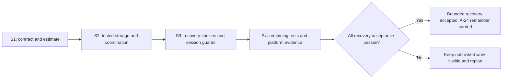

<!-- SPDX-License-Identifier: MIT -->
<!-- Part of PyBLE (https://pyble.dev) — see /LICENSE. -->

# C1-S1 — current-text recovery design, source review and sizing

| Field | Result |
|---|---|
| Recorded | 25 September 2026; preparatory execution ahead of the forecast Sprint dates |
| Tasks | C1-S1-T10 and C1-S1-T11; parent PYB-006.1 |
| Authority | User request to implement C1-S1; no named human sign-off or completed Scrum ceremony is inferred |
| Design result | Bounded contract specified and reviewed against current source; implementation pending |
| Normative deliverable | [Current-draft recovery](../../../specifications/App/current-draft-recovery.md), [ADR-0048](../../../decisions/0048-bounded-current-text-draft-recovery.md) |
| Existing contract updated | [App requirements](../../../specifications/App/specs.md), [App TDD](../../../specifications/App/TDD.md), dated [ADR-0010 follow-up](../../../decisions/0010-working-loop-in-memory-document.md) |
| Runtime / physical results | None produced by this design task; current released/source behavior remains volatile |
| Effort records | Original S1 allowance: 3h + 1h. These are planning allowances, not an assertion of four elapsed hours or a team velocity |

**31 October handoff:** this is the S1 design/inventory baseline. The
[C1-S2 implementation record](../c1-s2/00_Execution_Record.md) and
[scoped operator recipe](../c1-s2/01_Operator_Recipe.md) now track candidate source
and actual acceptance states. Original estimates are not measured effort or
confirmed future capacity; historical device access is not a new candidate run.

## 1. Source-grounded findings

| Source inspected | Observed behavior | Design consequence |
|---|---|---|
| [EditorDocument](../../../../app/lib/editor/editor_document.dart) | Single `name/content/dirty/boardPath` value; mutations bump `editorDocumentEpochProvider`; no durable backend | Observe every mutation, preserve the public provider seam and use epoch identity rather than value equality |
| [Data barrel](../../../../app/lib/data/data.dart) and [pubspec](../../../../app/pubspec.yaml) | Persistence placeholder; no admitted Drift/database packages | Dependency/native opening/schema/migration work has real cost; TDD architecture is not existing implementation |
| [Save controller](../../../../app/lib/editor/save_controller.dart) | Normalizes source, writes through ProgramActions, then compares document values before `markSaved` | Keep normalization out of recovery serialization; add epoch and session checks to completion |
| [Run controller](../../../../app/lib/editor/run_controller.dart) and [ProgramActions](../../../../app/lib/editor/program_actions.dart) | Text run performs PUT then rereads Connection to run; bundle actions already pin a neutral session stamp | Carry the established session check into the affected text action; stable facade identity is insufficient |
| [Files controller](../../../../app/lib/files/file_explorer_controller.dart) | Open uses an open-operation epoch plus document equality; Upload uses equality; existing delete/list logic already has session protection | Strengthen the affected document-adoption and completion guards without rebuilding the file explorer |
| [Blocks controller](../../../../app/lib/blocks/blocks_document.dart) | In-memory retained JSON and generated Python; explicit one-way `openGenerated` handoff; existing sidecar behavior is board-backed | Persist only text after explicit handoff; no claim of local workspace/graph recovery |
| [Shell](../../../../app/lib/app/shell.dart) and [ADR-0011](../../../decisions/0011-connection-gated-shell.md) | IDE appears only after connection | A board-independent local recovery panel is necessary; a full offline IDE remains separate |
| [ADR-0010](../../../decisions/0010-working-loop-in-memory-document.md) and [ADR-0012](../../../decisions/0012-flutter-code-editor-behind-editorsurface.md) | Volatile persistence deviation remains; the old rich-editor deferral has already been superseded | Address the actual persistence gap without treating rich editing as missing |

This is source inspection, not a reproduction of a released-build defect. The
edit-away/back and stable-facade cases are required implementation regressions;
the design does not claim a device incident or a test result that was not run.

## 2. Decisions and bounded acceptance

| Question | Specified answer | Trace |
|---|---|---|
| What is protected? | One exact current-text copy, including untitled text and explicit Blocks-to-Editor text; up to 1 MiB UTF-8 | DR-01; contract §2 |
| When is it protected? | Successful atomic content/metadata commit for that exact revision; local status is separate from board dirty/upload status | DR-02; §3 |
| How is a copy scheduled? | 500ms idle debounce, maximum 2s active scheduling interval, explicit Save recovery copy and best-effort lifecycle flush; pending text is not falsely guaranteed | §3 |
| What happens on launch? | Local preview and explicit Restore/Discard before board workflows; restored text remains viewable offline | DR-03; §4 |
| What authorizes a board write? | A new explicit destination/action decision in the current session; historical path never becomes live authorization | DR-05; §5 |
| What if storage fails? | Preserve current memory and previous committed store; report failure, Retry or explicit volatile session; no reset-on-error | DR-04; §6 |
| What handles races? | Editor epochs, document identity, serialized durable generations, discard barriers and neutral connection-session stamps | DR-06; §5 |
| What migrates? | First real schema starts at v1; tested forward migrations later, unsupported versions refused; no fictional released v0 store | §6 |
| What remains outside? | Full projects/settings/saved boards, history/console, durable import provenance, Blocks graph, reconnect guarantees | DR-07; §8 |

The schema reuses the planned `projects`/`project_files` subset and one
SettingsStore. The design does not add a new content-table family or use a
scratch-file substitute. Exact package versions, platform database opening
adapter and generated column names belong to implementation admission with the
existing toolchain/license checks; they are not unsupported dependency pins in
a design document.

## 3. Acceptance scenario review

| Concern reviewed | Required scenario and oracle | Result of C1-S1 review |
|---|---|---|
| Durability boundary | DR-T01–03: exact content and old-or-new atomic state on real file-backed reopen/interruption | Specified; execution pending |
| Local failure | DR-T04–06: full/corrupt/unavailable storage and version refusal preserve state | Specified; execution pending |
| User choice and source loss | DR-T07/09: Restore/Discard/Cancel/replacement keep explicit consent and cannot resurrect a discarded slot | Specified; execution pending |
| Concurrency | DR-T08: delayed hydration/commit and edit-away/back cannot publish stale success | Specified; execution pending |
| Board safety | DR-T10/11: no implicit verb, consent invalidation, session swap between PUT and Run | Specified; execution pending |
| Blocks scope | DR-T12: copied Python recovers while retained/invalid workspace semantics stay unchanged | Specified; execution pending |
| Usability and platform parity | DR-T13/14: localized offline panel, separate local/board status, keyboard/large text, actual iPad and Android process restart | Specified; execution pending |

Existing tests provide seams to extend rather than justify another framework:
[editor document](../../../../app/test/unit/editor_document_test.dart),
[Save](../../../../app/test/unit/save_controller_test.dart),
[Run](../../../../app/test/unit/run_controller_test.dart),
[ProgramActions](../../../../app/test/unit/program_actions_test.dart),
[Files](../../../../app/test/unit/file_explorer_controller_test.dart),
[Blocks](../../../../app/test/unit/blocks_document_test.dart), and the
[shell widget suite](../../../../app/test/widget/app_shell_test.dart).

**Independent agent review resolution (25 September 2026).** The pilot-worktree
review identified that Files `openInEditor` does not currently capture a session
stamp and its connection-state handler does not invalidate `_openEpoch`.
Editor epoch plus open generation alone would therefore admit a delayed GET
from board A after the stable facade attached board B. The contract now requires
capturing `connectionSessionStampOf` before GET and matching it immediately
before adoption; DR-T11 explicitly tests the swap with an unchanged editor
epoch. This is a reviewed design correction, not a claim that the runtime gap
has been fixed or tested on hardware.

No runtime tests were added or run for this specification-only task. Future
implementation must show meaningful failing tests before the passing change,
including file-backed persistence; a fake repository alone is insufficient.
An independent package review may still refine the design; neither this record
nor a commit signature impersonates a named human reviewer or release approver.

## 4. Bottom-up implementation estimate

These are engineering estimates from the inspected code and mandatory scenarios,
not measured velocity. They assume a developer familiar with Riverpod and the
existing seams, a working pinned Flutter toolchain, and timely access to both
physical platforms. Store review, recruitment, full five-profile qualification,
new features and unrelated defects are excluded.

| Work package | Low h | High h | Included acceptance / uncertainty |
|---|---:|---:|---|
| Database dependency admission, platform opening, initial schema and version fixtures | 4 | 7 | New native dependency closure, persistent private path, schema fixture/version refusal |
| Atomic repository, content validation and nondestructive failure behavior | 6 | 10 | Real transactions, generation guards, hash/size validation, error seams |
| Recovery coordinator and mutation/lifecycle queue | 4 | 7 | Debounce, coalescing, revision status, discard barriers and stale reads |
| Startup Restore/Discard and replacement flow | 5 | 8 | Disconnected panel, volatile-mode Retry, epochs and replacement choices |
| Target consent and affected board completion/session guards | 6 | 10 | Editor Save/Run, Files Upload/Open, Blocks handoff; partial Run result |
| Localized UI, accessibility and affected layouts | 3 | 5 | Distinct recovery/board states, error guidance, keyboard and 2× text |
| Required red/green failure, migration and race tests | 7 | 11 | Real file-backed tests plus recording-seam/controller/widget coverage |
| Integration regressions, review and scope/user documentation | 3 | 5 | Existing affected suites/gates and honest remaining A-24 scope |
| **PYB-006.2 engineering subtotal** | **38** | **63** | Original C1-S2-T02–T07/T10 allowance was **17h** |
| Operator recipe completion (PYB-009.1) | 2 | 2 | Existing C1-S2-T01 allowance; exact artifacts and safe test data |
| Representative Android + iPad recovery observations (PYB-008.1) | 4 | 6 | Build installation, interruptions and session/target observations; devices available |
| C1-S2 due follow-up (PYB-011.2) | 1 | 1 | Existing pilot allowance; not persistence implementation |
| **Comparable first-delivery workload** | **45** | **72** | Original full C1-S2 base allowance was **24h**, ceiling **26h** |

The range is deliberately wider than the original task allowances. Even the
lower bound exceeds one Sprint's ceiling by 19h. Corruption, migration, session
and replacement guards cannot be removed to make the story appear to fit.
Physical access delays are calendar blockers, not hidden zero-hour passes.

## 5. Reforecast proposal for Sprint Planning

Use **50 engineering hours** as a working planning figure within the range;
re-estimate after the database and race tests expose actual complexity. The
following is a concrete capacity-safe proposal, not a silently adopted change
to future Sprint commitments or an assertion that extra people are assigned.

| Sprint | Proposed allocation | Planned h | Consequence |
|---|---|---:|---|
| C1-S2 | 23h recovery foundations/meaningful tests, 2h operator recipe, 1h due pilot follow-up | 26 | Uses its existing 2h headroom; prioritize repository/coordinator and fail-closed tests. A tested engineering enabler may finish, but user recovery is not Done or exposed as complete |
| C1-S3 | 21h recovery UI/consent/integration and remaining failure scenarios, 1h rolling follow-up | 22 | Replaces the original matrix/activation batch forecast; 4h below ceiling remains available only after actual progress. M-02 remains pending if any required criterion is unfinished |
| C1-S4 | 6h finishing/review, 5h representative platform evidence, 1h rolling follow-up | 12 | Leaves 14h below ceiling for explicitly reselected work. Only then can PYB-006.2/M-02 be accepted if all scoped evidence passes |
| **Total** | **50h engineering + 2h recipe + 5h physical + 3h rolling follow-up** | **60** | Two additional follow-up hours are included because delivery spans three Sprints |

This proposal consumes 60 of the 78 planned-ceiling hours across S2–S4. It does
not fit alongside all 70h of their original base tasks: matrix runs, activation
collection and conditional repairs must be reordered into the remaining 18h,
later capacity or separately confirmed contributor capacity. Keep prospective
follow-up windows; an inability to recruit/observe still remains an explicit
research limitation. Do not quietly use the 14h-per-Sprint event/support reserve
or count the same headroom twice. Root planning documents own the adopted
forecast and must preserve this proposal's status until selection is recorded.

If the estimate trends toward 63 engineering hours, replan again; the 50h
working figure is not an acceptance waiver. An unexposed tested foundation is
an engineering increment, not a finished recovery user story. An earlier safe
end-to-end result can be accepted earlier when its complete evidence passes.

## 6. Decisions still needed during implementation

| Item | Current disposition | When it matters |
|---|---|---|
| Exact Drift/native dependency versions and OS opening adapter | Select against the actual pinned toolchain; record licenses, minimums, lockfile and platform floors | Before admitting new implementation dependencies |
| Named Developer/operator and device access | Not assigned by a design document; root execution/evidence record tracks actual availability | Before selecting implementation and platform runs |
| Revised future Sprint order | Proposal above is sized; existing matrix and research work cannot all retain its old allocation | Next Sprint Planning/reforecast |
| Broader A-24 and Blocks persistence | Explicitly deferred; needs later contract and budget | Separate accepted slice |

These are implementation planning inputs, not a request to stop authorized S1
design work. T10 delivers the contract; T11 delivers this source review,
scenario matrix and estimate. Neither task closes PYB-006.2 or marks M-02,
platform qualification or a release complete.

## 7. Documentation validation performed

| Check | Actual result on 25 September 2026 |
|---|---|
| Canonical local-link checker, extended to include new Markdown files | 127 tracked + 3 new documents checked; zero broken local links |
| Mermaid rendering | Both new diagrams rendered with Mermaid CLI 11.16.0 and installed Chrome; generated SVGs stayed in a temporary directory |
| Estimate / scenario consistency | Engineering subtotal 38–63h, conditional allocation 60h, all 14 distinct DR-T scenarios verified |
| `git diff --check` and new-document whitespace/fences | Passed |
| `tools/ci/no_leak.sh` | Passed in the isolated recovery worktree |
| `tools/ci/spdx_lint.sh` | Passed in the isolated recovery worktree |
| `tests/firmware_tests/test_governance_files.sh` | Seven checks passed |

The CLI's first default-browser launch could not find its expected cached
headless binary; explicitly selecting the already-installed Chrome completed
both renders. No browser/package installation or generated diagram asset was
needed. These are documentation/source-governance results, not evidence of
implemented persistence, runtime tests or physical recovery.
