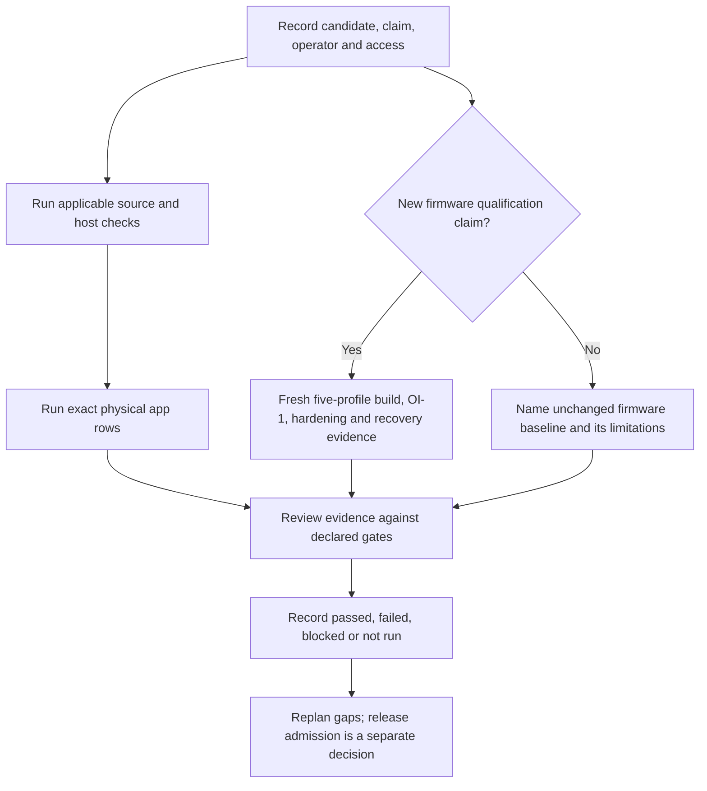

<!-- SPDX-License-Identifier: MIT -->
<!-- Part of PyBLE (https://pyble.dev) — see /LICENSE. -->

# C1-S1 — validation inventory and operator recipe

| Field | Recorded S1 state (25 September 2026) |
|---|---|
| Task / story | C1-S1-T12 / PYB-009.1; initial inventory and recipe, with scoped recovery completion planned in C1-S2-T01 |
| Inspection date / source | 25 September 2026; `d039db09779ed45124874721f88b2e0931664743` before this documentation change |
| Worktree | Branch `work/c1-s1-qualification`; isolated from the app/research worktrees |
| Result | Existing tools, normative counts, missing access, operator procedure and initial cost range inventoried; 110 focused host tests passed |
| Physical result | No board, BLE session, flash operation or physical qualification performed; separate device retry verifies existing channel installations and launch without reinstalling |
| Review boundary | Documentary source/command checks are complete; named physical operator, reviewed candidate and actual timed rehearsal remain required before execution |
| Related evidence | [Execution record](00_Execution_Record.md), [channel/artifact ledger](01_Channel_and_Artifact_Ledger.md), [pilot procedure](02_Pilot_Protocol_and_Observation_Kit.md), [recovery design](03_Recovery_Design_and_Sizing.md) |

This is an operator entry point to maintained suites, not a new harness or release schema. Follow the selected candidate's versioned contracts and the current [HIL guide](../../../../tests/firmware_tests/hil/README.md). A host test proves the tested software contract; a physical run proves only its recorded artifact, device and scenario. Neither supplies participant-observation evidence or a PyBLE Ready award.

**31 October acceptance update:** this document preserves the 25 September S1
design/inventory baseline. The [C1-S2 execution record](../c1-s2/00_Execution_Record.md)
now records accepted bounded recovery and all ten app-only Q01–Q10 rows, with
exact candidate/firmware identities, earlier-row impact assessments and physical
conditions in the [iPad](../c1-s2/04_iPad_Acceptance.md) and
[Android](../c1-s2/05_Android_Acceptance.md) reports. PYB-009.1's scoped
[operator recipe](../c1-s2/01_Operator_Recipe.md) was executed and reviewed.
The S1 “unassigned” and “not run” entries below are historical findings, not the
current app-only acceptance state. Fresh firmware qualification, PYB-009.2
second-operator reproduction, Ready and pilot claims remain separate. Original
estimates are not measured effort or confirmed future capacity.

## 1. Evidence and gate selection

| Proposed claim | Required evidence and authority | What remains separate |
|---|---|---|
| Documentation task complete | Source/link/command review and applicable contributor gates | PYB-009.1 includes the scoped recovery procedure, completed and reviewed in the [S2 recipe](../c1-s2/01_Operator_Recipe.md); second-operator reproduction is PYB-009.2 |
| App source change works | Specification-first change, meaningful red/green tests, locked app CI, affected physical app scenarios and the accepted Definition of Done | Fake BLE, emulators and source version strings do not establish store installation or firmware qualification |
| Candidate app supports the five existing profiles | At least the ten platform/profile rows below, affected lifecycle/recovery cases and declared exact firmware baselines; qualify the claimed capability on both platforms | An unchanged released firmware is a named compatibility input; an app-only increment does not automatically require rebuilding/requalifying all firmware bytes |
| New automated-qualified v0.6.1 firmware release | Fresh atomic five-profile build/provenance/license/OI-1/hardening/provisioning/recovery matrix; both physical app rows in every V5 record; all applicable C3, Pico and Waveshare gates | A representative pair of app runs, a completed build or one Ready rehearsal cannot admit the release |
| Firmware v0.6.1 is publicly distributed | The dated [owner-confirmed publication record](../../../testing/firmware-v0.6.1-publication-2026-09-11.md) | Its incomplete automated HIL remains incomplete; retained v0.6.0 qualification is historical, not a fresh v0.6.1 result |
| User can perform/repeat a useful task | Prospective observation/assistance/follow-up records under the pilot procedure | Bench success is not activation, usability, retention or consent evidence |

The normative authorities are [App specifications](../../../specifications/App/specs.md), [firmware specifications §5.3](../../../specifications/firmware/specs.md#53-footprint-gates-nfr-fp), [V5 release evidence](../../../specifications/firmware/browser-flashing.md#95-pyble_hil_records_v5-five-profile-heterogeneous-release), the exact-profile contracts and the candidate-bound [OI-1 policy](../../../../firmware/qualification/oi1-gates.json). Use the source era selected by the candidate validator. Do not copy historical policy numbers or edit a policy to fit a failing run.



## 2. Existing tools and reproducible entry points

Unless a row names another directory, commands run from the repository root in a clean, candidate-specific checkout. Record command, start/end time, exit status, source commit and full retained log. For new Markdown files, the normal tracked-file link gate must be supplemented with explicit discovery before staging. Do not initialize submodules or substitute toolchains merely to turn an unavailable check green.

| Layer / maintained entry point | Environment and command | Expected evidence / limits |
|---|---|---|
| Contributor/document checks | `tools/ci/no_leak.sh`; `tools/ci/spdx_lint.sh`; `python3 tools/ci/docs_links.py`; `python3 -m unittest discover -s tests/publication -p 'test_*.py'`; `tests/firmware_tests/test_governance_files.sh` | Successful exits and actual counts. DCO requires `git commit -s`; `tools/ci/dco_check.sh` checks the selected range. A source gate is not a device result |
| App unit/widget/conformance | In `app/`, Flutter **3.44.1 stable**: `flutter pub get --enforce-lockfile`, `flutter gen-l10n`, `dart format --output=none --set-exit-if-changed lib test integration_test`, `flutter analyze`, `flutter test --exclude-tags golden` | Match tracked `app/pubspec.lock`; preserve failure output. Import and locale gates also apply to affected app source |
| App pixel goldens | Same app prerequisites; `flutter test --tags golden` on CI's pinned **macos-15 Apple Silicon** environment | Reviewed renderer-specific baselines. A different local OS can provide diagnostics but must not silently replace reference images |
| Actual Android WebView integration | Reproduce the complete `android-webview` job in [CI](../../../../.github/workflows/ci.yml): Ubuntu 24.04; API 34 AOSP x86_64 emulator; compile API 36; build-tools 36.0.0; NDK 28.2.13676358; Flutter 3.44.1 | The job checks production packaging and drives `integration_test/android_smoke_test.dart` using the integration flavor. Reuse its AVD setup, app build and `flutter drive` arguments together. Real WebView success remains emulator evidence, not physical BLE HIL |
| Complete firmware host suite | CI initializes pinned MicroPython host dependencies `lib/micropython-lib` and `lib/cyw43-driver`; then `tests/firmware_tests/run_tests.sh` and `python3 -m unittest discover -s tests/firmware_tests/host -p 'test_*.py'` | Shell/native/portable/release tests. No connected board required; compiler/submodule availability still matters. Historical `DEFERRED-HIL` output remains unfinished physical work |
| Focused shared conformance | `python3 tests/firmware_tests/host/conformance/test_hil_wire.py`; active fixtures described in [host conformance guide](../../../../tests/firmware_tests/host/conformance/README.md) | Byte agreement with shared PBLE/1 corpus; current semantic vectors are `v061_session_vectors.json`, `v061_payload_grammar_vectors.json` and `v061_label_vectors.json`. Archived byte-less ledgers are not current blockers |
| Focused bench contracts | `python3 tests/firmware_tests/host/test_target_hil_benches.py`; `python3 tests/firmware_tests/host/test_oi1_profile_bench.py`; `python3 tests/firmware_tests/host/test_oi1_rp2_profile_bench.py` | Host-only identity, orchestration, threshold, integrity and evidence-shape contracts; no physical pass |
| BLE identity / lifecycle diagnostics | `target_smoke.py`, `target_run_stop.py`, `file_roundtrip_bench.py` under `tests/firmware_tests/hil/`; command sequence below | Exact expected chip/agent; raw results retained privately. They do not synthesize complete release records |
| OI-1 final-candidate measurement | `tests/firmware_tests/hil/oi1_profile_bench.py --mode verify` with exact policy, profile/artifacts, private address, identity and reset inputs from the HIL guide | Canonical `oi1_observation` plus exclusive-created raw log. Baseline mode derives engineering inputs; it is not final verify qualification |
| v0.6.1 workspace and hardening | `v061_workspace_acquire.py`, then `v061_hardening_bench.py`; use the guide's complete candidate/receipt/binding arguments | Two measured sacrificial-media acquisitions plus seven live scenarios per profile. Requires separate explicit disposable-media authority and backups; never use an owner's working board as a fixture |
| Release evidence writers/gates | `firmware/scripts/release_bundle.py create-hil-completion` and `assemble-hil-report`; `firmware/qualification/v060_profile_release_gate.py`, `v061_hardening_release_gate.py`, `waveshare_lcd147b_release_gate.py` | Candidate-specific canonical fragments and validator-derived summaries. A `--passed-gate` argument attests already retained evidence; it does not execute or waive the gate |

### Environment and artifact binding

| Input | Required record / available source |
|---|---|
| Firmware source and tools | [versions.lock](../../../../firmware/versions.lock): MicroPython v1.28.0 / `e0e9fbb17ed6fd06bb76e266ae554784c9c80804`; ESP-IDF v5.5.1 / `fcae32885b0296b32044cb99ecbdc50d98dddb83`; ARM GNU 14.2.Rel1 / GCC `14.2.1 20241119`; picotool 2.3.0 with locked archive/executable hashes. These are inspected pins, not newly built binaries |
| HIL collector environment | Dedicated environment, OS/Python/BLE backend/adapter and package versions retained. Current macOS workspace acquisition specifies Bleak **3.0.2**, pyserial **3.5**, esptool **4.12.0** for ESP, plus the repository-pinned picotool for Pico. Do not modify the compiler environment |
| Candidate identity | Selected source/qualification commits; protected candidate `release.json` hash; exact install bytes/hash, manifest/component hashes for ESP; UF2 and bound raw BIN for Pico; policy and suite hashes. Keep candidate directories immutable |
| Current inspected policy | Schema 3 / `v0.6.0-five-profile` scope reused by the admitted v0.6.1 contract. Current policy binds `docs/validation/firmware/oi1/96497b9cf642ab2078842ce8a321c3c84b6714b2.json` with SHA-256 `007e19f0c0281801a3c065f01742ba9606e340bce07b5e67920f036cea375c76`; older `a8be631…` guide examples remain historical. The candidate-bound validator selects the actual admissible policy |
| App identity | Platform, delivery channel, displayed version/build, OS/device and actual source/upload/install provenance from the channel ledger. V5's `app_version`, `app_build`, `os_major` and `status` fields do not replace fuller supplemental provenance. Unknown installed-byte identity stays unknown |
| Private evidence | New access-controlled paths outside candidate/qualification checkouts for addresses, serial/UID bindings, raw capture and generated receipts; do not paste identifiers, user files or console content into Git |
| Public evidence | Reviewed redacted output, hashes, timestamps, exact scope and failed/not-run rows; link existing release formats rather than creating competing result files |

## 3. Physical inventory and ten app rows — 25 September S1 baseline

Historical release evidence establishes which exact profiles exist, not whether the required bench hardware is presently available. No physical board inventory was performed in this task. The initial 25 September discovery found no ADB device and the paired iPad's app query was denied while locked. The later user-supplied device retry supersedes those access gaps: [Lenovo TB-J616X / Android 12](06_Android_Channel_Verification.md) has verified Play `0.2.0 (8)` and [iPad16,10 / iPadOS 26.6.2](07_iPad_Channel_Verification.md) has verified TestFlight `0.2.0 (6)`; both launch. These checks do not select a firmware candidate or execute BLE scenarios. Host discovery found no `/dev/cu.usbmodem*`, `/dev/cu.usbserial*`, `/dev/cu.SLAB*` or `/dev/cu.wch*` endpoint; that does not exclude separately powered BLE boards. Pairing is not an app-install or HIL pass.

| Resource | 25 September S1 execution state, including device retry | Action identified by S1 before a physical batch |
|---|---|---|
| Five exact boards, revisions/memory/module markings | Historical profiles recorded; current possession, condition and firmware identity unverified | Physical operator assigned at Planning checks and privately records each exact unit |
| Android tablet / Play access | Available during retry; existing beta membership, Play installation `0.2.0 (8)` and launch verified | Reconfirm availability for the selected candidate; retain Android payload mapping and delivered minimum-SDK limitations |
| iPad / TestFlight access | Available during retry; TestFlight-origin `0.2.0 (6)` and launch verified | Reconfirm availability for the selected candidate; retain unknown source mapping and delivered minimum-OS discrepancy |
| USB data cables, reset adapters, power isolation, known backups | Not inventoried; serial endpoint discovery alone would not prove exact-board identity | Physical operator checks wiring, reliable power/data path and recoverability before operations |
| Disposable workspace media / spare boards | Availability and erase authority unconfirmed | Owner supplies an independently verified backup and explicitly disposable target for each required acquisition |
| Physical operator / independent reviewer | No named assignment or confirmed availability | Assign actual people/time; an assistant-authored recipe does not supply physical sign-off |
| Second operator for PYB-009.2 | Unassigned | Optional separately costed reproduction; no existing-profile Ready badge or partner claim |

All ten rows below are **not run for C1-S1**. An unchanged historical pass must retain its date/artifact instead of becoming a current pass. Platform rows reference one exact firmware digest per selected profile; they do not require duplicating the host OI-1 workload as though it were a tablet test.

| Row | Exact provisioning profile | Platform | Required profile distinction | Blocker recorded in the 25 September S1 inventory |
|---|---|---|---|---|
| Q01 | `esp32-4mb` | iPadOS | Classic ESP32, 4 MiB flash; PBLE chip `esp32` | Exact board/candidate/operator unassigned; channel installation now verified |
| Q02 | `esp32-4mb` | Android | Same declared firmware bytes as Q01 | Exact board/candidate/operator unassigned; channel installation now verified |
| Q03 | `esp32-s3-n16r8` | iPadOS | Lean S3, 16 MiB flash / 8 MiB Octal PSRAM; PBLE chip `esp32-s3` | Exact board/candidate/operator unassigned; channel installation now verified |
| Q04 | `esp32-s3-n16r8` | Android | Same declared firmware bytes as Q03; no bundled TFT-runtime claim | Exact board/candidate/operator unassigned; channel installation now verified |
| Q05 | `waveshare-esp32-s3-lcd-147b` | iPadOS | Exact B board, 16 MiB / 8 MiB; distinct image despite PBLE chip `esp32-s3` | Exact board/candidate/operator unassigned; channel installation now verified |
| Q06 | `waveshare-esp32-s3-lcd-147b` | Android | Same declared firmware bytes as Q05; exact-board display/splash gates separate | Exact board/candidate/operator unassigned; channel installation now verified |
| Q07 | `esp32-c3-4mb` | iPadOS | C3 revision v0.3 or newer, 4 MiB flash; C3-G0…C3-G6 required for fresh firmware qualification | Exact board/candidate/operator unassigned; channel installation now verified |
| Q08 | `esp32-c3-4mb` | Android | Same declared firmware bytes as Q07; separate C3-G5 real app run | Exact board/candidate/operator unassigned; channel installation now verified |
| Q09 | `rpi-pico2-w` | iPadOS | Exact Pico 2 W; bound UF2/raw BIN; RP2 resource facts and GP2 | Exact board/candidate/operator unassigned; channel installation now verified |
| Q10 | `rpi-pico2-w` | Android | Same declared firmware bytes as Q09; separate physical Android workflow | Exact board/candidate/operator unassigned; channel installation now verified |

Every selected row covers the applicable edit/save/run/stdout/STOP/file-readback/disconnect/reconnect workflow plus the increment's affected scenarios. C3-G5 expressly requires both tight-loop and print-flood STOP through the real UI, and GP2 includes both physical platforms. Use [C3 gates](../../../specifications/firmware/ports/esp32-c3-4mb.md), [Pico gates](../../../specifications/firmware/ports/rpi-pico2-w.md), and [Waveshare exact-board requirements](../../../specifications/hardware.md#12-waveshare-esp32-s3-lcd-147b-qualification-contract) without replacing them with this summary.

## 4. Frozen repetitions and thresholds to preserve

| Gate | Required workload / limit | Interpretation |
|---|---|---|
| OI-1 reset | **10** scanner-before-reset samples per profile; **1,000 ms** reset hold; **15,000 ms** discovery health timeout; all samples ≤ **3,000 ms** ESP or ≤ **7,000 ms** Pico | Exact service callback endpoint; no trimming/replacement/retry/widening. Include the separate fresh physical all-power-off advertising check |
| OI-1 transfer | **5 × 65,536-byte PUT/GET round trips** per profile; every PUT and GET ≥ **6,600 B/s** | Whole-file bytes, size, offsets and CRC; frozen integer timing formula permits at most **9,929,696,969 ns** per sample. Success-only reporting cannot omit a failure |
| OI-1 reliability/heap | Separate **20 × 16,384-byte** reliability run; **10** post-HELLO, **5** post-roundtrip and **1** post-reliability heap samples | Profile-specific static/heap floors come from the selected policy. Waveshare largest-block floor is **98,304 bytes**; Pico raw-image hard ceiling **1,572,864 bytes**, with tighter candidate-policy bounds also applicable |
| Link facts | ATT MTU **247**, chunk **229**; ESP PUT window **8**, Pico **4** | Unknown backend MTU stays unknown; require agreement when exposed. Preserve ESP epoch/DLE/PHY settlement and disconnect facts. Pico BTstack refill horizon is **103 ms**, not the ESP Notify wait budget |
| v0.6.1 hardening | Seven ordered scenarios: transport/session, fragment hardening, RUN isolation, resource stability, stdin isolation, configuration durability, filesystem hardening; resource stability exactly **50 sequential RUNs** | One fresh candidate-bound result per exact profile; not another arbitrary endurance experiment |
| Workspace first boot | Two separately measured receipts per profile: erased-media creation and nonblank incompatible-media refusal | Complete private pre/post readback, actual sealed boot observation, fresh advertisement watch and candidate binding; a source inference or manually entered summary is not a receipt |
| RUN/STOP diagnostic and C3-G2 | Busy loop and print flood; exactly one matching `RSP OK` before idle, terminal idle in **less than 500 ms**, followed by bounded same-link recovery | A tablet UI observation without the required timing evidence does not prove the protocol deadline |
| Real-app release records | **2 physical platforms × 5 exact profiles = 10 app rows** in V5; six separately observed operator checks plus derived OI-1 and v0.6.1 hardening checks | The six are provisioning install, provisioning recovery, advertising/INFO/HELLO, PBLE workflow, safe boot/reconnect, and filesystem resume/reliability |
| App performance/recovery | NFR-PERF-4 first connect **<10 s** and saved-board connect **<5 s** are SHOULD targets; console ceilings need measured/frozen HIL bounds | Do not turn unknown timing into a pass, invent new millisecond gates, or infer automatic reconnect/resume from firmware resumability |

Across five fresh firmware profiles the fixed minimum OI-1 work therefore includes 50 reset samples, 25 PUT/GET pairs, 100 reliability files and 5 physical power cycles; v0.6.1 adds 250 sequential RUNs and 10 workspace acquisitions. Those totals exclude setup, retries as new retained attempts, manual provisioning/recovery, profile-specific observations and ten tablet rows. No additional 100-operation or 30-recovery floor is introduced.

## 5. Operator procedure proposed in the 25 September S1 inventory

| Step | Action | Expected output / stop condition |
|---|---|---|
| 1 — Bind scope | Choose one exact profile and explicit app/candidate pairing; select required gates and nominal/interference conditions separately. Record operator, suite revision, device/OS and artifact provenance | A populated setup record, no inferred store/source hash. Missing exact unit or candidate blocks the run |
| 2 — Prepare safe bench | Use a controlled board with no actuators or external hazardous loads; preserve existing user files/autorun/labels, verify backup and power/reset wiring; close competing BLE clients and serial monitors | Confirm test-owned scratch namespace is unused. Do not delete a colliding owner's file to make a bench pass |
| 3 — Check host prerequisites | Use the pinned app/build tools where applicable; run focused harness/conformance checks; inspect full CI requirements for the selected change | Exit-zero host logs permit proceeding to physical execution only; failures stay visible |
| 4 — Identify over BLE | Use service-filtered discovery, select the physically verified exact unit, run identity smoke with explicit chip and agent version | HELLO/DEVICE_INFO/INFO agree; no chip-family inference of board profile or flash size. Keep scan identities private |
| 5 — Core physical app run | On each platform separately, record actual install/build; connect and inspect identity; create/edit/save a harmless named test file; run and verify output; STOP tight-loop/print-flood cases under the applicable gate; upload/read back exact bytes; disconnect/reconnect and verify workspace | Retain actual outcomes and timing evidence. Permission denial, wrong selection, timeout and stale session behavior are findings, not success |
| 6 — Recovery regression | For the app inspected in S1, distinguish navigation/disconnect from OS process termination. Preserve user content before termination. For the later recovery candidate, execute the accepted write-boundary/restore/discard/failure/board-isolation scenarios from the [recovery design](03_Recovery_Design_and_Sizing.md) | The 25 September inspected source did not guarantee durable draft recovery. The later executable suite and accepted physical results are recorded in [C1-S2](../c1-s2/00_Execution_Record.md); this S1 recipe itself supplies no physical pass |
| 7 — Firmware-specific qualification if selected | Follow the maintained OI-1 verify command, profile overrides, private workspace acquisitions, seven-scenario bench and profile-specific gates against one protected candidate | Fresh, immutable, exclusive-created results. Destructive acquisition requires a separately authorized disposable target, not routine app qualification |
| 8 — Recover a failed attempt | Stop running code where the link remains serviceable; disconnect/reconnect explicitly. If needed use documented safe boot/power reset, then the exact board's ESP bootloader or Pico BOOTSEL recovery procedure with a verified image | Preserve the first failed log. Reset is not evidence of recovery unless observed. Never erase/reflash user storage as an automatic troubleshooting step |
| 9 — Close the record | Confirm only test-owned files are cleaned up and original reviewed configuration restored; retain every attempt with result and duration; redact logs before public use | Failed/unrun rows remain explicit; no handwritten passing HIL map. Re-run affected steps after a recipe correction before an independent reproduction claim |

The following host commands reproduce the focused checks run during this task:

```sh
python3 tests/firmware_tests/host/conformance/test_hil_wire.py
python3 tests/firmware_tests/host/test_target_hil_benches.py
python3 tests/firmware_tests/host/test_oi1_profile_bench.py
python3 tests/firmware_tests/host/test_oi1_rp2_profile_bench.py
```

Physical diagnostics below are **instructions only, not executed evidence**. Use a private shell session, fill in the reviewed values, and run from the repository root. Scanning exposes local identifiers; avoid recording them in public terminal transcripts. Lifecycle/roundtrip benches write test files: check that `/target_hil_run.py` and `/bench_roundtrip.bin` are not owner data before use; inspect the current tool's fixture names before execution if its revision changes.

```sh
python3 tests/firmware_tests/hil/target_smoke.py --scan

# Set these privately from the reviewed exact unit and selected artifact.
PYBLE_HIL_ADDRESS='<private BLE UUID or MAC>'
PYBLE_HIL_CHIP='esp32-c3'
PYBLE_HIL_AGENT='0.6.1'

python3 tests/firmware_tests/hil/target_smoke.py \
  --address "$PYBLE_HIL_ADDRESS" \
  --expect-chip "$PYBLE_HIL_CHIP" --expect-agent "$PYBLE_HIL_AGENT"
python3 tests/firmware_tests/hil/target_run_stop.py \
  --address "$PYBLE_HIL_ADDRESS" \
  --expect-chip "$PYBLE_HIL_CHIP" --expect-agent "$PYBLE_HIL_AGENT"
python3 tests/firmware_tests/hil/file_roundtrip_bench.py \
  --address "$PYBLE_HIL_ADDRESS" --expect-chip "$PYBLE_HIL_CHIP" --size 12190
```

For release measurements, use the complete **verify-mode** example and exact profile substitutions in the HIL guide; these diagnostic commands do not replace it. Do not run `--allow-disposable-erase`, `create-result --passed-gate`, completion assembly or finalization to fill an evidence gap. The first changes physical storage; the remaining commands validate/encode already acquired evidence.

## 6. Initial cost model and Sprint implications

These are bottom-up **planning ranges in operator hours**, not measured durations or commitments. They assume one known candidate, functioning exact hardware, preinstalled tools and no product defects. Tool download/build/store waiting time, obtaining hardware/access, participant work and substantive defect repair are additional. Multiple people can reduce elapsed time but do not make their effort free. Retain actual preparation, active execution, passive wait and rerun times separately in the first representative pair.

| Work package | Quantity × allowance | Initial effort range |
|---|---|---:|
| Shared app/candidate provenance, device setup, prerequisites | One setup at 2–4 h | 2–4 h |
| Ten physical app core/recovery rows | 10 × 0.75–1.5 h | 7.5–15 h |
| Two representative cross-version/affected regression sessions | 2 × 1–2 h; exact pairings chosen at Planning | 2–4 h |
| Evidence review, redaction and unresolved-row reconciliation | One pass at 2–3 h | 2–3 h |
| **App qualification subtotal** | Baseline coverage before defects/repetition | **13.5–26 h** |
| Additional firmware install/recovery and two sacrificial-media acquisitions per profile | 5 × 1.5–3 h | 7.5–15 h |
| Additional OI-1 + hardening execution per profile | 5 × 1–2 h including physical intervention/log handling | 5–10 h |
| Additional profile-specific observations, release evidence and operator review | C3/Pico/Waveshare plus shared completion | 4–8 h |
| **Full fresh firmware qualification subtotal** | App subtotal plus additional firmware work; excludes clean builds/license audit and defect repair | **30–59 h** |

The app subtotal includes ten total rows: the S2 representative iPad/Android runs can contribute two of them if artifacts, scope and applicable acceptance remain valid. Do not double-count those rows or reuse them after a relevant change without impact review. Cross-version session estimates are placeholders; a broader supported-baseline claim increases the count.

| Planned allowance in [Sprint Backlogs](../06_Sprint_Backlogs.md) | Assessment / required planning action |
|---|---|
| S1-T12 2 h inventory; S2-T01 2 h scoped recipe | Documentation allowances; not physical qualification. S2 must bind executable recovery cases and the chosen candidate before implementation is declared Done |
| S2-T08/T09 4 h representative physical runs | Plausible initial checkpoint if access exists. Record actual setup/run cost and invalidating changes before projecting the other rows |
| S3-T02–T04 12 h execution | May cover a portion of the 7.5–15 h app-row estimate after setup; cannot promise all five firmware profiles with sacrificial-media work |
| S5-T02–T04 11 h remaining/cross-version work | Together with S3 yields 23 execution hours, plus separately planned setup/review. App scope may fit without major failure; full fresh firmware qualification is not supported by that assumption |
| 20 h cycle headroom and 84 h event/support/additional-qualification reserve | Not an automatic qualification allocation. Replan explicitly against actual event/support demand; do not consume reserve twice or shorten normative counts |
| PYB-009.2 second-operator rehearsal | Initially allow a separately confirmed 2–4 h for one already provisioned profile/core/recovery recipe, plus repair/rerun time; not included above and not a complete release/badge gate |

Before S3/S5 selection, Developers must replace these ranges with the first measured batch and named access, choose app-only versus fresh-firmware claim, assign exact Q rows to batches, and reforecast anything exceeding capacity. A failed required row blocks the relevant claim; the Sprint calendar never changes its pass threshold.

## 7. Checks performed and actions identified in the 25 September S1 inventory

The following focused suites ran on macOS 26.6.2 arm64, Python 3.13.5, at source `d039db09779ed45124874721f88b2e0931664743`. All use host fixtures/fakes; they open no physical BLE or serial connection.

| Suite | Actual result | Reported test runtime |
|---|---:|---:|
| `host/conformance/test_hil_wire.py` | 6 passed | 0.001 s |
| `host/test_target_hil_benches.py` | 4 passed | 0.057 s |
| `host/test_oi1_profile_bench.py` | 85 passed | 2.259 s |
| `host/test_oi1_rp2_profile_bench.py` | 15 passed | 0.029 s |
| **Focused total** | **110 passed** | Host runtime only; not a matrix estimate |

The full firmware suite, app suite, cross-builds and hardware tests were not run by this task. A separate `test_v061_hardening_release_gate.py` invocation was stopped during this bounded inspection before a result was collected; it supplies no pass. The [execution record](00_Execution_Record.md) records integrated document/source checks separately.

| Action remaining at the 25 September S1 inventory | Owner assignment / next checkpoint proposed at S1 |
|---|---|
| Confirm exact boards, safe fixtures, backups, candidate and physical operator | Product Owner/Developers were to name the actual operator at Planning; Q01–Q10 were not run in S1 |
| Reconfirm tablet availability and candidate identity for the selected physical batch | Device access and current channel installation checks are complete for this retry; device/channel owner rechecks when the candidate or session changes |
| Bind executable recovery cases and revise estimate from the accepted contract | App + QA during C1-S2-T01; the then-proposed current-draft behavior had no physical result in S1 |
| Time the first representative pair; allocate remaining rows and reruns | QA/Developers before C1-S3 scope selection |
| Independently review and reproduce the recipe if PYB-009.2 is selected | Named second operator with separately allocated time; assistance remains visible and triggers an affected-step rerun |
