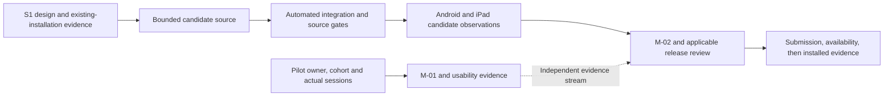

<!-- SPDX-License-Identifier: MIT -->
<!-- Part of PyBLE (https://pyble.dev) — see /LICENSE. -->

# C1-S2 — bounded current-text recovery implementation

| Field | Record |
|---|---|
| Execution date | 31 October 2026; Asia/Bangkok |
| Authorization | User requested implementation for the next release after the C1-S1 integration and stage review |
| Integrated starting baseline | `8dde8d6107e4b3c3fab29340ecec5b40c877444b`; previously merged C1-S1 work |
| Candidate | App `0.3.0+9`; local source/build candidate, with final revision/artifact identity to be recorded at qualification |
| Scope | PYB-006.2 bounded current-text recovery; supporting PYB-009.1 recipe and applicable PYB-008.1 observations |
| Contract | [Current-draft recovery](../../../specifications/App/current-draft-recovery.md), [ADR-0048](../../../decisions/0048-bounded-current-text-draft-recovery.md) |
| Overall state | Candidate source implemented; 972 ordinary Flutter tests pass, Android engineering recovery checks pass, and required physical acceptance remains partial. PYB-006.2 and M-02 are not Done |
| S1 state | Unchanged: six Done, two Prepared, four Awaiting evidence; M-01/SG0 and pilot work remain unfinished |
| Capacity/calendar | Original S2 allowance 24h and 12–25 October dates remain historical forecasts. The 45–72h estimate / 60h S2–S4 option is not measured effort or confirmed human capacity |
| Method | Separate storage, coordinator and UI Git worktrees; root integrates board/session guards, regressions, release records and qualification attempts |

## User outcome and implementation

An acknowledged current-text checkpoint can be offered after an app restart for
explicit local Restore or Discard. The bounded feature protects one text slot;
it does not implement project management, Blocks workspace recovery or backup.
Existing channel installations are separate from this unqualified candidate.

| Component | Candidate behavior | Evidence boundary |
|---|---|---|
| Drift repository | `projects` / `project_files` subset and one SettingsStore; atomic content/metadata/generation; exact UTF-8 and SHA-256; 1 MiB admission bound | File-backed tests/schema fixtures plus Android/iPad native storage harnesses; full interaction/board acceptance remains pending |
| Production storage | `pyble.sqlite` below the platform app-private Application Support directory; owned background database connection with WAL and FULL synchronization | No cache/scratch/preferences substitute; preserve database/WAL/journal on failure |
| Recovery coordinator | One active checkpoint and one coalesced pending revision; 500ms idle and maximum 2s active scheduling; manual/lifecycle flush; durable acknowledgement separate from board dirty | Controller timer/epoch/failure tests; callbacks are not a promise that every last keystroke survives termination |
| Startup and local panel | Resolve storage before Connect mounts; explicit preview/Restore/Discard; ten-second bounded wait; Retry / clearly volatile continuation | ARB-backed widget/semantics checks; disconnected preview/copy is a narrow shell exception |
| Guarded replacement | Confirm meaningful pending/dirty replacements; commit replacement/tombstone before adoption; keep live text if storage fails; require explicit volatile fallback | New, Board Open and Blocks-to-Editor keep captured editor epochs across confirmation and asynchronous work |
| Board authority | Restored text is dirty and unbound; Save/Run/Files Upload require current destination consent; paths in recovery metadata confer no authority | Recording-connection/session tests; physical board consent and absence of hidden writes remain required |
| Stale work | Epoch checks detect edit-away/back; facade/session guards fence Board Open and Save/Upload completion; PUT-to-Run refuses a changed attachment | A stable Connection facade is tested; no persistent board identity/session stamp is introduced |
| Unsafe store state | Conflict/corrupt/unsupported checkpoint state stops writes; Retry rereads and offers a choice without replacing live text | Generation conflict regression; no silent reset, downgrade or deletion |

## Sprint tasks and delivery state

These statuses report progress toward the selected outcome. **Implemented** is
source progress; it is not a Done Increment or release admission.

| Task | Current state | Remaining acceptance |
|---|---|---|
| C1-S2-T01 / PYB-009.1 | Prepared — [scoped recipe](01_Operator_Recipe.md) | Execute against exact candidate; reconcile observations and operator gaps |
| C1-S2-T02 / PYB-006.2 | Implemented — checkpoint/relaunch/side-effect tests | Final integrated regression and candidate evidence |
| C1-S2-T03 / PYB-006.2 | Implemented — storage failure/interruption/stale-operation tests | Final integrated regression and candidate evidence |
| C1-S2-T04 / PYB-006.2 | Implemented — durable storage and schema | Final integration and physical storage evidence |
| C1-S2-T05 / PYB-006.2 | Implemented — startup choices/coordinator/UI | Final integration and physical interaction/restart evidence |
| C1-S2-T06 / PYB-006.2 | Implemented — failure guidance/localization/volatile choices | Final localization/accessibility/regression checks |
| C1-S2-T07 / PYB-006.2 | Implemented and checked — full analysis, 972 ordinary tests, formatting and source gates pass | Pinned golden CI and final release evidence remain tracked separately |
| C1-S2-T08 / PYB-008.1 | Awaiting physical Android candidate evidence | Lenovo connected and isolated engineering storage/relaunch/offline UI checks pass; remaining board/interaction matrix recorded in [platform report](02_Platform_Qualification.md) |
| C1-S2-T09 / PYB-008.1 | Awaiting physical iPad candidate evidence | iPad USB signed profile seed → kill → verify checks pass; full physical UI/board interaction matrix remains pending |
| C1-S2-T10 / PYB-006.2 | In progress — integration/evidence review | Record final checks, immutable candidates, physical results and carried limitations |
| C1-S2-T11 / PYB-011.2 | Awaiting participant evidence | No consenting activation dates or mature follow-up records supplied |

## Required scenario evidence

Component reports below are dated engineering results before final integration.
Overlapping runs must not be added into one test count. The integration owner
records the final complete run and exact candidate revision before acceptance.

| Scenario | Implemented evidence | Current acceptance state |
|---|---|---|
| DR-T01 | Real repository validation/round-trip tests: exact Unicode, filenames, content bound and invalid metadata | Automated integrated suite passing |
| DR-T02 | File-backed close/reopen retains the committed slot and generation | Automated suite and Lenovo separate-process harness passing; iPad separate-process profile harness passing; full interaction matrix pending |
| DR-T03 | Child-process SIGKILL before/after write checkpoints; whole old/new committed content oracle | Host interruption tests and Lenovo force-stop/relaunch pass; precisely timed physical interruption phases and complete interaction matrix pending |
| DR-T04 | Real storage failure injection plus controller failure state retains previous copy and live edits | Automated integrated suite passing |
| DR-T05 | Bad hash/metadata, corrupt/truncated database and unsupported version fixtures; bounded startup error UI | Automated integrated suite passing |
| DR-T06 | Fresh v1/reopen, exported first schema and unsupported-version refusal; no fictional released v0 | Component tests passing; future schema migrations remain gated on new fixtures |
| DR-T07 | Explicit Restore/Discard, failed discard, volatile Retry, late hydration and no implicit board writes | Automated suite and Lenovo Restore/offline preview/relaunch pass; complete interaction matrix pending |
| DR-T08 | Deterministic 500ms / continuous-edit 2s scheduling; delayed commits, startup timeout and epoch tests | Component tests passing; physical lifecycle interruption pending |
| DR-T09 | Active write/replacement serialization, tombstones and no queued resurrection | Automated integrated suite passing |
| DR-T10 | Recovered-target cancellation and stale document/path/session consent | Recording-connection tests passing; physical target consent pending |
| DR-T11 | Stable-facade board swap, delayed GET, stale completion and PUT-to-Run attachment refusal | Recording-connection tests passing; final integrated regression pending |
| DR-T12 | Explicit generated text handoff with editor-epoch/revision guards; existing workspace/sidecar behavior retained | Affected automated regression required in final suite; representative device checks pending |
| DR-T13 | Local/board status separation, ARB error/status copy, disconnected preview, keyboard and 2× text | Automated UI/localization pass; physical Lenovo 2× preview observed; local golden baseline mismatch reproduced unchanged, pinned CI pending |
| DR-T14 | Exact recorded Android/iPad candidate, offline restore and explicit current target consent | Partial Lenovo engineering observations; signed iPad profile seed/verify pass; physical board consent still pending |

## Verification and remaining admission

| Check | Reported result / limitation |
|---|---|
| Storage component suite | 21 passing, including file-backed tests and fault-controlled child-process SIGKILL checks |
| Coordinator/document suite | 27 passing, including failed discard, delayed hydration, replacement/session races and conflict Retry choice |
| UI component suite | 57 passing in the latest component report; included in the final ordinary suite |
| Integrated storage/coordinator/guard subset | 51 passing in an integration subset; overlaps component suites |
| Static analysis | Full app analysis reported no issues at the latest integration checkpoint |
| Full app regression and repository gates | At app source `90311f3`: 972 ordinary Flutter tests pass; analysis clean; 204 Dart files formatted; no-leak/SPDX/import/locale/DCO pass; 42 publication tests and Markdown links pass after documentation updates |
| Android additional harness | Lenovo Android 12 separate-process seed/verify and production-entry offline UI checks pass in an isolated app; [scope/artifacts](02_Platform_Qualification.md) |
| iPad additional harness | Signed profile build/install/launch succeed. Seed and verify assertion receipts pass across a killed process; closed database hash unchanged. Flutter debug path remains unavailable |
| Candidate store state | No Google Play/TestFlight submission, approval, new public availability or installed-store verification established by this work |
| Firmware and Ready | No new firmware publication or complete five-profile qualification; no second-operator reproduction or PyBLE Ready award |

The next required work is the final integrated regression plus exact-candidate
physical recovery/consent observations and any affected release matrix. Preserve
failed/not-run rows rather than weakening the contract to meet a date. Human
pilot work continues as its own evidence stream. No full A-24 completion,
qualified release or publication follows from source commits alone.

## Local golden diagnosis and review branch

The 33 local pixel comparisons fail on macOS 27.0.1 with Flutter 3.44.1.
All 33 rendered test images match byte-for-byte with the same tests run from
unchanged `origin/main` at `8dde8d6` on this host. Existing baselines are retained;
this result is not a golden pass. The workflow pins macOS 15, whose result is
tracked on [draft PR #40](https://github.com/PyBLE-dev/PyBLE/pull/40).
The source and documentation are reviewable on `feature/current-draft-recovery`.
No merge or store publication is implied by that draft.

The final boundedness audit added SQL byte/count preflights before metadata or
row materialization: corrupt metadata is capped before JSON reaches the UI
isolate. The final ordinary suite is 972 passing tests. [Platform results](02_Platform_Qualification.md)
include successful iPad profile assertion receipts and a killed-process boundary.
Five powered boards were reported by the owner; the Lenovo fresh scan currently
shows four advertisements, with historical classic ESP32 label `8C9E` absent.
That discovery observation is under investigation and is not a four-result cap.
