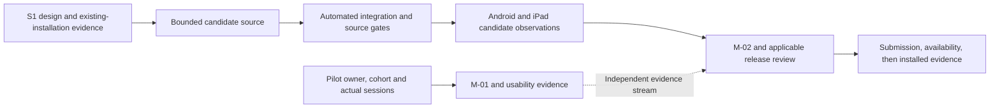

<!-- SPDX-License-Identifier: MIT -->
<!-- Part of PyBLE (https://pyble.dev) — see /LICENSE. -->

# C1-S2 — bounded current-text recovery implementation

| Field | Record |
|---|---|
| Execution date | 31 October 2026; Asia/Bangkok |
| Authorization | User requested implementation for the next release after the C1-S1 integration and stage review |
| Integrated starting baseline | `8dde8d6107e4b3c3fab29340ecec5b40c877444b`; previously merged C1-S1 work |
| Candidate | App `0.3.0+9`; recovery baseline merged at `6f5b3ea`, landscape repair `e54a78a`, native dismissal `01a7ac8`, and guide correction `bef67bd` under PR #41; platform and release reports bind each actual artifact |
| Scope | PYB-006.2 bounded current-text recovery; supporting PYB-009.1 recipe and applicable PYB-008.1 observations |
| Contract | [Current-draft recovery](../../../specifications/App/current-draft-recovery.md), [ADR-0048](../../../decisions/0048-bounded-current-text-draft-recovery.md) |
| Overall state | Scoped PYB-006.2 / M-02 and app-only M-04 pass engineering review at frozen runtime `bef67bd`: 984 ordinary tests, 36 runtime-head CI checks, both-platform recovery/keyboard evidence and all ten declared app/profile rows. Device policy, owned fixtures and normal board advertising are restored; [PR #41](https://github.com/PyBLE-dev/PyBLE/pull/41) merged at `247e58a` after all 36 final-head checks passed. M-05 is partial: internal-account TestFlight delivery verified; external build 9 is submitted and Waiting for Review; Google Play open-testing build 9 is submitted with Changes in review; approval/delivery remain pending. S2 participant follow-up remains unfinished |
| S1 state | Unchanged: six Done, two Prepared, four Awaiting evidence; M-01/SG0 and pilot work remain unfinished |
| Capacity/calendar | Original S2 allowance 24h and 12–25 October dates remain historical forecasts. The 45–72h estimate / 60h S2–S4 option is not measured effort or confirmed human capacity |
| Method | Separate storage, coordinator and UI Git worktrees; root integrates board/session guards, regressions, release records and qualification attempts |

## Acceptance continuation after merge

The user requested completion of the remaining acceptance and release work.
The normal-app runs exposed a connected landscape keyboard overflow. The
specification-first regression at `d1f8719` and repair at `e54a78a` keep the
console output strip compact while the keyboard is open and make navigation
scrollable. The repaired app tree is `d0f2a464e9886c8451a0cb046123973095f246c6`.
At that revision, the ordinary suite had 974 passing tests, the focused shell
suite had 25 passing tests and analysis was clean. [PR #41](https://github.com/PyBLE-dev/PyBLE/pull/41)
merged the repair and subsequent acceptance record. These results are separate from the
972-test PR #40 baseline below. Physical checks and artifact packaging must use
or explicitly revalidate the repaired candidate; version `0.3.0 (9)` alone is
not enough to equate the earlier and repaired binaries.

A further normal-app check found that expanding the console did not dismiss a
keyboard owned by a native Blocks field. The meaningful red test at `62b077c`
and repair at `01a7ac8` add an explicit request to the current Android/iOS
window; the console still follows observed keyboard insets, and a request
acknowledgement is not a claim that dismissal occurred. That revision's app tree is `10336954910872172006300bdcc15d62231471e9`.
It passes 978 ordinary tests, including 28 shell tests and one platform-fallback
test, clean analysis/source gates, and Android/iOS native builds. Android's
physical rerun observes the keyboard hide and console expand while retaining
field text; the final iPad continuation is recorded below. Signed production
artifacts were rebuilt and passed the packaging and repeated 16 KiB runtime
checks in the release report. A subsequent iPad keyboard-palette Hide→Show
transition left the docked keyboard covering the console Expand control while
Flutter insets did not reflect that obstruction; the handler could not be
reached. Native diagnostics show an offscreen notification end frame while the
current view's public keyboard layout guide correctly reports the docked
498-point overlap. That actual platform failure kept the `01a7ac8` artifacts
provisional; the following guide-based correction supersedes that candidate and its physical revalidation is recorded below.
Earlier artifacts and recovery observations retain their own source/artifact
scope; no M-02/M-04 acceptance follows from packaging alone.

| Workstream | Evidence authority | Current disposition |
|---|---|---|
| iPad normal workflow | [iPad acceptance continuation](04_iPad_Acceptance.md) | Normal Preview passes offline Unicode Restore/current-board consent at `e54a78a`, generated-text handoff/recovery at `01a7ac8`, and Editor/native Blocks palette Hide→Show/dismissal at `bef67bd`; exact text and usable viewports are retained. All five iPad Q rows pass on their recorded candidates; exact firmware baselines and unchanged-behavior impact assessment remain explicit |
| Android normal workflow | [Android acceptance continuation](05_Android_Acceptance.md) | Recorded P01–P15 scope and all five Q rows pass with explicit earlier-source/accessibility limits. Final `bef67bd` normal profile `945e9746…` passes Editor/native Blocks keyboard checks and generated-text/offline recovery after actual launcher start under temporary qualifier-only Unrestricted battery policy; original watchdogs and the policy condition remain recorded |
| Production artifacts and channel packet | [Release readiness](06_Release_Readiness.md) | Current `bef67bd` signed Android/iOS artifacts pass packaging and repeated 16 KiB Android startup/storage checks. Earlier artifacts are historical; scoped engineering acceptance is recorded below, with device closeout complete. [PR #41](https://github.com/PyBLE-dev/PyBLE/pull/41) merged at `247e58a` after all 36 final-head checks passed. Apple upload accepted; later internal-account TestFlight `0.3.0 (9)` offer/Open, production About and bounded smoke verified. External build 9 is submitted and Waiting for Review; Google Play open-testing build 9 is submitted with Changes in review; approval and delivery remain pending |
| Pilot and capacity | [Pilot kit](../c1-s1/02_Pilot_Protocol_and_Observation_Kit.md) and [continuation order](../04_Sprint_Plan.md#31-october-continuation-order-and-reforecast) | Human owner/cohort/setup/capacity and actual consented sessions remain pending |

The subsequent guide correction is integrated at
`bef67bded9e5b83437e3eb0e2ec4be6a4cfd1a64`, equivalent to release-worktree commit
`c6e685dd3ebe718ed89fcfe58e441331eb174648`, app tree
`60b3a68b693551af5d83076547c502f69838e052`. It uses the greater of Flutter's
ordinary inset and the current view's observed guide overlap, including a
remaining input palette, with safe-area handling and generation/lifecycle
checks. Explicit snapshots recover a measurement that arrived before updated
window dimensions. The committed source passes 984 ordinary tests, including
six guide regressions, plus native iOS compilation and analysis/source gates.
All 36 checks at the PR #41 runtime head pass, including pinned goldens and
native Android WebView checks ([push CI](https://github.com/PyBLE-dev/PyBLE/actions/runs/41199415487),
[PR CI](https://github.com/PyBLE-dev/PyBLE/actions/runs/41199411607)).
Rebuilt signed production artifacts and repeated 16 KiB Android runtime smoke
also pass. The exact iPad Editor and native Blocks palette Hide→Show transitions now pass
on `bef67bd`: Expand stays above the keyboard and is hittable, dismissal restores
the available viewport, and exact text/Blocks field state are retained. Native
screenshots and accessibility frames agree. A subsequent Lenovo
final-candidate run repeatedly reached the Blocks startup watchdog. Retained
OS traces show suppressed renderer-service startup. A same-UID native control
and the normal final profile then load under the explicitly recorded
qualifier-only Unrestricted battery condition; the normal run uses the actual
launcher icon. Its Hello example, native-field keyboard dismissal, guarded
generated-text handoff, acknowledged checkpoint, both-radios-off process
relaunch, exact local Restore and current-target Save/Run cancellation pass.
An early helper incorrectly expected an enabled Preview action in an empty
workspace; the retained hierarchy already showed a valid workspace and Browse
examples. That selector failure is distinct from the genuine earlier watchdogs.
No app startup patch, general production-package failure or universal battery
workaround is claimed. Earlier rows retain their actual source/artifact scope.

After artifact freeze, `ef19773` corrects four explanatory comment lines in
`blockly_webview.dart` about the pinned Android asset-loading adapter. It changes
no executable behavior. The retained binaries remain bound to `bef67bd` and its
app tree; the later branch tree is not asserted byte-identical to that build.

## Verified firmware inputs for the app observations

A reported agent version of `0.6.1` does not distinguish the retained observer
build from the owner-published build. Read-only verification on 31 October bound
the following current program bytes before using them as app-compatibility
inputs. ESP rows compare device-computed MD5 values for the complete immutable
bootloader, partition table and application against retained components; their
SHA-256 below identifies the matching reference application. The Pico row is
an actual verified raw-flash readback SHA-256. Mutable NVS/PHY and user-filesystem
regions are outside these firmware-identity comparisons.

| Exact profile | Current immutable program identity | Application/raw program SHA-256 | Evidence scope |
|---|---|---|---|
| `esp32-4mb` | Owner-published source `c8f549eeabe6d2b8c2766eab022517944bb09c8c` | `0f05c96631832da8e9e03b5895a398d6787d7dad2eb5c624beaef2497fdb8a0c` | All three immutable components match; supersedes the earlier prefix-only observation |
| `esp32-s3-n16r8` | Retained observer source `96497b9cf642ab2078842ce8a321c3c84b6714b2` | `746b2375ee6d3346413597cf04ffd5ef4e5f397d18d9d934f6646d016cf29c4c` | Exact ROM identity, flash geometry and all three immutable component checksums match |
| `waveshare-esp32-s3-lcd-147b` | Retained observer source `96497b9cf642ab2078842ce8a321c3c84b6714b2` | `3641a4eeaefcb7dde6626596ccd7b6c5b10859241fcd5dd580918f467d19f2d7` | Exact ROM identity, flash geometry and all three immutable component checksums match |
| `esp32-c3-4mb` | Retained observer source `96497b9cf642ab2078842ce8a321c3c84b6714b2` | `792cbf018a9cba8f70ad6bddd543a690ecd38e5eaa8c6ba034d70e5afc12d042` | Exact ROM identity, flash geometry and all three immutable component checksums match after release of the Android session |
| `rpi-pico2-w` | Retained observer source `96497b9cf642ab2078842ce8a321c3c84b6714b2` | `36220898a8bfef521453eb04b3dd01b005a13f34275ab57b8cb060e1c0b535e2` | Exact runtime/ROM identity and verified 862,492-byte raw read at flash offset zero match |

Private receipts are retained under
`local/recovery-completion/firmware-verification/` and, for Classic,
`local/recovery-completion/ipad/firmware-provenance/`. USB aliases were freshly
bound to retained physical identities. Earlier setup failures remain in the
evidence: missing separate observer bootloader input, native USB re-enumeration,
unavailable Pico USB REPL, and incomplete `picotool info -d` fields. The
successful Pico route used the maintained BLE runtime-identity check and a
transient `machine.bootloader()` command, followed by `picotool` verified read
and application reboot. All five boards appeared in the final scan after the
C3 verification and return to runtime. No firmware or filesystem write and no erase
operation was performed.

The observer-to-published source diff changes qualification-policy and release
validator/audit files; runtime code, board definitions, upstream pins and build
drivers are unchanged. Their resulting program bytes are nevertheless distinct.
App observations name the actual baseline and its historical limitations;
they cannot be relabelled as tests of the published bytes. The 31 October
engineering scope review by the Codex integration operator selects these
current, verified baselines for the app-only Q rows, using the unchanged runtime,
board, upstream and build-driver sources as the rationale. This is a bounded
compatibility scope decision, not binary equivalence, a human release sign-off,
or a waiver of matrix requirements. No firmware update is selected. Claims of
candidate-app testing against published `c8f549ee` on all profiles remain outside
this evidence. No new firmware qualification or full firmware-suite pass is
created by this comparison.

## User outcome and implementation

An acknowledged current-text checkpoint can be offered after an app restart for
explicit local Restore or Discard. The bounded feature protects one text slot;
it does not implement project management, Blocks workspace recovery or backup.
Existing channel installations are separate from this engineering-qualified candidate.

| Component | Candidate behavior | Evidence boundary |
|---|---|---|
| Drift repository | `projects` / `project_files` subset and one SettingsStore; atomic content/metadata/generation; exact UTF-8 and SHA-256; 1 MiB admission bound | File-backed tests/schema fixtures, both native storage harnesses and the accepted normal-app platform observations |
| Production storage | `pyble.sqlite` below the platform app-private Application Support directory; owned background database connection with WAL and FULL synchronization | No cache/scratch/preferences substitute; preserve database/WAL/journal on failure |
| Recovery coordinator | One active checkpoint and one coalesced pending revision; 500ms idle and maximum 2s active scheduling; manual/lifecycle flush; durable acknowledgement separate from board dirty | Controller timer/epoch/failure tests; callbacks are not a promise that every last keystroke survives termination |
| Startup and local panel | Resolve storage before Connect mounts; explicit preview/Restore/Discard; ten-second bounded wait; Retry / clearly volatile continuation | ARB-backed widget/semantics checks; disconnected preview/copy is a narrow shell exception |
| Guarded replacement | Confirm meaningful pending/dirty replacements; commit replacement/tombstone before adoption; keep live text if storage fails; require explicit volatile fallback | New, Board Open and Blocks-to-Editor keep captured editor epochs across confirmation and asynchronous work |
| Board authority | Restored text is dirty and unbound; Save/Run/Files Upload require current destination consent; paths in recovery metadata confer no authority | Recording-connection/session tests and observed physical current-target consent/cancellation; no implicit board write is authorized |
| Stale work | Epoch checks detect edit-away/back; facade/session guards fence Board Open and Save/Upload completion; PUT-to-Run refuses a changed attachment | A stable Connection facade is tested; no persistent board identity/session stamp is introduced |
| Unsafe store state | Conflict/corrupt/unsupported checkpoint state stops writes; Retry rereads and offers a choice without replacing live text | Generation conflict regression; no silent reset, downgrade or deletion |

## Sprint tasks and delivery state

The engineering review accepts the bounded recovery outcome and its supporting
recipe/platform work. Device closeout is complete. Ten engineering tasks are
Done; participant follow-up is a separate unfinished task, so the whole Sprint is not complete.

| Task | Current state | Evidence / carried boundary |
|---|---|---|
| C1-S2-T01 / PYB-009.1 | Done — scoped operator recipe executed and reviewed | Actual setup/keyboard corrections incorporated; optional second-operator reproduction remains PYB-009.2 |
| C1-S2-T02 / PYB-006.2 | Done — checkpoint/relaunch/side-effect tests | Meaningful red/green evidence and integrated suite pass |
| C1-S2-T03 / PYB-006.2 | Done — storage failure/interruption/stale-operation tests | File-backed fault and controller/session oracles pass |
| C1-S2-T04 / PYB-006.2 | Done — durable storage and schema | Automated and both-platform native storage/restart evidence pass |
| C1-S2-T05 / PYB-006.2 | Done — startup choices/coordinator/UI | Normal-app offline Restore, explicit Discard and generated-text recovery observed |
| C1-S2-T06 / PYB-006.2 | Done — failure guidance/localization/volatile choices | Required widget/localization/semantics and scoped physical evidence pass |
| C1-S2-T07 / PYB-006.2 | Done — applicable automated regression | 984 ordinary tests; 36 frozen-runtime CI checks including pinned goldens/native WebView; later documentation integration tracked separately |
| C1-S2-T08 / PYB-008.1 | Done — Android observations reviewed | [Android report](05_Android_Acceptance.md): exact sources, final affected checks, OEM qualifier condition and retained failures |
| C1-S2-T09 / PYB-008.1 | Done — iPad observations reviewed | [iPad report](04_iPad_Acceptance.md): offline/consent/generated text, final palette regression and all five app/profile rows |
| C1-S2-T10 / PYB-006.2 | Done — scoped review, evidence reconciliation and device closeout | Actual policy restoration, owned-fixture cleanup and restored advertising recorded; PR #41 subsequently merged after all 36 final-head checks passed |
| C1-S2-T11 / PYB-011.2 | Awaiting participant evidence | No consenting activation dates or mature follow-up records supplied |

## Required scenario evidence

Component counts below are historical subsets of the integrated 972-test run.
They must not be added together. PR #40 and post-merge CI confirm the combined
source gates; physical observations remain bound to their recorded artifacts.

| Scenario | Implemented evidence | Current acceptance state |
|---|---|---|
| DR-T01 | Real repository validation/round-trip tests: exact Unicode, filenames, content bound and invalid metadata | Automated integrated suite passing |
| DR-T02 | File-backed close/reopen retains the committed slot and generation | Automated suite and Lenovo separate-process harness passing; iPad separate-process profile harness passing; normal-app restart/Restore observed on both platforms |
| DR-T03 | Child-process SIGKILL before/after write checkpoints; whole old/new committed content oracle | Host fault-controlled interruption tests and both-platform killed-process restart checks pass; deterministic physical phase timing is not claimed; normal-app interaction scenarios are recorded separately |
| DR-T04 | Real storage failure injection plus controller failure state retains previous copy and live edits | Automated integrated suite passing |
| DR-T05 | Bad hash/metadata, corrupt/truncated database and unsupported version fixtures; bounded startup error UI | Automated integrated suite passing |
| DR-T06 | Fresh v1/reopen, exported first schema and unsupported-version refusal; no fictional released v0 | Integrated schema tests pass; future schema migrations remain gated on new fixtures |
| DR-T07 | Explicit Restore/Discard, failed discard, volatile Retry, late hydration and no implicit board writes | Automated suite, Lenovo Restore/offline preview/relaunch, and iPad normal-app offline preview/Discard cancellation/Restore pass; final normal-app affected checks also pass with the Android OEM condition recorded |
| DR-T08 | Deterministic 500ms / continuous-edit 2s scheduling; delayed commits, startup timeout and epoch tests | Integrated clock/epoch/lifecycle tests pass; candidate-specific physical interruption scope remains explicit |
| DR-T09 | Active write/replacement serialization, tombstones and no queued resurrection | Automated integrated suite passing |
| DR-T10 | Recovered-target cancellation and stale document/path/session consent | Recording-connection tests and Lenovo/iPad current-target Save/Run consent with cancellation pass for their recorded candidates; iPad Files Upload cancellation preserves the empty destination, while confirmation writes only the selected file. Final affected checks pass within their declared artifact/platform conditions |
| DR-T11 | Stable-facade board swap, delayed GET, stale completion and PUT-to-Run attachment refusal | Integrated recording-connection/session regression passes |
| DR-T12 | Explicit generated text handoff with editor-epoch/revision guards; existing workspace/sidecar behavior retained | Affected automated regression and representative Android/iPad device checks pass. The iPad normal Preview preserves the previous Unicode draft on handoff cancellation, adopts exact generated text only on confirmation, and offers that committed text after actual relaunch |
| DR-T13 | Local/board status separation, ARB error/status copy, disconnected preview, keyboard and 2× text | Automated UI/localization/semantics and pinned golden CI pass; physical Lenovo 2× preview observed; local macOS mismatch remains documented separately |
| DR-T14 | Exact recorded Android/iPad candidate, offline restore and explicit current target consent | Lenovo observations and signed iPad native-storage checks retained; normal iPad offline Restore and current-target Save/Run consent now pass. Both-platform generated-text checks also pass; final keyboard regressions and affected normal-app checks pass on both platforms with the Android qualifier condition explicit |

## Verification and distribution boundary

| Check | Reported result / limitation |
|---|---|
| Storage component suite | 21 passing, including file-backed tests and fault-controlled child-process SIGKILL checks |
| Coordinator/document suite | 27 passing, including failed discard, delayed hydration, replacement/session races and conflict Retry choice |
| UI component suite | 57 passing in the latest component report; included in the final ordinary suite |
| Integrated storage/coordinator/guard subset | 51 passing in an integration subset; overlaps component suites |
| Static analysis | Full app analysis reported no issues at the latest integration checkpoint |
| Full app regression and repository gates | At app source `90311f3`: 972 ordinary Flutter tests pass; analysis clean; 204 Dart files formatted; no-leak/SPDX/import/locale/DCO pass; 42 publication tests and Markdown links pass after documentation updates |
| Android additional harness | Lenovo Android 12 separate-process seed/verify and production-entry offline UI checks pass in an isolated app; [scope/artifacts](02_Platform_Qualification.md) |
| iPad additional harness | Signed profile build/install/launch succeed. Seed and verify assertion receipts pass across a killed process; closed database hash unchanged. Flutter debug path remains unavailable |
| Candidate store state | Apple accepted the `0.3.0 (9)` upload on 31 October at `14:03:25 UTC` and started processing; see the [channel receipt](06_Release_Readiness.md#31-october-app-store-connect-upload-receipt). Later internal-account TestFlight offer/Open, production About and bounded smoke verify the existing updated installation; the exact update transaction was not observed. External build 9 is submitted and Waiting for Review; Google Play open-testing build 9 is submitted with Changes in review; its approval and delivery remain pending |
| Firmware and Ready | No new firmware publication or complete five-profile qualification; no second-operator reproduction or PyBLE Ready award |

## 31 October engineering acceptance and next stage

The Codex integration operator, under the user's completion request, reviewed
DR-T01–14, the exact platform reports and the frozen candidate against the
selected story criteria and Definition of Done. This is an automated engineering
review with parallel source/evidence review; it does not invent an independent
human sign-off or a Scrum ceremony.

- **PYB-006.2 / M-02 accepted:** one durable current-text slot, explicit local
  Restore/Discard and current-board consent, with required failure/stale-work
  coverage. Full A-24 projects/history, durable settings and Blocks graphs remain
  outside this accepted slice.
- **PYB-008.1/.2 and app-only M-04 engineering pass:** all ten declared profile /
  platform rows, exact unchanged firmware inputs, final affected keyboard and
  generated-text checks, signed packaging and Android 16 KiB runtime evidence.
  Earlier-row impact assessments and the Lenovo qualifier's temporary battery
  condition remain part of the accepted scope. No new firmware qualification,
  published-image equivalence on all five profiles or Ready badge is inferred.
- **Review scope:** source/red-green history, locked dependency/license/privacy
  records and the [scoped dependency audit](06_Release_Readiness.md) were checked.
  The website's remaining moderate toolchain findings are separate maintenance;
  the audit is not a vulnerability-free claim.
- **Closeout complete:** the qualifier is back to Optimized with Unrestricted
  off and removed from the device-idle allowlist. Global DuraSpeed settings are
  unchanged, and the production package was not altered. All 19 authored files
  were read/CRC-checked and backed up before removal; ten empty owned
  directories were also removed across eight cleanup sessions. Unrelated root
  entries were preserved. Classic
  ESP32 returned to advertising after fresh ROM identity verification and an
  ordinary RTS reset, with no firmware/filesystem write; all five boards then
  advertised. That restoration is not counted as an app reconnect pass. The
  platform/release reports retain the private receipts. [PR #41](https://github.com/PyBLE-dev/PyBLE/pull/41)
  merged after all 36 final-head checks passed; those integration checks are
  separate from the 36 passing frozen-runtime checks.
- **Next release stage — M-05:** track the submitted Google Play open-testing
  build 9 in Changes in review and verify its availability and installed identity
  after approval; production build 8 remains unchanged. Internal-account TestFlight
  delivery is verified in the [delivery record](06_Release_Readiness.md#31-october-testflight-delivery-and-published-metadata);
  external build 9 is assigned and submitted with status Waiting for Review.
  Track Apple's decision and subsequent external availability separately.
  The update transaction was not observed; no manual upgrade gesture is claimed.
  Prepared binaries, local Preview installs and passing engineering tests do not
  establish channel delivery.

Human pilot work remains its own evidence stream. T11 and the earlier S1
participant obligations are unfinished; no recruitment, consent, return-rate
result or human capacity is reconstructed from these engineering runs.

## Integrated source and CI review

The 33 local pixel comparisons differ on macOS 27.0.1 with Flutter 3.44.1.
All 33 rendered images matched the same tests from unchanged `8dde8d6` on this
host, so existing baselines were retained. This local diagnosis is not a golden
pass; the pinned macOS 15 CI jobs provide that result.

[PR #40](https://github.com/PyBLE-dev/PyBLE/pull/40) merged on 31 October at
`6f5b3ea73a70342331fb49d0685938ce2a4cae11` using the repository-required rebase
method. All 29 commits retained their DCO sign-offs and equivalent patches; the
merged tree equals the reviewed `ace7dbb` tree. All 36 pre-merge checks passed.
The [post-merge workflow](https://github.com/PyBLE-dev/PyBLE/actions/runs/41183672112)
also completed successfully, including pinned goldens and native Android jobs.
The feature branch was removed after verification. Source integration does not
establish store publication or acceptance of unperformed physical scenarios.

The final boundedness audit added SQL byte/count preflights before metadata or
row materialization: corrupt metadata is capped before JSON reaches the UI
isolate. At that earlier checkpoint, the ordinary suite had 972 passing tests. [Platform results](02_Platform_Qualification.md)
include successful iPad profile assertion receipts and a killed-process boundary.
All five boards now appear in the Lenovo scan after the [classic ESP32 recovery](03_Classic_ESP32_Workspace_Recovery.md).
Its workspace exactly matched an intentional invalid-media fixture left by an
earlier qualification run. A fresh backup and the verified valid original
workspace were preserved; restoring only that region returned `8C9E` to normal
advertising. No firmware or scan-count logic changed.

### PR #41 final integration receipt

[PR #41](https://github.com/PyBLE-dev/PyBLE/pull/41) merged on
31 October 2026 at `14:01:01 UTC` as
`247e58adadd52ebe46c6f684a6ee06f36a90a9bf`. All 36 checks on final reviewed head
`34dd89e40bc69b97a0d1caf198f234eab6cf1e02` passed across the
[push workflow](https://github.com/PyBLE-dev/PyBLE/actions/runs/41206669043) and
[PR workflow](https://github.com/PyBLE-dev/PyBLE/actions/runs/41206673197).
After fetching `main`, both commits resolved to the exact repository tree
`b32115d210dcd198f0289f0b4486f1bce4a0b108`.

This proves integration of the reviewed source and evidence. The accepted
production artifacts remain bound to frozen runtime `bef67bd` and app tree
`60b3a68b693551af5d83076547c502f69838e052`; the later explanatory comment and
reports do not change their executable behavior. Merge and CI do not establish
store upload, processing, availability or an installed-channel upgrade.
