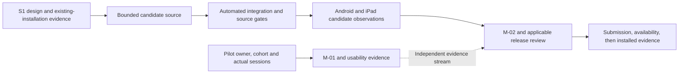

<!-- SPDX-License-Identifier: MIT -->
<!-- Part of PyBLE (https://pyble.dev) — see /LICENSE. -->

# C1-S2 — bounded current-text recovery implementation

| Field | Record |
|---|---|
| Execution date | 31 October 2026; Asia/Bangkok |
| Authorization | User requested implementation for the next release after the C1-S1 integration and stage review |
| Integrated starting baseline | `8dde8d6107e4b3c3fab29340ecec5b40c877444b`; previously merged C1-S1 work |
| Candidate | App `0.3.0+9`; recovery baseline merged at `6f5b3ea`, landscape repair `e54a78a`, native dismissal `01a7ac8`, and guide correction `bef67bd` under PR #41; platform and release reports bind each actual artifact |
| Scope | PYB-006.2 bounded current-text recovery; supporting PYB-009.1 recipe and applicable PYB-008.1 observations |
| Contract | [Current-draft recovery](../../../specifications/App/current-draft-recovery.md), [ADR-0048](../../../decisions/0048-bounded-current-text-draft-recovery.md) |
| Overall state | Recovery baseline merged with passing post-merge CI; both native platform storage restart baselines and normal-app recovery observations retained. Latest guide-correction source passes 984 ordinary tests, rebuilt production packaging and the exact iPad palette regression. All five iPad Q rows pass with their declared source/baseline scope, and 36 PR #41 checks pass at `bef67bd`. A repeated final-candidate Android Blocks startup failure remains under investigation. PYB-006.2 and M-02 are not Done |
| S1 state | Unchanged: six Done, two Prepared, four Awaiting evidence; M-01/SG0 and pilot work remain unfinished |
| Capacity/calendar | Original S2 allowance 24h and 12–25 October dates remain historical forecasts. The 45–72h estimate / 60h S2–S4 option is not measured effort or confirmed human capacity |
| Method | Separate storage, coordinator and UI Git worktrees; root integrates board/session guards, regressions, release records and qualification attempts |

## Acceptance continuation after merge

The user requested completion of the remaining acceptance and release work.
The normal-app runs exposed a connected landscape keyboard overflow. The
specification-first regression at `d1f8719` and repair at `e54a78a` keep the
console output strip compact while the keyboard is open and make navigation
scrollable. The repaired app tree is `d0f2a464e9886c8451a0cb046123973095f246c6`.
At that revision, the ordinary suite had 974 passing tests, the focused shell
suite had 25 passing tests and analysis was clean. [PR #41](https://github.com/PyBLE-dev/PyBLE/pull/41)
tracks the repair and its current CI/review state. These new results are separate from the
972-test PR #40 baseline below. Physical checks and artifact packaging must use
or explicitly revalidate the repaired candidate; version `0.3.0 (9)` alone is
not enough to equate the earlier and repaired binaries.

A further normal-app check found that expanding the console did not dismiss a
keyboard owned by a native Blocks field. The meaningful red test at `62b077c`
and repair at `01a7ac8` add an explicit request to the current Android/iOS
window; the console still follows observed keyboard insets, and a request
acknowledgement is not a claim that dismissal occurred. That revision's app tree is `10336954910872172006300bdcc15d62231471e9`.
It passes 978 ordinary tests, including 28 shell tests and one platform-fallback
test, clean analysis/source gates, and Android/iOS native builds. Android's
physical rerun observes the keyboard hide and console expand while retaining
field text; the iPad result remains separately tracked. Signed production
artifacts were rebuilt and passed the packaging and repeated 16 KiB runtime
checks in the release report. A subsequent iPad keyboard-palette Hide→Show
transition left the docked keyboard covering the console Expand control while
Flutter insets did not reflect that obstruction; the handler could not be
reached. Native diagnostics show an offscreen notification end frame while the
current view's public keyboard layout guide correctly reports the docked
498-point overlap. That actual platform failure kept the `01a7ac8` artifacts
provisional; the following guide-based correction supersedes that candidate and its physical revalidation is recorded below.
Earlier artifacts and recovery observations retain their own source/artifact
scope; no M-02/M-04 acceptance follows from packaging alone.

| Workstream | Evidence authority | Current disposition |
|---|---|---|
| iPad normal workflow | [iPad acceptance continuation](04_iPad_Acceptance.md) | Normal Preview passes offline Unicode Restore/current-board consent at `e54a78a`, generated-text handoff/recovery at `01a7ac8`, and Editor/native Blocks palette Hide→Show/dismissal at `bef67bd`; exact text and usable viewports are retained. All five iPad Q rows pass on their recorded candidates; exact firmware baselines and unchanged-behavior impact assessment remain explicit |
| Android normal workflow | [Android acceptance continuation](05_Android_Acceptance.md) | Recorded `01a7ac8` P01–P15 scope and five Android Q rows pass with stated earlier-profile/accessibility limits. A repeated Blocks startup watchdog on the subsequent final-candidate attempt is under investigation; earlier passes do not close that admission issue |
| Production artifacts and channel packet | [Release readiness](06_Release_Readiness.md) | Current `bef67bd` signed Android/iOS artifacts pass packaging and repeated 16 KiB Android startup/storage checks. Earlier artifacts are historical; physical acceptance, release admission and channel delivery remain separately tracked |
| Pilot and capacity | [Pilot kit](../c1-s1/02_Pilot_Protocol_and_Observation_Kit.md) and [continuation order](../04_Sprint_Plan.md#31-october-continuation-order-and-reforecast) | Human owner/cohort/setup/capacity and actual consented sessions remain pending |

The subsequent guide correction is integrated at
`bef67bded9e5b83437e3eb0e2ec4be6a4cfd1a64`, equivalent to release-worktree commit
`c6e685dd3ebe718ed89fcfe58e441331eb174648`, app tree
`60b3a68b693551af5d83076547c502f69838e052`. It uses the greater of Flutter's
ordinary inset and the current view's observed guide overlap, including a
remaining input palette, with safe-area handling and generation/lifecycle
checks. Explicit snapshots recover a measurement that arrived before updated
window dimensions. The committed source passes 984 ordinary tests, including
six guide regressions, plus native iOS compilation and analysis/source gates.
All 36 checks at the PR #41 runtime head pass, including pinned goldens and
native Android WebView checks ([push CI](https://github.com/PyBLE-dev/PyBLE/actions/runs/41199415487),
[PR CI](https://github.com/PyBLE-dev/PyBLE/actions/runs/41199411607)).
Rebuilt signed production artifacts and repeated 16 KiB Android runtime smoke
also pass. The exact iPad Editor and native Blocks palette Hide→Show transitions now pass
on `bef67bd`: Expand stays above the keyboard and is hittable, dismissal restores
the available viewport, and exact text/Blocks field state are retained. Native
screenshots and accessibility frames agree. A subsequent Lenovo
final-candidate run also repeatedly reached the Blocks startup watchdog. Its
investigation remains open; the preceding successful Android observations are
retained with their actual source and artifact scope.

After artifact freeze, `ef19773` corrects four explanatory comment lines in
`blockly_webview.dart` about the pinned Android asset-loading adapter. It changes
no executable behavior. The retained binaries remain bound to `bef67bd` and its
app tree; the later branch tree is not asserted byte-identical to that build.

## Verified firmware inputs for the app observations

A reported agent version of `0.6.1` does not distinguish the retained observer
build from the owner-published build. Read-only verification on 31 October bound
the following current program bytes before using them as app-compatibility
inputs. ESP rows compare device-computed MD5 values for the complete immutable
bootloader, partition table and application against retained components; their
SHA-256 below identifies the matching reference application. The Pico row is
an actual verified raw-flash readback SHA-256. Mutable NVS/PHY and user-filesystem
regions are outside these firmware-identity comparisons.

| Exact profile | Current immutable program identity | Application/raw program SHA-256 | Evidence scope |
|---|---|---|---|
| `esp32-4mb` | Owner-published source `c8f549eeabe6d2b8c2766eab022517944bb09c8c` | `0f05c96631832da8e9e03b5895a398d6787d7dad2eb5c624beaef2497fdb8a0c` | All three immutable components match; supersedes the earlier prefix-only observation |
| `esp32-s3-n16r8` | Retained observer source `96497b9cf642ab2078842ce8a321c3c84b6714b2` | `746b2375ee6d3346413597cf04ffd5ef4e5f397d18d9d934f6646d016cf29c4c` | Exact ROM identity, flash geometry and all three immutable component checksums match |
| `waveshare-esp32-s3-lcd-147b` | Retained observer source `96497b9cf642ab2078842ce8a321c3c84b6714b2` | `3641a4eeaefcb7dde6626596ccd7b6c5b10859241fcd5dd580918f467d19f2d7` | Exact ROM identity, flash geometry and all three immutable component checksums match |
| `esp32-c3-4mb` | Retained observer source `96497b9cf642ab2078842ce8a321c3c84b6714b2` | `792cbf018a9cba8f70ad6bddd543a690ecd38e5eaa8c6ba034d70e5afc12d042` | Exact ROM identity, flash geometry and all three immutable component checksums match after release of the Android session |
| `rpi-pico2-w` | Retained observer source `96497b9cf642ab2078842ce8a321c3c84b6714b2` | `36220898a8bfef521453eb04b3dd01b005a13f34275ab57b8cb060e1c0b535e2` | Exact runtime/ROM identity and verified 862,492-byte raw read at flash offset zero match |

Private receipts are retained under
`local/recovery-completion/firmware-verification/` and, for Classic,
`local/recovery-completion/ipad/firmware-provenance/`. USB aliases were freshly
bound to retained physical identities. Earlier setup failures remain in the
evidence: missing separate observer bootloader input, native USB re-enumeration,
unavailable Pico USB REPL, and incomplete `picotool info -d` fields. The
successful Pico route used the maintained BLE runtime-identity check and a
transient `machine.bootloader()` command, followed by `picotool` verified read
and application reboot. All five boards appeared in the final scan after the
C3 verification and return to runtime. No firmware or filesystem write and no erase
operation was performed.

The observer-to-published source diff changes qualification-policy and release
validator/audit files; runtime code, board definitions, upstream pins and build
drivers are unchanged. Their resulting program bytes are nevertheless distinct.
App observations name the actual baseline and its historical limitations;
they cannot be relabelled as tests of the published bytes. The 31 October
engineering scope review by the Codex integration operator selects these
current, verified baselines for the app-only Q rows, using the unchanged runtime,
board, upstream and build-driver sources as the rationale. This is a bounded
compatibility scope decision, not binary equivalence, a human release sign-off,
or admission of an unfinished matrix. No firmware update is selected. Claims of
candidate-app testing against published `c8f549ee` on all profiles remain outside
this evidence. No new firmware qualification or full firmware-suite pass is
created by this comparison.

## User outcome and implementation

An acknowledged current-text checkpoint can be offered after an app restart for
explicit local Restore or Discard. The bounded feature protects one text slot;
it does not implement project management, Blocks workspace recovery or backup.
Existing channel installations are separate from this unqualified candidate.

| Component | Candidate behavior | Evidence boundary |
|---|---|---|
| Drift repository | `projects` / `project_files` subset and one SettingsStore; atomic content/metadata/generation; exact UTF-8 and SHA-256; 1 MiB admission bound | File-backed tests/schema fixtures plus Android/iPad native storage harnesses; full interaction/board acceptance remains pending |
| Production storage | `pyble.sqlite` below the platform app-private Application Support directory; owned background database connection with WAL and FULL synchronization | No cache/scratch/preferences substitute; preserve database/WAL/journal on failure |
| Recovery coordinator | One active checkpoint and one coalesced pending revision; 500ms idle and maximum 2s active scheduling; manual/lifecycle flush; durable acknowledgement separate from board dirty | Controller timer/epoch/failure tests; callbacks are not a promise that every last keystroke survives termination |
| Startup and local panel | Resolve storage before Connect mounts; explicit preview/Restore/Discard; ten-second bounded wait; Retry / clearly volatile continuation | ARB-backed widget/semantics checks; disconnected preview/copy is a narrow shell exception |
| Guarded replacement | Confirm meaningful pending/dirty replacements; commit replacement/tombstone before adoption; keep live text if storage fails; require explicit volatile fallback | New, Board Open and Blocks-to-Editor keep captured editor epochs across confirmation and asynchronous work |
| Board authority | Restored text is dirty and unbound; Save/Run/Files Upload require current destination consent; paths in recovery metadata confer no authority | Recording-connection/session tests; physical board consent and absence of hidden writes remain required |
| Stale work | Epoch checks detect edit-away/back; facade/session guards fence Board Open and Save/Upload completion; PUT-to-Run refuses a changed attachment | A stable Connection facade is tested; no persistent board identity/session stamp is introduced |
| Unsafe store state | Conflict/corrupt/unsupported checkpoint state stops writes; Retry rereads and offers a choice without replacing live text | Generation conflict regression; no silent reset, downgrade or deletion |

## Sprint tasks and delivery state

These statuses report progress toward the selected outcome. **Implemented** is
source progress; it is not a Done Increment or release admission.

| Task | Current state | Remaining acceptance |
|---|---|---|
| C1-S2-T01 / PYB-009.1 | Prepared — [scoped recipe](01_Operator_Recipe.md) | Execute against exact candidate; reconcile observations and operator gaps |
| C1-S2-T02 / PYB-006.2 | Implemented — checkpoint/relaunch/side-effect tests | Integrated regression passes; reconcile required physical acceptance |
| C1-S2-T03 / PYB-006.2 | Implemented — storage failure/interruption/stale-operation tests | Integrated regression passes; reconcile required physical acceptance |
| C1-S2-T04 / PYB-006.2 | Implemented — durable storage and schema | Integrated regression and native storage checks pass; reconcile required physical acceptance |
| C1-S2-T05 / PYB-006.2 | Implemented — startup choices/coordinator/UI | Integrated regression passes; remaining physical interaction/restart checks |
| C1-S2-T06 / PYB-006.2 | Implemented — failure guidance/localization/volatile choices | Automated localization/accessibility/regression checks pass; applicable physical checks remain separate |
| C1-S2-T07 / PYB-006.2 | Implemented and checked — latest source has 984 ordinary tests, including 28 shell, one dismissal-fallback and six guide tests, with clean analysis | PR #40 baseline CI and all 36 PR #41 checks at `bef67bd` pass, including pinned goldens/native WebView; physical/release evidence remains separate |
| C1-S2-T08 / PYB-008.1 | Earlier Android continuation recorded; final-candidate issue under investigation | [Normal-app recovery and five Android Q rows](05_Android_Acceptance.md) pass on their stated sources; repeated Blocks startup watchdog during final-candidate checking remains unresolved |
| C1-S2-T09 / PYB-008.1 | Physical iPad execution complete; final integrated review pending | iPad native storage restart and normal Preview offline Restore/current-board Save/Run consent pass for the recorded artifact; generated-text handoff/recovery and the final Editor/Blocks palette regression also pass; all five iPad release-matrix rows pass with their recorded source and baseline scope |
| C1-S2-T10 / PYB-006.2 | In progress — integration/evidence review | Record final checks, immutable candidates, physical results and carried limitations |
| C1-S2-T11 / PYB-011.2 | Awaiting participant evidence | No consenting activation dates or mature follow-up records supplied |

## Required scenario evidence

Component counts below are historical subsets of the integrated 972-test run.
They must not be added together. PR #40 and post-merge CI confirm the combined
source gates; physical observations remain bound to their recorded artifacts.

| Scenario | Implemented evidence | Current acceptance state |
|---|---|---|
| DR-T01 | Real repository validation/round-trip tests: exact Unicode, filenames, content bound and invalid metadata | Automated integrated suite passing |
| DR-T02 | File-backed close/reopen retains the committed slot and generation | Automated suite and Lenovo separate-process harness passing; iPad separate-process profile harness passing; full interaction matrix pending |
| DR-T03 | Child-process SIGKILL before/after write checkpoints; whole old/new committed content oracle | Host fault-controlled interruption tests and both-platform killed-process restart checks pass; deterministic physical phase timing is not claimed; remaining normal-app interaction scenarios are recorded separately |
| DR-T04 | Real storage failure injection plus controller failure state retains previous copy and live edits | Automated integrated suite passing |
| DR-T05 | Bad hash/metadata, corrupt/truncated database and unsupported version fixtures; bounded startup error UI | Automated integrated suite passing |
| DR-T06 | Fresh v1/reopen, exported first schema and unsupported-version refusal; no fictional released v0 | Integrated schema tests pass; future schema migrations remain gated on new fixtures |
| DR-T07 | Explicit Restore/Discard, failed discard, volatile Retry, late hydration and no implicit board writes | Automated suite, Lenovo Restore/offline preview/relaunch, and iPad normal-app offline preview/Discard cancellation/Restore pass; final-candidate interaction matrix pending |
| DR-T08 | Deterministic 500ms / continuous-edit 2s scheduling; delayed commits, startup timeout and epoch tests | Integrated clock/epoch/lifecycle tests pass; candidate-specific physical interruption scope remains explicit |
| DR-T09 | Active write/replacement serialization, tombstones and no queued resurrection | Automated integrated suite passing |
| DR-T10 | Recovered-target cancellation and stale document/path/session consent | Recording-connection tests and Lenovo/iPad current-target Save/Run consent with cancellation pass for their recorded candidates; iPad Files Upload cancellation preserves the empty destination, while confirmation writes only the selected file. Final affected checks remain separate |
| DR-T11 | Stable-facade board swap, delayed GET, stale completion and PUT-to-Run attachment refusal | Integrated recording-connection/session regression passes |
| DR-T12 | Explicit generated text handoff with editor-epoch/revision guards; existing workspace/sidecar behavior retained | Affected automated regression and representative Android/iPad device checks pass. The iPad normal Preview preserves the previous Unicode draft on handoff cancellation, adopts exact generated text only on confirmation, and offers that committed text after actual relaunch |
| DR-T13 | Local/board status separation, ARB error/status copy, disconnected preview, keyboard and 2× text | Automated UI/localization/semantics and pinned golden CI pass; physical Lenovo 2× preview observed; local macOS mismatch remains documented separately |
| DR-T14 | Exact recorded Android/iPad candidate, offline restore and explicit current target consent | Lenovo observations and signed iPad native-storage checks retained; normal iPad offline Restore and current-target Save/Run consent now pass. Both-platform generated-text checks also pass; final iPad keyboard regression passes; the subsequent Android Blocks startup observation remains under investigation |

## Verification and remaining admission

| Check | Reported result / limitation |
|---|---|
| Storage component suite | 21 passing, including file-backed tests and fault-controlled child-process SIGKILL checks |
| Coordinator/document suite | 27 passing, including failed discard, delayed hydration, replacement/session races and conflict Retry choice |
| UI component suite | 57 passing in the latest component report; included in the final ordinary suite |
| Integrated storage/coordinator/guard subset | 51 passing in an integration subset; overlaps component suites |
| Static analysis | Full app analysis reported no issues at the latest integration checkpoint |
| Full app regression and repository gates | At app source `90311f3`: 972 ordinary Flutter tests pass; analysis clean; 204 Dart files formatted; no-leak/SPDX/import/locale/DCO pass; 42 publication tests and Markdown links pass after documentation updates |
| Android additional harness | Lenovo Android 12 separate-process seed/verify and production-entry offline UI checks pass in an isolated app; [scope/artifacts](02_Platform_Qualification.md) |
| iPad additional harness | Signed profile build/install/launch succeed. Seed and verify assertion receipts pass across a killed process; closed database hash unchanged. Flutter debug path remains unavailable |
| Candidate store state | No Google Play/TestFlight submission, approval, new public availability or installed-store verification established by this work |
| Firmware and Ready | No new firmware publication or complete five-profile qualification; no second-operator reproduction or PyBLE Ready award |

The next required work is resolving the final-candidate Android Blocks startup
observation and reviewing the now-completed iPad release-matrix evidence. Preserve
failed/not-run rows rather than weakening the contract to meet a date. Human
pilot work continues as its own evidence stream. No full A-24 completion,
qualified release or publication follows from source commits alone.

## Integrated source and CI review

The 33 local pixel comparisons differ on macOS 27.0.1 with Flutter 3.44.1.
All 33 rendered images matched the same tests from unchanged `8dde8d6` on this
host, so existing baselines were retained. This local diagnosis is not a golden
pass; the pinned macOS 15 CI jobs provide that result.

[PR #40](https://github.com/PyBLE-dev/PyBLE/pull/40) merged on 31 October at
`6f5b3ea73a70342331fb49d0685938ce2a4cae11` using the repository-required rebase
method. All 29 commits retained their DCO sign-offs and equivalent patches; the
merged tree equals the reviewed `ace7dbb` tree. All 36 pre-merge checks passed.
The [post-merge workflow](https://github.com/PyBLE-dev/PyBLE/actions/runs/41183672112)
also completed successfully, including pinned goldens and native Android jobs.
The feature branch was removed after verification. Source integration does not
establish store publication or acceptance of unperformed physical scenarios.

The final boundedness audit added SQL byte/count preflights before metadata or
row materialization: corrupt metadata is capped before JSON reaches the UI
isolate. The final ordinary suite is 972 passing tests. [Platform results](02_Platform_Qualification.md)
include successful iPad profile assertion receipts and a killed-process boundary.
All five boards now appear in the Lenovo scan after the [classic ESP32 recovery](03_Classic_ESP32_Workspace_Recovery.md).
Its workspace exactly matched an intentional invalid-media fixture left by an
earlier qualification run. A fresh backup and the verified valid original
workspace were preserved; restoring only that region returned `8C9E` to normal
advertising. No firmware or scan-count logic changed.
