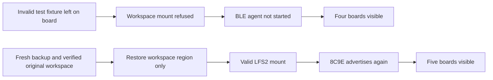

<!-- SPDX-License-Identifier: MIT -->
<!-- Part of PyBLE (https://pyble.dev) — see /LICENSE. -->

# Classic ESP32 — missing advertisement and workspace recovery

| Field | Record |
|---|---|
| Date | 31 October 2026; Asia/Bangkok |
| Trigger | Owner connected all five boards but Lenovo scan showed four |
| Physical board | Classic ESP32-D0WD revision 1.0; CP2102 adapter; ROM base MAC ending `8C:9C`, Bluetooth suffix `8C9E` |
| Missing / present | `8C9E` absent; `C81A`, `3DCB`, `5646` and `DA86` present |
| Confirmed cause | Workspace contained exactly the intentional invalid-media fixture from the earlier qualification run; firmware correctly refused mounting and withheld BLE agent startup |
| Result | Verified pre-test workspace restored; native scan subsequently shows all five boards including `PyBLE-8C9E` |
| Firmware | Existing PyBLE 0.6.1 retained; no application, bootloader or partition-table update |
| Evidence | Ignored `local/recovery-implementation/`: startup trace, fresh backups, hashes, restoration log, offline inventory and five-board UI XML |

## Diagnosis and preservation

Source inspection established that there is no four-result limit. The adapter
filters only by PBLE service UUID, the accumulator retains distinct OS device
IDs and the UI renders the full result count. Pico 2 W (`3DCB`) was present.

Serial ownership was free. Short UART captures saw only the ROM boot; a longer
45-second controlled capture reached the workspace recovery message, then the
MicroPython 1.28.0 / PyBLE 0.6.1 banner and REPL. This is the intentional
[nonblank-media protection](../../../specifications/firmware/TDD.md#91-filesystem)
path, rather than evidence of unsupported silicon or a scan-list cap. The
complete read-only media scan explains the delayed startup message.

A 115200-baud ROM read established that the installed first 256 KiB matches the
retained c8f549ee candidate image prefix at flash offset 0x1000. An earlier
460800-baud attempt had framing errors; no write was attempted at that speed.
Only prefix correspondence is claimed, not an independently read whole-image
hash.

The fresh **entire 2 MiB workspace** exactly matched the earlier refusal fixture:
first 8,192 bytes `0x00`, remainder `0xFF`. This proves the current region contains
the synthetic test fixture rather than a new user filesystem. The earlier run
failed after that test and never produced its planned erased-media/recovery
receipt. That leftover test state should have been restored before handback.

| Preserved or prepared input | SHA-256 / validation |
|---|---|
| Fresh current workspace backup | `cc5fcfcad390f42a5f7b0603f08f0142e9d0618c3ac102cb2ffab08722626ee1`; 2,097,152 bytes, exact equality with retained fixture |
| Immutable original full owner backup | `2aa2280b9fa0d66bbd60e73d0858e8df62f8025aa1e93f1c900ea86eb36aca3e`; rehashed before extraction |
| Original valid workspace extraction | `33490a100808d7fc89854d079bfa072e53ee0d48a80aa2ce8cd895ca643a0f37`; same 2 MiB region and identical partition geometry |
| Offline original-workspace inspection | Explicit LFS2 mount on a copied buffer; one empty diagnostic `.pbltmp` file, no user programs or boot scripts; original bytes unchanged |
| Existing NVS region | Erased in the captured image; workspace restoration does not restore old autorun settings |

The offline reader (`littlefs-python` 0.19.0) was installed only in an ignored
inspection environment. Its buffer was mounted explicitly without formatting;
no board or immutable backup was changed during inspection. It is not an app
or firmware dependency.

## Controlled restoration and result

The explicit operator restoration wrote **only flash 0x200000–0x3fffff**, using
the verified original workspace extraction. Both current and original backups
remain preserved. The operation restored the board from synthetic test data to
its valid pre-test workspace; it did not format unknown owner data or install a
new firmware image.

The flash tool reported `Hash of data verified.` before its normal reset. The
next native Lenovo scan included `PyBLE-8C9E` at approximately −45 dBm and
reported **Boards seen: 5**. The other four advertisements remained present.

## Future qualification handback

After intentional invalid-media or interrupted-install tests, retain the actual
failed evidence and explicitly restore or hand off the disposable board state.
A completed host report does not prove that the physical board is ready for
ordinary use. Verify normal startup and advertisement, and record remaining
work before disconnecting the bench. Do not run old destructive qualification
collectors as a recovery shortcut or silently format a nonblank workspace.
