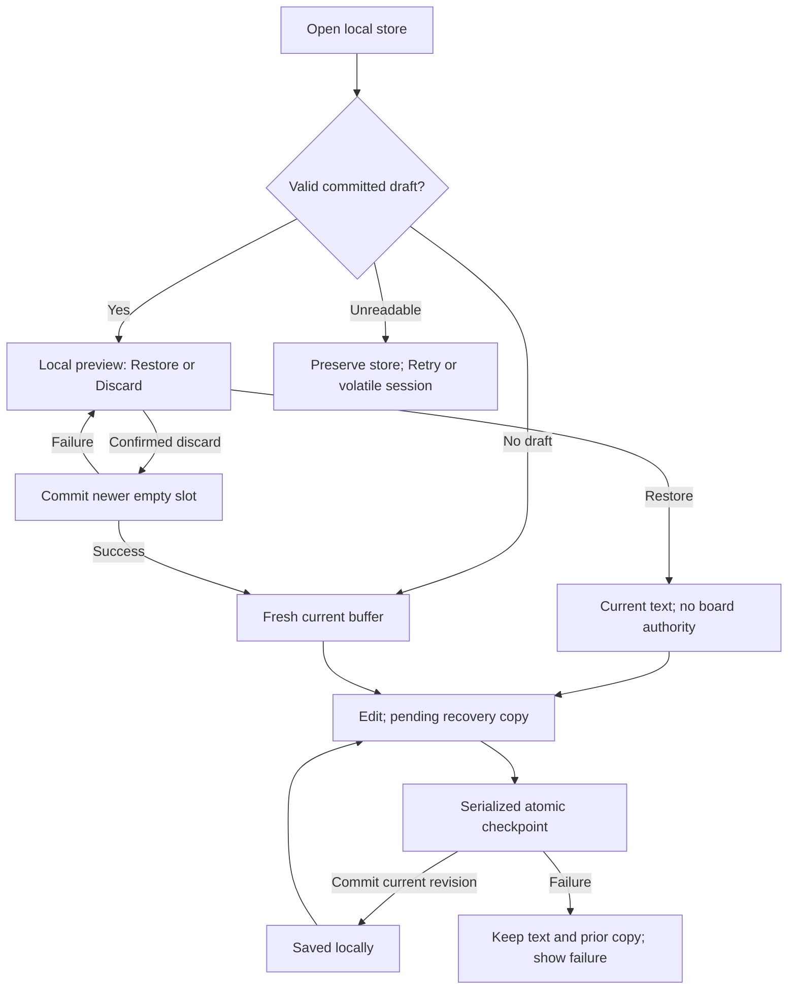

<!-- SPDX-License-Identifier: MIT -->
<!-- Part of PyBLE (https://pyble.dev) — see /LICENSE. -->

# Current-text draft recovery — bounded implementation contract

| Field | Value |
|---|---|
| Design baseline | 25 September 2026; C1-S1-T10/T11, PYB-006.1 |
| Status | Bounded `0.3.0+9` recovery accepted by 31 October engineering review at `bef67bd`; required automated and both-platform physical evidence pass; channel delivery remains separate |
| Decision | [ADR-0048](../../decisions/0048-bounded-current-text-draft-recovery.md) |
| Parent obligations | A-24; FR-EDIT-7, FR-PROJ-2/6, NFR-REL-3; their broader acceptance remains carried |
| Delivery and sizing | [C1-S1 design review](../../developments/2026-q4-reliable-workflow/c1-s1/03_Recovery_Design_and_Sizing.md) |

This is the normative contract for PYB-006.2. Candidate source now implements
its bounded current-text storage, coordinator, recovery UI and guarded board
actions. [The implementation record](../../developments/2026-q4-reliable-workflow/c1-s2/00_Execution_Record.md)
records the scoped automated/physical acceptance and declared test conditions.
[Channel evidence](../../developments/2026-q4-reliable-workflow/c1-s2/06_Release_Readiness.md#31-october-testflight-delivery-and-published-metadata)
separately verifies internal-account TestFlight `0.3.0 (9)` delivery; external
build 9 is submitted and Waiting for Review. Google Play delivery remains pending. Engineering acceptance alone
does not establish channel availability. [ADR-0048](../../decisions/0048-bounded-current-text-draft-recovery.md)
supersedes the volatile-only current-text limitation in ADR-0010 for this slice.
No PBLE/1 change or board-identity allowlist is introduced.

## 1. Scope and observable promise

| ID | Required behavior |
|---|---|
| DR-01 | Retain one current text document in an on-device Drift database, including an untitled buffer and Python explicitly copied from Blocks into the Editor. Persist exact accepted text, its filename and bounded recovery metadata. |
| DR-02 | A revision is protected only after the matching database transaction commits successfully. Show local recovery status separately from whether the document was uploaded to a board. |
| DR-03 | After process restart, present the last valid committed revision for explicit Restore or Discard without requiring network, BLE permission, scanning or a board. No restore action writes or runs board code. |
| DR-04 | Preserve the previous committed revision when an attempted update fails or is interrupted before commit; never claim newer uncommitted text is protected. Detect unusable storage and fail without silently resetting it. |
| DR-05 | Treat recovered board-path information as historical context. Every recovered draft starts without an authorized board target and must receive explicit current-session target consent before an Editor Save, Run or Files Upload can write it. |
| DR-06 | An old asynchronous read, write, confirmation or board completion must not overwrite newer editor content, clear newer edits, resurrect a discarded draft or authorize another board session. |
| DR-07 | State explicitly that Blocks workspaces, multiple projects/files, console/run history, saved boards, import provenance and durable display settings are outside this slice. |

The guarantee covers an acknowledged recovery checkpoint in the app's retained
private storage across ordinary app termination and relaunch. Text still marked
pending, an uninstalled app, cleared app data, device loss, unrecoverable media
failure and OS restore/backup behavior are outside that guarantee. Copy must not
promise that every keystroke survives immediate termination or that this is a
backup/export service.

## 2. Content and storage model

Use the planned Drift database in `lib/data/`, behind Riverpod-injected typed
repositories. Do not create a scratch-file store, a second preferences store or
a transport dependency. Database work runs outside the UI isolate through one
owned connection/writer. Widgets receive neutral state and commands.

Implement the necessary `projects` and `project_files` subset of the existing
[TDD §9](TDD.md#9-persistence-design-libdata) model plus its single `SettingsStore`.
One internal project and one file form the current-draft slot; this does not
expose a project browser or imply that all six content tables are implemented.
Reserve an internal local key for that project rather than a user-visible
project name. The remaining content tables can be added by tested migrations.

| Stored value | Contract |
|---|---|
| Internal project/file identity | Local opaque identifiers; never board identifiers or an authentication decision |
| Current filename | Exact accepted display leaf; nonempty, no separators, control characters, `.` or `..`; at most 128 UTF-8 bytes. Invalid metadata produces a recoverable validation error, not a silently renamed write target |
| Content | Exact well-formed Unicode text encoded as UTF-8; preserve whitespace, newlines, comments and smart punctuation. Storage must not apply the board Save/Run normalization |
| Size and content hash | Exact UTF-8 byte length and SHA-256 of those bytes; verify before offering Restore. Hash detects accidental content mismatch, not authenticity or a board checksum |
| Recovery metadata in SettingsStore | Versioned draft-slot record: document ID, monotonically increasing persisted generation, filename, optional origin path, checkpoint time and content identity; updated atomically with the content row |
| Origin path | Optional validated historical board path, at most PBLE/1's 128 UTF-8 bytes; shown as context only, never loaded into active `boardPath` authority |
| Empty slot | Explicit committed empty state/tombstone at a newer generation after confirmed Discard or New; pending older writes cannot repopulate it |
| Never stored by this slice | BLE address, board label/identity, session stamp, board-write consent, `Connection`, runtime operation state, console text, Blocks JSON or import credentials/provenance |

Content admission is bounded at **1 MiB of UTF-8 text**. The limit applies to the
recovery copy, not a new silent truncation of the Editor. Larger or malformed
text remains in memory, shows a localized “recovery copy not saved” reason and
leaves the prior committed copy intact. No code is normalized, truncated,
executed or uploaded to make it fit. Snapshot comparison and the byte bound must
not block the UI isolate for large buffers. Boundary tests cover zero bytes, one byte,
the exact limit, one byte over, multibyte text and unpaired UTF-16 surrogates.

Store the database and its journal files in app-private persistent application
storage, never a cache directory or repository. No app-managed remote sync or
telemetry is added. Do not log source, origin paths or database contents in
ordinary diagnostics. The implementation must document actual platform
storage/backup settings without presenting OS-managed backups as a PyBLE feature.

The schema name/column spelling is an implementation detail frozen by the first
schema fixture. Content, recovery metadata and generation must be committed in
one transaction; a row and its metadata can never be accepted separately.
SQLite WAL with `synchronous=FULL` is the specified starting configuration; verify
it on each production connection. This uses SQLite's commit guarantees subject
to functioning filesystem/OS synchronization, not an absolute media-loss
promise. [SQLite WAL documentation](https://www.sqlite.org/wal.html) and
[SQLite atomic commit](https://www.sqlite.org/atomiccommit.html) describe those
boundaries.

## 3. Write boundary and local status

Observe all document mutations, not only `openFromBoard` and `markSaved`:
`setContent`, `newDocument`, `openFromBoard`, `openGenerated`, restore/discard and
successful board-binding changes must go through one recovery coordinator.
Keep the existing document provider readable by Editor, Files and run controls;
keep recovery status in a separate typed provider. Existing `dirty` remains a
board-upload comparison, not proof of durable local storage.

| Local state | User-visible meaning |
|---|---|
| Loading / recovery decision pending | Storage has not yielded a usable current draft; no default empty buffer may overwrite it |
| Pending | Current revision differs from the last acknowledged recovery copy |
| Saving | Its captured snapshot is being committed; newer edits can remain pending |
| Saved locally | The exact current document identity and revision have committed successfully |
| Unavailable / failed | Current text is in memory only, or newer than the saved copy; offer Retry and show the reason without claiming a successful save |

Queue after 500 ms of edit inactivity, with a maximum two-second scheduling
interval during continuous editing while the app is active. These are scheduling
rules, not promised disk completion times. Use one active commit and at most
one coalesced latest pending snapshot. Lifecycle inactive/pause requests an
immediate flush, but a lifecycle callback is never the only persistence trigger
and process termination need not deliver it.

Provide an explicit localized **Save recovery copy** action with completion/error
feedback. It waits for the captured revision's commit; a later edit remains
pending even when that request succeeds. Existing board **Save** and **Run**
retain their explicit board semantics and separate result feedback; a successful
board upload must not be called a successful local checkpoint. The local copy
can succeed while BLE is unavailable, and a board failure cannot delete it.

Do not drop a committed copy merely because the document is clean relative to
a board. Restoring a clean or dirty prior document follows the same local-only
choice and starts with `dirty=true`, `boardPath=null` and no target consent.
A genuinely empty untitled slot produced by confirmed New/Discard does not
prompt at the next launch; a deliberately empty named file is still recoverable.

## 4. Startup, replacement and recovery interaction

Resolve local storage before mounting any recovery-dependent Editor mutations
or auto-starting connection workflows. Show a bounded loading/error surface;
never wait indefinitely behind an unresponsive spinner. After ten seconds without
completion, offer Retry and Continue without recovery. Cancelling a wait advances
the operation epoch; a late completion cannot change the current UI or replace
text. Do not delete or reopen storage underneath a still-running database task.

A local recovery panel is reachable from the disconnected shell as well as the
Editor. This is a narrow exception to the connection-gated shell in
[ADR-0011](../../decisions/0011-connection-gated-shell.md), not a complete offline
IDE. It may preview and copy recovered text locally; the normal IDE still appears
when connected. Restore itself happens before any connection and places text in
the shared document provider; the panel keeps the restored text visible offline.

| Choice / trigger | Required outcome |
|---|---|
| Restore | Preview filename, checkpoint time and text; explain that a board target must be chosen again. Explicit Restore loads the validated copy, resets target authority and increments the editor epoch. It does not delete the durable copy |
| Discard | Confirm deletion of this local recovery copy. Commit the empty-slot tombstone first; only success closes the prompt and installs a fresh buffer. Cancel or failed commit preserves the copy and prompt |
| Dismiss / Back | Leaves the decision unresolved and the committed copy intact; return to the recovery surface, not an empty auto-saving Editor |
| Storage unreadable / migration unsupported | Offer Retry or Continue without recovery with a persistent warning. Preserve the database/journal files; do not auto-delete, recreate or migrate downward |
| Continue without recovery | Allow a clearly volatile session; keep old storage untouched. Retrying later requires an explicit choice between existing local text and recovered text, with preview/copy, never automatic replacement |
| Replace by New, board Open or Blocks-to-Editor | Ask before replacing nonempty/current meaningful content when it is dirty, locally pending/failed, or awaiting recovery. Existing Blocks confirmation must use the same captured editor epoch. Do not require the user to discover which surface owns the previous copy |
| Confirmed replacement | Serialize the replacement/tombstone after cancelling obsolete queued writes. Commit the replacement before acknowledging local protection. If storage fails, retain current content and offer Cancel or explicit continuation in volatile mode; do not silently lose both versions |

Confirmation is bound to the captured editor epoch, not merely equal text or a
filename. A delayed board download or Blocks snapshot must recheck that epoch
and any operation/session guard before replacing the buffer. A changed epoch
requires a new decision. There is one current slot, no history or version browser;
confirmed replacement may remove its prior committed content and must say so.

All new copy, error, status, confirmation and semantics strings are ARB-backed.
Dialogs/panels must remain usable at 2× text, with a keyboard present and through
screen-reader focus; technical filenames, source and board paths stay verbatim.
No automatic copying to the clipboard or export/sharing occurs.

## 5. Document identity, board authority and stale work

Allocate durable generations from the stored high-water mark after opening the
store; never reset them to zero on relaunch. The coordinator is the sole writer
for this slot in the app process; database locking and the transaction guard
reject an unexpected competing writer rather than overwriting a newer copy.

Use the existing `editorDocumentEpochProvider` as an in-process mutation guard
and add explicit current-document identity/recovery generation where needed.
Do not equate equal `EditorDocument` values with the same operation: editing
away and back is still a newer revision. Capture the appropriate identity,
epoch and generation before every asynchronous operation.

| Boundary | Required guard |
|---|---|
| Database startup/read | Startup/retry operation epoch and expected editor epoch; older hydration cannot replace newer text |
| Checkpoint queue | Single serial writer; each mutation or discard has a newer generation. Commit must not regress the durable generation; completion only acknowledges the captured revision |
| Discard/replacement | Cancel obsolete queued snapshots, order a newer tombstone/replacement after an active write, and fence late completions; no resurrection after confirmed success |
| Board Open | Capture expected editor epoch, open-operation generation and `connectionSessionStampOf` before GET; recheck all three immediately before adoption. A stable facade changing from board A to B invalidates the download even when the editor never changed |
| Blocks-to-Editor | Expected editor epoch plus snapshot/operation generation; recheck after snapshot/confirmation and before adopting; preserve any existing board-session guards on a board-backed preparation |
| Save / Files Upload completion | Captured document identity and editor epoch **and** current opaque connection-session stamp; only matching completion may mark the document saved/bound |
| Editor Run upload → run | Capture the session before PUT and recheck it before `runFile`; refuse the second verb on a replacement attachment. Preserve truthful partial outcome: upload may have succeeded but Run did not occur |
| Post-Run completion | Recheck document epoch and session before clearing board-dirty state or persisting binding metadata |
| Board target consent | Bind to current document identity, opaque session stamp, resolved target and action; changing session, document, target or displayed source revision invalidates the pending confirmation |

A `Connection` facade can keep the same object identity across attachments.
Reuse the neutral `connectionSessionStampOf` mechanism already used for Blocks
bundles and Files multi-delete. Do not persist a session stamp or infer the same
physical board from an advertising name, chip, SemVer or a recovered path.

For a recovered draft, show the actual current-session destination and whether
the operation writes only or writes and runs; confirm its ability to overwrite
that path before the first mutation. Cancellation sends no board verb. A
successful explicitly confirmed action may bind that document to the same
session/path for later explicit actions; disconnect or a new attachment revokes
that binding. Files Upload uses its actual `cwd/name` destination, not the
historical path. No board listing or probe happens as a side effect of local
recovery. Existing filesystem-jail, path and capability restrictions still apply.

## 6. Failure and migration rules

| Scenario | Required result |
|---|---|
| Termination before transaction commit | Next launch offers the previous complete committed copy, or no copy if none was ever committed; never partial content/metadata |
| Termination after commit but before UI acknowledgement | New revision may be recoverable; caller uncertainty must not trigger a duplicate board action or rollback to an older revision |
| Full storage, permission loss or write I/O error | Keep current in-memory edits and last committed copy; show a local error and explicit Retry. Do not clear board-dirty/local-pending flags as if the save succeeded |
| Invalid length/hash/metadata or truncated/corrupt database | Refuse automatic hydration, preserve storage, show a bounded error and volatile-mode option. Do not silently choose an empty draft or treat corrupt text as valid |
| Temporarily unavailable protected app storage | Same nondestructive error path; Retry when available. Do not rewrite the store merely because opening failed |
| Unsupported newer schema or recovery format | Fail closed without writing, reset or downgrade; tell the user a compatible app version is needed |
| First install / current volatile release upgrade | Create schema version 1 only when no database exists; start empty. No old disk draft exists to migrate and no pre-upgrade volatile text can be promised recovered |
| Supported future schema migration | Transactional explicit forward steps; preserve the current slot and its identity. Check exported old/new schemas and round-trip fixtures before accepting the version bump |
| Migration interruption/failure | Retain a usable prior schema or report preserved-but-unreadable state. Never catch migration failure by deleting user storage |

Version both the database schema and draft metadata format. Export the first
schema and test fresh creation, reopening, supported fixture migration where
one exists, unsupported-version refusal and interrupted failure paths. A made-up
“v0 disk draft” fixture must not imply earlier released persistence. Follow the
[Drift migration guide](https://drift.simonbinder.eu/migrations/) and
[schema exports](https://drift.simonbinder.eu/migrations/exports/).

A database full/corrupt failure injection is local storage evidence, separate
from a PBLE `ENOSPC` board response. Preserve journal/WAL companions as part of
storage; do not copy only the main file and claim a recoverable checkpoint.
Automatic repair, database reset UI and recovery of arbitrary damaged storage
are not included. Their absence must not cause hidden deletion or a startup loop.

## 7. Required evidence before acceptance

All rows below are required for the behavior they cover. Unit fakes cannot prove
process durability, and a passing physical happy path cannot replace failure
injection. Evidence links/statuses belong in the implementation record; every
row has its actual implementation status in the
[C1-S2 evidence matrix](../../developments/2026-q4-reliable-workflow/c1-s2/00_Execution_Record.md#required-scenario-evidence).
Component tests do not substitute for the final integrated run or required
physical observations.

| Scenario ID | Exercise and oracle | Required evidence |
|---|---|---|
| DR-T01 | Exact UTF-8, filenames, empty/named text, size limits and invalid metadata round-trip without normalization | Pure validation + file-backed database tests |
| DR-T02 | Await committed revision, close/reopen the actual file-backed store, obtain identical text/metadata | Real database integration, not an in-memory fake only |
| DR-T03 | Terminate before/during/after checkpoint; reopened content is the permitted whole old/new revision | Fault-controlled child process/database tests; Android and iPad termination/relaunch observations |
| DR-T04 | Full/permission/I/O failure leaves prior committed copy and live text, never false success | Store error injection + UI/controller assertions |
| DR-T05 | Corrupt row, bad hash, truncated store and unsupported schema preserve files and offer honest recovery choices | File fixtures + startup/widget tests |
| DR-T06 | Create/reopen v1; exported-schema validation; unsupported version and future supported migrations | Drift schema fixtures and migration tests; no invented released v0 |
| DR-T07 | Restore, Cancel/Back, Discard success/failure and volatile-mode Retry never overwrite newer text or invoke board/network actions | Widget/controller tests with recording seams |
| DR-T08 | Continuous edits, coalescing, pause without callback, late hydration, delayed commit and edit-away/back | Deterministic clock/epoch tests plus lifecycle regression |
| DR-T09 | Discard/New/replacement racing an active write cannot resurrect prior content | Real transaction + coordinator tests |
| DR-T10 | Recovered draft requires current target consent; cancel, path/session/document changes invalidate it | Save/Run/Files tests with recording connections |
| DR-T11 | Board swap after text PUT refuses Run; stale Save/Run/Upload and board Open completions preserve newer edits. A delayed GET from board A cannot replace the Editor after the same facade attaches board B, even with an unchanged editor epoch | Controller/session tests including stable facade, GET across attachments and edit-away/back |
| DR-T12 | Explicit Blocks handoff text is recoverable, workspace JSON is not; same-process Blocks retention and sidecar behavior remain intact | Blocks-to-Editor regression + representative device checks |
| DR-T13 | Separate local/board statuses, ARB parity, errors, disconnected panel, keyboard and 2× text | Localization/widget/semantics tests and affected goldens |
| DR-T14 | Recorded Android and iPad candidates restore offline and demand board-target consent; no invisible board write/run | Physical platform records tied to exact installed builds, test boards and actual observations |

Required source gates, dependency/license records, DCO and red → green commits
remain as defined in [AGENTS.md](../../../AGENTS.md). Device/profile release
qualification is additionally governed by the selected release matrix; two
representative recovery runs do not qualify five firmware profiles.

## 8. Carried scope

| A-24 / related obligation | Treatment after this bounded slice |
|---|---|
| Current text after process restart | Only the acknowledged, bounded copy and failure semantics above can become accepted |
| Full FR-EDIT-7 Save-to-project | Still carried: board Save plus one recovery slot is not a project-management UI |
| FR-PROJ-2 and complete six-table model | Still carried: multiple projects/files and their complete DAOs/flows are absent |
| FR-PROJ-6 / NFR-REL-3 all user state | Still carried for console/run state, project collections and uncommitted edits; maintain existing same-process link-loss behavior |
| Blocks workspace/invalid graph recovery | Deferred separately; restoring generated Python cannot reconstruct the graph, revisions, warnings or target. Existing board sidecar reopen is a different, explicit operation |
| Saved boards, locale/font settings | Deferred within the single future SettingsStore; no second settings backend |
| Snapshots/history, GitHub import provenance, export/import | Deferred to their existing stories; local recovery is neither history nor a project backup |
| Automatic reconnect/resume or board ownership | No new guarantee; no new protocol operation or identity proof |
